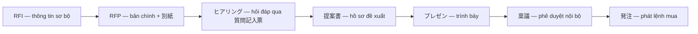

## Tóm tắt điều hành

Báo cáo này tổng hợp nghiên cứu có trích nguồn cho ý tưởng web app hỗ trợ presales làm hồ sơ dự thầu (docs/01_idea.md), theo ba trục: (1) quy trình presales/đấu thầu phần mềm thực tế, đặc biệt với khách Nhật; (2) phương pháp ước lượng effort và WBS cho dự án phần mềm/AI offshore; (3) các công cụ AI viết proposal hiện có và điểm yếu của chúng.

Phát hiện quan trọng nhất: **thị trường công cụ trả lời RFP hiện nay gần như hoàn toàn xoay quanh "sinh văn bản"** — thư viện nội dung, bản nháp có trích nguồn, workflow phê duyệt văn bản — và **không công cụ nào nối yêu cầu của khách với ước lượng nỗ lực và giá chào**. Compliance matrix trong các công cụ này ánh xạ yêu cầu sang trạng thái tuân thủ, không phải yêu cầu sang chi phí. Đây chính là khoảng trống mà sản phẩm của chúng ta — lấy "code tính số, AI soạn thảo, con người duyệt" làm nguyên tắc — có thể chiếm.

Về phía khách Nhật, nghiên cứu xác nhận ba quy ước mà sản phẩm phải tôn trọng tuyệt đối: RFP là "luật chơi" bắt buộc (phải điền đúng biểu mẫu khách phát hành, không đổi format); bảng đáp ứng yêu cầu dùng thang **◎/○/△/×** (đã xác minh bằng file thật của chính quyền địa phương); và văn hóa **質問記入票** — khách Nhật kỳ vọng vendor hỏi nhiều câu hỏi rõ ràng dạng YES/NO, câu trả lời được chia sẻ cho mọi nhà thầu để tránh chênh lệch thông tin. Văn hóa này ăn khớp hoàn toàn với tính năng "hỏi lại tối đa 7 câu" của sản phẩm.

Về ước lượng, dữ liệu đã xác minh: bảng giá offshore Nhật–Việt theo オフショア開発白書 2025 (PG 40,1 vạn yên, senior 50,0, BrSE 59,0, PM 71,4 vạn yên/người-tháng); chi phí VN thấp hơn nội địa Nhật khoảng 31–69%; dự án phần mềm trung bình vượt ngân sách 27–45%; và dự án AI có cấu trúc bất định riêng (ước lượng theo hiệu năng model, dữ liệu chiếm 60–80% nỗ lực). Một số con số phổ biến trên mạng đã bị bác bỏ trong quá trình phản biện chéo (quy tắc "8–80 giờ" không có trong PMBOK; con số "30–50% hồ sơ Mỹ bị loại" không truy được nguồn gốc) — báo cáo chỉ giữ lại những claim đã qua xác minh.

Phần cuối đề xuất **5 điều sản phẩm nên làm khác** so với công cụ hiện có, được dẫn trực tiếp từ khoảng trống thị trường và quy ước khách Nhật.

## 1. Quy trình presales/đấu thầu phần mềm thực tế — trọng tâm khách Nhật

### 1.1 Vòng đời một thương vụ: RFI → RFP → ヒアリング → 提案 → プレゼン → 稟議 → 発注

Vòng đời mua phần mềm của doanh nghiệp Nhật chạy theo chuỗi gần như cố định: RFI (情報提供依頼書 — yêu cầu cung cấp thông tin) → RFP (提案依頼書 — đề nghị đề xuất/báo giá) → ヒアリング (buổi nghe yêu cầu, hỏi đáp) → 提案書 (hồ sơ đề xuất) → プレゼン (trình bày) → 稟議 (phê duyệt nội bộ) → 発注 (phát lệnh mua). Chuyên gia tư vấn chọn vendor người Nhật mô tả RFP chuẩn gồm sáu phần: tổng quan dự án, nội dung yêu cầu đề xuất, yêu cầu về tổ chức dự án và đảm bảo chất lượng, yêu cầu báo giá chi tiết theo hạng mục (内訳) và lịch trình, điều khoản hợp đồng và nghiệm thu, và thể lệ (cách hỏi đáp, hạn nộp, hình thức, lịch chọn vendor) ([atom_bit, 2026](https://note.com/atom_bit/n/n5de0af12f3df)). Một điểm quan trọng về nhịp mua sắm: năm tài chính Nhật chạy từ tháng 4 đến tháng 3 năm sau, và mua sắm đạt đỉnh trước cuối năm tài chính khi các phòng mua sắm chạy đua chốt deal trước khi ngân sách reset ([Nihonium, 2025](https://nihonium.io/stakeholder-management-japan-saas/)).

Hai đặc điểm định hình toàn bộ quy trình. Thứ nhất, RFP của khách Nhật là "luật chơi" bắt buộc: công ty đào tạo bán hàng IT Rashic nhấn mạnh vendor phải điền đúng các biểu mẫu khách phát hành (機能要件一覧, 質問記入票...) đúng format, không được tự ý đổi — *"顧客の提案ルールである以上、従わなければならない"* ([Rashic, 2020/2024](https://rashic.co.jp/2020/11/23/question-entry-form/)). Thứ hai, giai đoạn hỏi đáp có quy ước chống bất công: người mua thường không nhận câu hỏi bằng miệng và không trả lời riêng từng vendor — mọi câu hỏi phải ghi vào bảng QA (質問記入票 / QA表), và câu trả lời được công bố giống hệt cho tất cả nhà thầu để tránh 情報格差 (chênh lệch thông tin) ([Josys CS, 2023](https://www.josys-cs.co.jp/3232/)). Cơ chế này đã được xác minh bằng nguồn sơ cấp: các chính quyền địa phương như TP Sendai, TP Sano, TP Anjo công bố công khai 質疑応答書 cho mọi nhà thầu, và mẫu hợp đồng của hãng luật Legalist còn đưa điều khoản "công bố cùng nội dung cho mọi nhà thầu" vào văn bản (memo phản biện verify-japan-mechanics; lưu ý định dạng phổ biến là PDF/Word/hệ thống đấu thầu điện tử, không chỉ riêng Excel).

Từ phía người bán, Rashic khuyên vendor tận dụng triệt để giai đoạn 質問記入票 — "cuộc gặp duy nhất" trước vòng trình bày: hỏi thật nhiều (tác giả khuyên tối thiểu 100 câu), hỏi dạng YES/NO để khách đỡ vất vả, và dùng câu hỏi để chứng minh am hiểu nghiệp vụ — thậm chí hỏi hay đến mức khách chủ động mời gặp riêng ([Rashic, 2020/2024](https://rashic.co.jp/2020/11/23/question-entry-form/)). Điều này trái ngược hoàn toàn với tư duy "chat AI trả lời ngay" — ở Nhật, biết đặt câu hỏi đúng còn quan trọng hơn có câu trả lời đúng.

### 1.2 Cấu trúc RFP hai lớp: 本編 + 別紙

RFP Nhật được chia làm hai lớp: **RFP本編** (bản chính, dạng văn bản, dùng lại được cho nhiều dự án) và **RFP別紙** (phụ lục chứa thông tin riêng của từng hệ thống, làm bằng Excel/PowerPoint). Các 別紙 điển hình gồm 業務要求一覧 (danh sách yêu cầu nghiệp vụ), 帳票一覧 (biểu mẫu/báo cáo), 外部インタフェース一覧 (giao diện kết nối), 非機能要求一覧 (yêu cầu phi chức năng) và QA表. Mấu chốt vận hành: *"file nào cần vendor điền thì gửi nguyên dạng Excel và bắt vendor điền câu trả lời ngay trong file đó"* — không được đổi format, không được nộp bản PDF hóa ([Josys CS, 2023](https://www.josys-cs.co.jp/3232/)).

Lý do của cấu trúc hai lớp được atom_bit giải thích: bản chính dành cho sales/consultant đọc để định hướng đề xuất, còn 別紙 dành cho kỹ sư đọc để dựng công (工数). Nguyên tắc *"本文は薄く、別紙を厚く"* (bản chính mỏng, phụ lục dày): nếu phụ lục sơ sài, vendor sẽ coi mọi điểm chưa rõ là rủi ro và cộng thẳng vào giá — phụ lục mỏng đồng nghĩa giá bị đội "safe margin" ([atom_bit, 2026](https://note.com/atom_bit/n/n5de0af12f3df)).

Về cấu trúc file Excel requirement của khách, phân tích trực tiếp hai file thật của chính quyền địa phương (TP Ureshino, làng Nakagawa) cho thấy cấu trúc chuẩn của 機能要件一覧 gồm các cột: 番号/項番, 大分類, 中分類, 機能要件, 区分 (必須/任意), 回答, 備考 — theo hướng dẫn của digital-supporter.net và xác nhận bằng file thực tế (memo japan-requirement-excel-format). Làng Nakagawa còn kèm sheet 記入要領 giải thích đầy đủ thang đánh dấu ◎/○/△/× gắn với chi phí hợp đồng. Điều đáng chú ý cho kỹ thuật: các file này chứa đầy quirk phá vỡ parser thông thường — ô merge, số thứ tự là công thức `=ROW()-1`, tên sheet viết katakana nửa độ rộng, bảng Excel/defined names, các sheet lệch số cột, và **không có chuẩn tên cột thống nhất giữa các địa phương** (memo japan-requirement-excel-format). Đây là bằng chứng trực tiếp ủng hộ quyết định "code đọc file, không để AI trích xuất" trong docs/01_idea.md — nhưng cũng cảnh báo rằng việc tự nhận diện cột cần thiết kế khoan dung với lỗi và cho phép người dùng sửa mapping.

### 1.3 Bảng đáp ứng yêu cầu: thang ◎/○/△/×

Quy ước đánh dấu mức đáp ứng yêu cầu là một phần không thể thiếu khi trả lời RFP Nhật. Rashic mô tả vendor phải lập bảng "◎〇△×表" cho 機能要件一覧: ◎/○ = đáp ứng bằng tính năng chuẩn, △ = đáp ứng một phần/có điều kiện, × = không đáp ứng; mỗi câu trả lời phải kết thúc bằng câu khẳng định (肯定文) và mục tiêu là tối đa hóa số ô "○以上" ([Rashic, 2020/2024](https://rashic.co.jp/2020/11/23/question-entry-form/)).

Bước phản biện chéo đã xác minh quy ước này bằng **file thật của chính quyền**: TP Hofu (防府市) phát hành 機能要件確認書 dạng xlsx với chú giải gốc *"○：標準仕様で対応可能 / △：代替案またはカスタマイズにより対応可能 / ×：対応不可能"* (235 dòng yêu cầu, cột 対応 để trống cho vendor điền); TP Choshi (銚子市) dùng 機能評価表 với thang **4 ký hiệu ◎/○/△/×** (△ = tùy biến) (memo verify-japan-marking). Kết luận: thang thực tế là **◎/○/△/×**, không chỉ ○/△/× — sản phẩm nên hỗ trợ đủ bốn mức, và mức "cần làm rõ" trong ý tưởng (docs/01_idea.md) nên được trình bày như nhãn phụ (ví dụ 要確認) chứ không thay thế thang chính. Cũng cần nói thẳng: việc dùng nhãn 要確認 trong các bảng này chưa tìm được nguồn tài liệu trực tiếp trong đợt nghiên cứu này — đây là tri thức ngành cần xác nhận thêm từ người làm nghề (memo japan-rfp-process, mục "not found").

Về phía vendor offshore Việt Nam, blog của một kỹ sư VN 11 năm tại Nhật mô tả cơ chế **FIT/GAP** khi trả lời 業務/システム要求要件一覧: yêu cầu đáp ứng được bằng chức năng chuẩn là FIT, cần customize là GAP kèm lý do, và GAP nhiều sẽ đội chi phí (memo vn-offshore-bid-practice). Quy ước ◎/○/△/× cụ thể khi trả lời RFP hiện chỉ có nguồn phía Nhật — chưa tìm được nguồn VN trực tiếp mô tả quy trình này, một khoảng trống cần lưu ý.

### 1.4 見積書 — văn hóa báo giá Nhật

Báo giá Nhật có những quy ước nghiêm ngặt mà một công cụ tạo hồ sơ dự thầu phải tôn trọng. Một PM đang hành nghề tóm tắt các quyết định cốt lõi khi lập báo giá 受託開発: (1) xác định loại hợp đồng trước — 請負 (trọn gói theo kết quả, vendor chịu trách nhiệm bàn giao) hay 準委任 (trả theo công lao động, phù hợp khi yêu cầu chưa rõ); (2) ở vòng 要件ヒアリング phải nắm "vì sao" và "đến đâu" chứ không chỉ "làm gì"; (3) tách hạng mục báo giá — bên trong phân rã chi tiết, bên ngoài gom thành nhóm dễ đọc (ví dụ "認証機能：5人日" thay vì liệt kê từng màn hình 0,5 ngày-công); (4) luôn cộng buffer rủi ro khoảng **15–30%** tổng công; và (5) ghi rõ phạm vi KHÔNG bao gồm (スコープ外) — *"ghi rõ cái không có sẽ đỡ tranh cãi về sau"* ([PMのメモ帳, 2026](https://note.com/pm_diary/n/nb33e0f6b3933)).

Về hình thức, các mẫu 見積書 của chính quyền xác nhận chuẩn mực: có trường **見積有効期限** (thời hạn hiệu lực) — mẫu của Bộ Quốc phòng ghi rõ bắt buộc điền ([MOD](https://www.mod.go.jp/asdf/4dep/open.deta/open.files/mitumori.xls)); mẫu tỉnh Shizuoka có dòng tổng "消費税込み" (đã gồm thuế) kèm yêu cầu 積算内訳 (bảng phân rã chi phí) ([Shizuoka](https://www.pref.shizuoka.jp/_res/projects/default_project/_page_/001/053/436/sanko_mitsumori.xls)); mẫu TP Tonami có ô 見積有効期限 ([Tonami](https://www.city.tonami.lg.jp/wp-content/uploads/関連05　見積書参考様式及び記入例-.pdf)). Tuy nhiên, phản biện chéo làm rõ sắc thái: 見積有効期限 là **tập quán gần như phổ biến chứ không bắt buộc về pháp lý** (luật sư xác nhận một số nhà cung cấp cố tình bỏ qua), còn 内訳 thì bắt buộc trong mẫu đấu thầu công (memo verify-japan-mechanics).

Về thuế và đồng tiền: thuế tiêu dùng Nhật hiện là 10%; với B2B, quy ước đáng tin cậy là ghi giá chưa thuế (税抜) làm giá chính kèm nhãn rõ 税抜/税込, vì doanh nghiệp khấu trừ thuế đầu vào. Giá phải là **số yen tròn sạch** (5.000円, 30.000円...) kèm dấu phân tách hàng nghìn, không phải quy đổi từ USD theo tỷ giá ngày. Hai "cổng chặn âm thầm" về thanh toán: nhiều doanh nghiệp Nhật chỉ trả bằng 請求書払い (hóa đơn + chuyển khoản), và từ hệ thống hóa đơn 2023 (インボイス制度) người mua cần mã 適格請求書発行事業者 của nhà cung cấp để khấu trừ thuế — thiếu hai thứ này, vendor bị loại âm thầm khỏi deal ([Hiraki Localization, 2026](https://hirakilocalization.com/insight-japanese-pricing-psychology-localization)).

### 1.5 Người ra quyết định, 稟議 và tiêu chí đánh giá

Quyết định mua ở doanh nghiệp Nhật mang tính tập thể: lãnh đạo bộ phận kinh doanh, kiến trúc sư IT/quản lý an ninh, tài chính đều góp ý, quyền quyết cuối thuộc cấp board hoặc hội đồng, và quyết định thường được chuẩn bị qua **nemawashi** (根回し — vun đắp ngầm: họp 1-1 và nhóm nhỏ trước các cuộc họp chính thức để gỡ lo ngại từng người) ([Nihonium, 2025](https://nihonium.io/stakeholder-management-japan-saas/)). Sau khi chọn xong còn ba quy trình nối tiếp: 選定 (chọn, diễn ra ở phòng chủ quản), 承認 (phê duyệt chính thức qua 役員会/稟議), và 発注 (phát lệnh mua: mở tài khoản, thẩm định tín dụng, kiểm tra an ninh, soát hợp đồng) — riêng khâu phát lệnh có thể mất vài tháng nếu không chạy song song từ sớm ([DJ141, 2019](https://note.com/dj141/n/na3b3a83a7729)).

Một hiệu chỉnh quan trọng từ phản biện chéo: **稟議 thường chỉ mất 2–3 ngày**, không phải nhiều tuần. Khảo sát 2024 (n=312) của 弁護士ドットコム cho thấy 52,5% doanh nghiệp duyệt 稟議 trong 2–3 ngày và 26,5% trong 1 ngày; khảo sát 2022 của エイトレッド cho kết quả tương tự; 稟議 còn có thể bỏ qua cho vụ nhỏ/khẩn cấp (memo verify-japan-mechanics). "Nhiều tuần–nhiều tháng" chỉ đúng cho các ca đầu tư vốn lớn trình hội đồng. Hệ quả cho sản phẩm: thời gian ép của một vòng bid phần lớn nằm ở khâu soạn hồ sơ và phát lệnh, không phải ở khâu phê duyệt — càng củng cố luận điểm "bản nháp trong vài phút".

Về tiêu chí đánh giá, Josys CS nêu 5 trục cố định theo kiểu so sánh tương đối giữa các vendor: ① chức năng, ② chi phí, ③ track record, ④ kế hoạch dự án, ⑤ khác — trọng số đổi theo dự án nhưng khung thì cố định ([Josys CS, 2022](https://www.josys-cs.co.jp/1847/)). Ba "knockout factor" loại vendor ngay vòng RFI: thiếu tính năng chuẩn ngành (custom đụng lõi = rủi ro chất lượng), thiếu track record có tên công ty cụ thể (社名 — không chấp nhận "hơn 100 công ty" vô danh vì dễ bịa), và quy mô yếu (doanh thu tra được qua Teikoku Databank; vendor dưới ~10 người bị loại khỏi dự án lớn) ([Josys CS, 2022](https://www.josys-cs.co.jp/1778/)). Bộ tiêu chí chấm điểm thật của TP Nagaoka cho thấy cấu trúc tương tự: 60% điểm cho phương châm/phương pháp thực hiện và đề xuất theo chủ đề, 40% cho chứng chỉ và thành tích dự án tương tự — kèm quy định hình thức nghiêm ngặt (≤20 trang, cỡ chữ ≥11pt, sai mẫu bị vô hiệu) (memo proposal-content-structure).

### 1.6 Cấu trúc 提案書 và nguyên tắc "ringi-ready"

Cấu trúc 提案書 kiểu Nhật được các chuyên gia bán hàng doanh nghiệp mô tả khá thống nhất: 表紙 → 目次 → 現状認識 (chỉ ghi FACT) → 課題認識 → 解決策 (As-Is/To-Be) → 期待される効果 (quy đổi ra tiền) → 費用 → スケジュール → 体制図; và quan trọng nhất, đề xuất là "kho nguyên liệu" cho tờ trình 稟議書 của chính khách hàng (memo proposal-content-structure, từ DJ141/BIG COMPASS/Baigie). Chuẩn Shipley/APMP bổ sung bảy trụ cột (compliance, responsiveness, strategy, competitive focus, writing quality, visualization, document design) và nhấn mạnh executive summary là phần quan trọng nhất, win themes phải được đỡ bằng discriminators có bằng chứng (memo proposal-content-structure).

Khái niệm **"ringi-ready"** gói gọn điều khách Nhật cần ở một đề xuất: đề xuất hiếm khi chỉ một người đọc — nó bị chuyển tiếp, soi xét nội bộ, rồi dùng làm tài liệu phê duyệt. Ba lý do đề xuất bị kẹt: tầm nhìn mạnh nhưng logic phê duyệt yếu, thiếu phương án giảm rủi ro, và bước tiếp theo không rõ ràng. Đề xuất nên có: yêu cầu quyết định rõ ở đầu trang, luồng đơn giản vấn đề → đề xuất → bằng chứng → chi phí → bước tiếp theo, bản tóm tắt 1 trang dễ chuyển tiếp nội bộ, kiểm soát rủi ro nhìn thấy được ([Kamata/Shimoda, LinkedIn 2026](https://www.linkedin.com/posts/susumu-shimoda-31964722a_japan-b2b-businessdevelopment-activity-7437059758995521537-rneY)). Một lỗi định vị phổ biến khác: demo quá sớm — khách Nhật mua theo đồng thuận nội bộ và lập bản đồ rủi ro trước; demo sớm kích hoạt phòng mua sắm và thu hẹp cuộc chơi thành so sánh spec ([Lim, LinkedIn 2026](https://www.linkedin.com/posts/howardichirolim_enterprisesales-japanmarket-b2bsoftware-activity-7429269363741888512-UBlw)).

### 1.7 Thực hành của vendor offshore Việt Nam

Khảo sát nguồn công khai cho thấy các công ty offshore VN không có "presales team" riêng được công khai — chính **BrSE** (bridge system engineer) kiêm phần việc chào thầu: giải pháp, estimate, lập kế hoạch (mô tả công việc của CMC Global; phỏng vấn BrSE FPT Japan trên ITNavi 2022 — memo vn-offshore-bid-practice). Mô hình tổ chức chuẩn là trung tâm sản xuất ở VN + văn phòng Nhật làm đầu mối khách (Luvina có chi nhánh Kawasaki do người Nhật phụ trách; FPT lập pháp nhân Nhật từ 2005). Ước lượng một chức năng mới thủ công mất **1–2 tuần đến 1 tháng** (gồm dịch tiếng Việt, Q&A qua lại); với hỗ trợ AI rút còn 3–4 ngày (blog LocDV 2026 — memo vn-offshore-bid-practice). Các pain point lặp lại: ngôn ngữ, khoảng cách, múi giờ, văn hóa 報連相 (báo cáo–liên lạc–bàn bạc), yêu cầu thiếu/rõ ràng kém, estimate sai từ đầu, thay đổi liên tục (memo vn-offshore-bid-practice). Đáng chú ý: không tìm thấy nguồn công khai của KMS/NashTech/TMA/Rikkeisoft/Bravestars mô tả quy trình presales của họ — một khoảng trống dữ liệu cần ghi nhận.

## 2. Ước lượng effort và WBS cho dự án phần mềm và AI offshore

### 2.1 Các phương pháp ước lượng phổ biến

Tài liệu và thực hành ngành ghi nhận sáu phương pháp chính: expert judgment (chuyên gia), analogous (so sánh với dự án tương tự), parametric (COCOMO, function points, story points), 3-point/PERT (lạc quan–kỳ vọng–bi quan), T-shirt sizing (S/M/L) và planning poker. Điểm đáng chú ý từ tổng hợp nghiên cứu: **không phương pháp nào vượt trội tuyệt đối** — expert judgment cho độ chính xác tương đương mô hình tham số; planning poker tương đương chuyên gia cá nhân; bucket system (gom thẻ vào nhóm) nhanh gấp đôi planning poker với độ chính xác không khác biệt (memo effort-estimation-methods). Thực hành Nhật thường phối hợp theo pha: analogous ở giai đoạn sớm → parametric → bottom-up → function points → story points khi yêu cầu rõ dần (memo effort-estimation-methods).

Hệ quả thiết kế cho sản phẩm: một "bảng chuẩn min–max theo hướng giải pháp × giai đoạn" (như docs/01_idea.md đề xuất) thực chất là mô hình parametric kiểu T-shirt sizing — hoàn toàn hợp lệ và phù hợp giai đoạn RFP, miễn là được trình bày như dải ước lượng (range) chứ không phải điểm số giả chính xác. Dải min–max cũng khớp với khuyến nghị của ICEAA về ước lượng AI: không đưa point estimate mà đưa khoảng (memo ai-project-estimation).

### 2.2 Cone of uncertainty và dữ liệu vượt ngân sách

Khái niệm "cone of uncertainty" bắt nguồn từ Boehm 1981 (*Software Engineering Economics*): ở giai đoạn concept, ước lượng có thể lệch **0,25x–4,0x** so với thực tế, thu hẹp dần về 0,9x–1,1x ở thiết kế chi tiết (Boehm gọi là "Funnel Curve"; tên "cone of uncertainty" do McConnell đặt năm 1997 — memo verify-estimation). Phản biện chéo lưu ý các con số này của Boehm là chủ quan, không từ tập dữ liệu lớn — nhưng ý nghĩa định tính (ước lượng sớm rất bất định, thu hẹp khi giảm rủi ro chủ động) là vững.

Về thống kê vượt ngân sách, hai nguồn được xác minh: nghiên cứu McKinsey/Oxford 2012 trên hơn 5.400 dự án IT cho thấy trung bình vượt ngân sách **45%** ([Bloch, Blumberg & Laartz, 2012](https://www.mckinsey.com/capabilities/mckinsey-digital/our-insights/delivering-large-scale-it-projects-on-time-on-budget-and-on-value)); nghiên cứu Flyvbjerg & Budzier trên HBR 2011 cho trung bình **27%** và cảnh báo "black swan" — 1/6 dự án vượt trên 200% (memo verify-estimation). Con số 45% và 27% khác nhau vì mẫu và phương pháp khác nhau; điểm chung là cả hai đều xác nhận vượt ngân sách là chuẩn mực chứ không phải ngoại lệ. Điều này biện minh cho việc sản phẩm cộng buffer rủi ro (15–30% theo tập quán Nhật, mục 1.4) và cho phép người duyệt điều chỉnh dự phòng.

### 2.3 WBS theo PMBOK — và một huyền thoại bị bác bỏ

Về WBS, quy tắc **100%** (tổng các work package bằng đúng toàn bộ phạm vi dự án, không thừa không thiếu) được xác nhận có trong PMBOK và PMI Practice Standard for WBS (§2.4) (memo verify-estimation). Quy tắc phân rã phổ biến: Analysis → Design → Build → Test → Deploy + PM, và phải bao gồm cả công PM/QA/overhead — khớp với yêu cầu "WBS phải đủ PM/QA mỗi giai đoạn" trong docs/01_idea.md.

Một hiệu chỉnh quan trọng từ phản biện chéo: quy tắc **"8–80 giờ"** (work package nên 8–80 giờ) — vốn được nhắc rộng rãi — **không hề tồn tại trong PMBOK**; đây là heuristic truyền miệng từ sách ôn thi PMP, và chính bài báo PMI 2007 còn khuyến nghị 20–80 giờ thay thế (memo verify-estimation). Sản phẩm không nên cứng nhắc áp đặt quy tắc 8–80 giờ làm ràng buộc kiểm tra.

### 2.4 Ước lượng dự án AI — cấu trúc bất định riêng

Dự án AI khác phần mềm truyền thống ở điểm cốt lõi: phần mềm ước lượng theo chức năng (yêu cầu "engineer" được), còn AI ước lượng theo **hiệu năng model** (accuracy/F1) — thứ phải khám phá bằng thực nghiệm, không hứa trước được. ICEAA (International Cost Estimating and Analysis Association) liệt kê 9 lý do khiến cả 4 phương pháp truyền thống suy yếu với dự án AI (memo ai-project-estimation). Hệ quả: ước lượng AI nên theo vòng lặp CRISP-DM (khám phá dữ liệu → prototype → đánh giá) thay vì waterfall, và nên có ngưỡng quyết định rõ ràng (ví dụ ≥80% accuracy trước khi chuyển PoC → production — memo ai-project-estimation).

Về phân bổ nỗ lực, các nguồn nhất quán: chuẩn bị dữ liệu chiếm phần lớn thời gian — khảo sát CrowdFlower 2016 cho thấy 60% người làm data science coi "làm sạch dữ liệu" là việc tốn thời gian nhất (con số 80% thường được trích dẫn là gộp sai từ NYT 2014; Kaggle 2018 chỉ ghi ~15% — memo verify-ai-stats). Modeling chỉ chiếm khoảng 30–40% tổng nỗ lực (memo ai-project-estimation). Dữ liệu kém chất lượng làm tăng chi phí 50–100% (memo ai-project-estimation).

Về tỷ lệ thất bại, các con số phổ biến cần đọc kỹ: dự báo Gartner tháng 2/2018 đúng nguyên văn là "đến 2022, 85% dự án AI sẽ cho kết quả sai lệch (erroneous outcomes) do bias trong dữ liệu, thuật toán hoặc đội ngũ" — là **dự báo về kết quả sai lệch, không phải tỷ lệ thất bại kinh doanh đo được** (memo verify-ai-stats); Heudecker (Gartner) nói 85% dự án big data thất bại vào **tháng 11/2017**, không phải 2016. Các bằng chứng mới hơn: MIT SMR/BCG 2019 cho thấy 70% công ty không thu được tác động đáng kể từ AI; MIT NANDA 2025 cho thấy 95% pilot GenAI không có P&L; nhưng Gartner 2024 tự dự báo chỉ **30%** dự án GenAI bị bỏ sau PoC — con số 85% đã lỗi thời (memo verify-ai-stats). Ý nghĩa cho sản phẩm: không nên dùng "85% thất bại" làm lời quảng cáo; nên dùng cấu trúc PoC/MVP/Production với dải min–max riêng từng giai đoạn, đúng như bảng effort chuẩn trong docs/01_idea.md.

Về chi phí tương đối giữa các archetype giải pháp, các nguồn tư vấn (mang tính heuristic ngành, cần ghi rõ tính tham khảo) cho thấy: RAG trả phí vận hành định kỳ (khoảng 350–2.850 USD/tháng), fine-tuning trả phí trước (khoảng 2.400–18.000 USD); PoC rẻ hơn production 5–7 lần tiền và 4 lần thời gian — con số này chỉ là số học suy ra từ dải giá của một vendor, chưa có nghiên cứu độc lập xác nhận (memo verify-ai-stats). Google có "Rule #1" đáng tham khảo: đừng ngại ra mắt sản phẩm không có ML — tức là phương án "không cần AI" phải luôn nằm trong bảng lựa chọn hướng giải pháp (memo ai-project-estimation).

### 2.5 Man-day, rate card và chi phí offshore VN–Nhật

Văn hóa ước lượng offshore Nhật–Việt xoay quanh đơn vị **man-day/man-month**: mặc định 1 tháng = 20 ngày làm việc (cho hợp đồng lab-type/準委任) và man-day = 8 giờ (cho hợp đồng fixed-price, thường cao hơn man-month ÷ 20 vì gánh trách nhiệm hoàn thành) (memo effort-estimation-methods). Trong fixed-price, 工数 đã bao gồm buffer rủi ro vì nhà thầu không được đòi thêm tiền — khớp với mục 1.4.

Bảng giá tham chiếu chuẩn ngành đến từ オフショア開発白書 2025 (do TECHNODIGITAL/オフショア開発.com xuất bản — không phải IPA; khảo sát 8–10/2025, phát hành 1/2026): **PG 40,1 vạn yên, senior 50,0, BrSE 59,0, PM 71,4 vạn yên/người-tháng** — con số đã được phản biện chéo xác nhận khớp từng số qua ba nguồn độc lập (memo verify-ratecard). Lưu ý hầu hết công ty Nhật trích cùng một bảng này nên chỉ là giá tham khảo, và bảng giá chi tiết của Kaopiz cho thấy **tiếng Nhật là biến số đẩy giá mạnh nhất**: BrSE 50–80 vạn, PM 60–100 vạn khi yêu cầu JLPT N2–N1, trong khi junior/test không cần N2 chỉ 20–40 vạn (memo offshore-pricing-ratecard).

Về mức chiết khấu so với nội địa Nhật, các nguồn không hoàn toàn khớp: chính 白書 ghi mức giảm chi phí **31–50%** (tức trả 50–69% giá nội địa); nhà xuất bản nói 1/3–1/2; Luvina nói 60–70%; tự tính theo vai trò so giá nội địa (71–173 vạn) ra ~34–61% — dải thực tế khoảng **33–70%** (memo verify-ratecard). Việt Nam giữ 43% thị phần đơn hàng offshore của Nhật dù không rẻ nhất (memo offshore-pricing-ratecard). BrSE có premium so với developer khoảng 10–50% tùy bảng giá (cao hơn senior ~18% theo 白書) — con số "10–20%" thường được nhắc không có nguồn trực tiếp xác nhận (memo offshore-pricing-ratecard).

Về mô hình hợp đồng: **lab-type/準委任** (trả theo người-tháng, không chịu trách nhiệm hoàn thành, hợp spec còn động) đang là hình thức phổ biến nhất, trong khi **fixed-price/請負** (trọn gói, vendor chịu trách nhiệm) thường cộng **contingency 15–30%**; hybrid "fixed-price discovery + T&M delivery" là xu hướng (memo offshore-pricing-ratecard). Điều này trực tiếp biện minh cho hai bảng cấu hình trong docs/01_idea.md: bảng effort chuẩn (min–max × hệ số) và rate card (đơn giá theo vai trò, tách offshore/onsite, overhead PM/BrSE, tỉ giá, dự phòng, mốc thanh toán). Một khoảng trống dữ liệu cần ghi nhận: utilization/gross margin chuẩn ngành và tỷ lệ % mốc thanh toán offshore không tìm thấy nguồn công bố trực tiếp — các con số trong bảng chuẩn giả lập nên được gắn nhãn "tham khảo ngành" thay vì trình bày như sự thật đã kiểm chứng (memo offshore-pricing-ratecard).

## 3. Công cụ AI viết proposal hiện có và điểm yếu

### 3.1 Bản đồ thị trường

Thị trường phần mềm RFP/proposal được ước tính khoảng 2,3–3,2 tỷ USD, tăng trưởng 12–16%/năm ([Stargazy](https://stargazy.io/resources/the-rfp-is-a-growth-engine-how-to-use-ai-where-it-actually-matters), [PlanMySaaS](https://www.planmysaas.com/ideas/ai-saas-ideas/ai-rfp-response-generator)); RFP ảnh hưởng tới khoảng 39% tổng doanh thu doanh nghiệp theo benchmark ngành (memo ai-proposal-tools). Hai "ông lớn" cũ là Loopio (2014) và Responsive/RFPIO (2015), sinh ra ở kỷ nguyên tiền-generative-AI theo mô hình **thư viện nội dung** (content library) làm trung tâm; các công cụ AI-native như Arphie (2023) xây quanh AI agents có nguồn tham chiếu, kiến thức công ty sống và phê duyệt con người ([Arphie](https://www.arphie.ai/blog/comparing-rfp-proposal-software-loopio-responsive-and-arphie)). Bên cạnh đó là các nền tảng ngang như Microsoft Copilot (có sẵn scenario "Respond to an RFP" trong Word/Teams), Google Gemini, ChatGPT với custom GPTs, và các công cụ tài liệu như PandaDoc.

| Công cụ | Mô hình | Giá tham khảo | Điểm yếu chính |
|---|---|---|---|
| Loopio | Thư viện nội dung + AI bản nháp | Trung vị ~23.915 USD/năm (Vendr) | "Library tax" 30–100% TCO; AI yếu với câu hỏi tinh tế; lỗi import/export định dạng gốc |
| Responsive | Strategic Response Management | 6.500–28.000 USD/năm | Editor không làm nổi bảng; tìm kiếm keyword; SSO sau add-on |
| Qvidian (Upland) | Legacy + AI | Báo giá qua sales | AI "needs heavy editing"; UI cũ |
| Arphie | AI-native, agents + nguồn | Custom quote | Vendor trẻ, lịch sử vận hành ngắn |
| PandaDoc | Tài liệu + e-sign | Từ ~19,49 USD/người/tháng | Không phải công cụ RFP; output "vẫn chỉ là tài liệu" |
| Copilot/Gemini/ChatGPT | LLM đa dụng | Theo gói | Không điền được bảng có cấu trúc; không governance; rủi ro bảo mật |

Table: So sánh tóm tắt các công cụ chính (chi tiết và nguồn trong memo ai-proposal-tools).

### 3.2 Điểm yếu đã được ghi nhận (có nguồn)

**Hallucination là điểm yếu được ghi nhận rộng rãi nhất.** ChatGPT "trả lời mọi câu hỏi với giọng tự tin như nhau, dù có biết hay không... khi không biết, nó bịa ra thứ đọc rất trôi chảy" — có thể chèn chi tiết SOC 2 cũ hai năm hoặc một tích hợp bạn không có ([1up](https://1up.ai/blog/chatgpt-rfp-limitations)); AutogenAI bị chấm "more prone to hallucination" so với cách tiếp cận có trích nguồn (memo ai-proposal-tools). RAG có grounding giảm hallucination hơn 40% so với LLM đa dụng ([Glean](https://www.glean.com/perspectives/top-7-ai-tools-for-streamlining-rfp-responses-in-2026)), và chi phí hallucination AI ước tính 67,4 tỷ USD/năm (memo ai-proposal-tools). Hệ quả thực tế: "mọi câu trả lời đều phải sửa tay vì hallucination" ([1up](https://1up.ai/blog/chatgpt-rfp-limitations)).

**Không công cụ nào grounding vào dữ liệu định giá/chi phí chuẩn của công ty.** Toàn bộ thị trường khảo sát tập trung vào văn bản: compliance matrix ánh xạ yêu cầu sang trạng thái tuân thủ, không phải yêu cầu sang chi phí ([AutoRFP](https://autorfp.ai/blog/compliance-matrix)); go/no-go dùng win-rate lịch sử chứ không phải mô hình giá ([Glean](https://www.glean.com/perspectives/top-7-ai-tools-for-streamlining-rfp-responses-in-2026)). Định giá bị bỏ lại cho con người và hệ thống khác (ERP/estimating). Phản biện chéo đã làm rõ sắc thái: các công cụ CPQ (Conga CPQ + Composer, Salesforce CPQ, Tribble, STACK) **có** tích hợp giá sống từ price book — nhưng đây là lớp công cụ tạo tài liệu thương mại (quote/contract), không phải công cụ trả lời RFP, và không nối yêu cầu kỹ thuật với ước lượng nỗ lực (memo verify-tool-gap).

**Template rigidity — không tôn trọng định dạng khách hàng.** Người dùng Loopio gặp khó import RFP phức tạp và "often cannot export back in the original buyer format" (memo ai-proposal-tools); AutogenAI gặp khó import Excel/Word/PDF buộc copy-paste thủ công; Copilot "không được xây để đọc layout đó, đặt câu trả lời đúng vào đúng ô, tick đúng ô checkbox" — người dùng phải rà từng ô ([1up](https://1up.ai/blog/microsoft-copilot-rfp-limitations)); editor của Responsive không làm nổi bảng (memo ai-proposal-tools). Đây chính là lý do các công cụ Âu-Mỹ không chiếm ưu thế ở thị trường Nhật — nơi có hệ sinh thái công cụ nội địa riêng (Mazrica Target, Gamma...) (memo ai-proposal-tools).

**Bảo mật là rào cản pháp lý thực sự.** Đưa dữ liệu đề xuất chính phủ (CUI, giá chi tiết, thỏa thuận teaming) vào model công khai như ChatGPT "may be unlawful": vi phạm NIST SP 800-171 và DFARS 252.204-7012, có thể cấu thành cơ sở cho kiện False Claims Act ([Turingon/GovSignals](https://www.linkedin.com/pulse/youre-uploading-proposal-data-chatgpt-you-may-breaking-law-mibef)); Gemini Apps bản tiêu dùng lưu hoạt động tới 18 tháng mặc định ([Google](https://support.google.com/gemini/answer/13594961?hl=en)). Đây là lý do các vendor RFP bán "zero-data-retention agreements with model providers" như điểm bán hàng ([Arphie](https://www.arphie.ai/blog/comparing-rfp-proposal-software-loopio-responsive-and-arphie)).

**Chất lượng đa ngôn ngữ kém, đặc biệt tiếng Nhật.** LLM thiên vị dữ liệu tiếng Anh; script logographic (Nhật/Trung) bị token hóa kém hiệu quả, độ chính xác và trôi chảy giảm rõ, tỷ lệ bịa đặt cao hơn khi ra khỏi tiếng Anh ([Black Seed USA](https://blackseedusa.com/multilingual-prompting-how-to-fix-non-english-llm-outputs)). Ở cấp sản phẩm, đa ngôn ngữ của Loopio chỉ nằm ở nấc Enhanced (không phải Foundations) ([Arphie](https://www.arphie.ai/blog/comparing-rfp-proposal-software-loopio-responsive-and-arphie)); AutoRFP quảng cáo "auto-translates output across more than 30 languages" như điểm khác biệt — ngụ ý các đối thủ không làm tốt (memo ai-proposal-tools).

**Không đảm bảo truy vết yêu cầu 100%.** Việc "shredding" RFP 200 trang thành yêu cầu rời rạc là nơi AI hay bỏ sót; cả một lớp công cụ QA/compliance mọc lên để vá lỗ hổng này — RFPCheck quảng cáo "detect pricing inconsistencies, missing mandatory requirements, formatting problems" ([RFPCheck](https://www.rfpai.io/?lang=en)), RFP360 "detect compliance gaps... missing requirements" ([RFP360](https://www.rfp360.ai/response-evaluation/)). Sự tồn tại của lớp công cụ QA riêng cho thấy các công cụ soạn thảo không tự đảm bảo bao phủ 100% yêu cầu. Phản biện chéo bổ sung một ngoại lệ: Sweetspot (AI proposal cho nhà thầu chính phủ) công khai marketing "100% requirement traceability" và "100% Compliance coverage" — nhưng đây là công cụ thị trường chính phủ Mỹ, không liên quan ước lượng chi phí hay thị trường Nhật (memo verify-tool-gap).

**Không có governance phê duyệt con người sẵn có.** Tool RFP tự xây bằng ChatGPT không có "version control, no audit trail, and no governance over what was going in or coming out" ([Morari, LinkedIn](https://www.linkedin.com/pulse/i-built-in-house-rfp-tool-chatgpt-heres-what-learned-andrew-morari-qqbzc)); Arphie bán "human approval from day one" như điểm khác biệt — ngụ ý các đối thủ không có sẵn ([Arphie](https://www.arphie.ai/blog/comparing-rfp-proposal-software-loopio-responsive-and-arphie)); Glean khuyên doanh nghiệp thiết lập "Governance guardrails... before you extend AI drafting" — tức là công cụ không tự áp đặt (memo ai-proposal-tools).

**Chi phí ẩn "library tax".** Với nhóm công cụ thư viện nội dung, lao động duy trì thư viện câu trả lời bằng tay có thể cộng thêm 30–100% vào tổng chi phí sở hữu ([Inventive](https://www.inventive.ai/blog-posts/loopio-pricing)); thư viện cũ làm AI trả lời sai nhanh hơn (memo ai-proposal-tools). Đây là bài học cho sản phẩm: tránh thiết kế "answer bank" cần bảo trì tay — thay vào đó tái sử dụng hồ sơ đã duyệt làm nguồn tham chiếu (đúng hướng "nhân bản hồ sơ cũ" trong docs/01_idea.md).

## 4. Khoảng trống thị trường (gap analysis)

Tổng hợp từ mục 3 và phản biện chéo, khoảng trống mà sản phẩm bidding-estimation có thể chiếm nằm ở **giao điểm của năm điều mà không công cụ nào khảo sát làm trọn vẹn**:

1. **Nối yêu cầu RFP với ước lượng nỗ lực/chi phí** — bản đồ yêu cầu → cost driver → person-day → giá chào. Toàn bộ thị trường xoay quanh văn bản trả lời; compliance matrix chỉ ánh xạ yêu cầu → tuân thủ (memo ai-proposal-tools, mục 6.1).
2. **Grounding vào dữ liệu định giá chuẩn nội bộ** — rate card, chi phí nhân công, catalog giá. CPQ có price book nhưng không nối với yêu cầu kỹ thuật (memo verify-tool-gap).
3. **Governance phê duyệt giá có trách nhiệm** — chưa duyệt thì không có số tiền trong proposal; không công cụ nào có (memo ai-proposal-tools, mục 6.5).
4. **Tôn trọng định dạng khách hàng và thang ◎/○/△/×** — điểm yếu cấu trúc của công cụ phương Tây, và chính là "luật chơi" của khách Nhật (mục 1.2, 1.3).
5. **Chất lượng tiếng Nhật có kiểm soát** — pipeline glossary/kiểm tra riêng thay vì tin LLM nền (mục 3.2).

## 5. Năm điều sản phẩm của chúng ta nên làm khác

Nghiên cứu cho thấy các công cụ hiện có thắng ở "sinh văn bản nhanh" nhưng thua ở mọi thứ liên quan đến con số, định dạng khách hàng và trách nhiệm. Năm đề xuất dưới đây biến những khoảng trống đó thành nguyên tắc thiết kế, và đều đã có sẵn dạng hạt giống trong docs/01_idea.md — phần này chỉ siết lại thành cam kết khác biệt, có nguồn dẫn.

**1. Làm con số thành "hàng rào", không phải văn bản.** Mọi công cụ khảo sát đều sinh văn bản và không nối yêu cầu với chi phí (mục 3.2, 4). Sản phẩm nên đảo ngược trọng tâm: mỗi requirement được ánh xạ tới cost driver → person-day → giá chào, và **mọi con số do code tính từ bảng chuẩn** (bảng effort min–max × hệ số, rate card) với dấu vết tính toán truy ngược về công thức — đúng như nguyên tắc "code tính số" trong docs/01_idea.md. Đây là thứ duy nhất trong thị trường mà khách hàng (và người duyệt nội bộ) không thể tự làm bằng ChatGPT.

**2. Tôn trọng tuyệt đối định dạng khách hàng — điền thẳng vào file Excel của khách.** Ở Nhật, RFP là luật chơi bắt buộc: file nào cần vendor điền thì điền ngay trong file đó, không đổi format (mục 1.2). Điểm yếu template rigidity của Loopio/AutogenAI/Copilot (mục 3.2) chính là lý do thị trường Nhật có hệ sinh thái riêng. Sản phẩm nên xuất bảng đáp ứng **◎/○/△/× ngay trong đúng file khách gửi** (giữ nguyên sheet, cột, định dạng) — và vì file thật chứa đầy quirk (merge cell, công thức `=ROW()-1`, tên cột không chuẩn — mục 1.2), việc đọc file phải do **code** làm với khả năng sửa mapping, không để AI đoán.

**3. Hỏi lại thay vì đoán bừa — và biến nó thành lợi thế văn hóa.** Hallucination là điểm yếu #1 của công cụ hiện có (mục 3.2). Trong khi đó văn hóa 質問記入票 của Nhật vốn kỳ vọng vendor đặt nhiều câu hỏi rõ ràng dạng YES/NO để chứng minh am hiểu (mục 1.1). Tính năng "dừng lại, hỏi tối đa 7 câu theo ngôn ngữ khách, kèm lý do tiếng Việt" vì thế không chỉ chống hallucination mà còn **khớp đúng kỳ vọng của khách Nhật** — một sự trùng hợp hiếm có giữa nguyên tắc kỹ thuật và quy ước thị trường.

**4. Governance phê duyệt giá có trách nhiệm, kiểu "ringi-ready".** Không công cụ nào có cổng duyệt giá (mục 3.2, 4). Sản phẩm nên làm điều mà docs/01_idea.md đã chốt: chưa duyệt giá thì proposal gửi khách chỉ hiện `"[Presales điền]"`, không có số tiền; hai cấp duyệt (kỹ thuật + giá) với kiểm tra tự động bằng code. Điều này khớp văn hóa 稟議 — đề xuất phải "ringi-ready", người duyệt chịu trách nhiệm con số (mục 1.6) — và khác hẳn "human approval" của Arphie vốn chỉ phê duyệt văn bản, không phê duyệt số.

**5. Kiểm tra tự động bằng code, không tin AI — kể cả tiếng Nhật.** Các công cụ hiện có không đảm bảo truy vết 100% đến mức phải có hẳn lớp công cụ QA riêng (RFPCheck, RFP360 — mục 3.2). Sản phẩm nên đưa kiểm tra vào lõi: mỗi mã requirement xuất hiện đúng một lần (không sót, không thừa), tổng effort khớp bảng chuẩn ±20%, output đúng schema, WBS đủ PM/QA mỗi giai đoạn — phát hiện sai thì AI làm lại có giới hạn, rồi cảnh báo cho người duyệt. Riêng tiếng Nhật, vì chất lượng LLM yếu ở cấp model (mục 3.2), cần pipeline glossary thuật ngữ và kiểm tra ngôn ngữ riêng thay vì tin output thô.

## 6. Tranh luận giữa các nguồn và điểm còn mở

Nghiên cứu này chủ động phản biện chéo các con số then chốt, và một số "sự thật phổ biến" đã không đứng vững. Quy tắc "8–80 giờ" của WBS không tồn tại trong PMBOK (mục 2.3); con số "30–50% hồ sơ chính phủ Mỹ bị loại vì không tuân thủ" không truy được nguồn gốc và không nên lặp lại; "稟議 mất nhiều tuần" bị bác bỏ bởi khảo sát cho thấy 52,5% doanh nghiệp duyệt trong 2–3 ngày (mục 1.5); "85% dự án AI thất bại" là dự báo Gartner 2018 về kết quả sai lệch do bias, đã lỗi thời so với dự báo 30% của chính Gartner 2024 (mục 2.4). Những hiệu chỉnh này không làm yếu luận điểm sản phẩm — chúng làm sạch nó.

Các điểm còn mở cần ghi nhận trung thực: (1) việc dùng nhãn "要確認" trong bảng đáp ứng yêu cầu chưa tìm được nguồn tài liệu trực tiếp — cần xác nhận từ người làm nghề (mục 1.3); (2) quy ước ◎/○/△/× phía vendor VN chưa có nguồn VN công khai mô tả (mục 1.3); (3) utilization/gross margin chuẩn ngành và tỷ lệ % mốc thanh toán offshore không có nguồn công bố — bảng chuẩn giả lập nên gắn nhãn "tham khảo ngành" (mục 2.5); (4) con số "PoC rẻ hơn production 5–7 lần" chỉ là suy ra từ dải giá một vendor (mục 2.4); (5) không tìm thấy nguồn công khai về quy trình presales của các công ty offshore VN lớn (mục 1.7). Với các khoảng trống này, sản phẩm nên ưu tiên thiết kế cho phép công ty thay số thật sau này — đúng yêu cầu "giả lập nhưng thay được" trong docs/01_idea.md — thay vì cố xác minh tuyệt đối từng con số ngay bây giờ.

## 7. Danh mục nguồn

**Quy trình dự thầu Nhật Bản**
- Nihonium — "Mastering Stakeholder Dynamics When Selling SaaS in Japan" (2025-10-30): https://nihonium.io/stakeholder-management-japan-saas/
- Hiraki Localization — "Japanese SaaS Pricing Psychology" (2026-06-01): https://hirakilocalization.com/insight-japanese-pricing-psychology-localization
- Josys CS — "RFP（提案依頼書）とRFP別紙の作り方" (2023-08-10): https://www.josys-cs.co.jp/3232/
- Josys CS — "【提案評価】ベンダー提案の5大評価項目とは" (2022-05-15): https://www.josys-cs.co.jp/1847/
- Josys CS — "RFI回答における3つのノックアウトファクターとは？" (2022-05-09): https://www.josys-cs.co.jp/1778/
- atom_bit (note.com) — "ベンダーに「刺さる」RFPとは" (2026-08-25): https://note.com/atom_bit/n/n5de0af12f3df
- Rashic Marketing — "RFPの作成と提案方法とは？質問記入票の書き方がポイント" (2020-11-23, cập nhật 2024-06-28): https://rashic.co.jp/2020/11/23/question-entry-form/
- PMのメモ帳＠現場から — "受託開発の見積もり作成で、考えておきたいポイント" (2026-04-14): https://note.com/pm_diary/n/nb33e0f6b3933
- DJ141 (note.com) — "エンタープライズセールスがやるべき5つのこと" (2019-10-13): https://note.com/dj141/n/na3b3a83a7729
- Ayuki Kamata (LinkedIn) — "In Japan, stop selling the vision" (2026): https://www.linkedin.com/posts/ayuki-kamata_japangtm-enterprisesales-b2b-activity-7426803346063417344-zecp
- Susumu Shimoda (LinkedIn) — "Is your proposal 'ringi-ready' for Japan?" (2026): https://www.linkedin.com/posts/susumu-shimoda-31964722a_japan-b2b-businessdevelopment-activity-7437059758995521537-rneY
- Howie "Ichiro" Lim (LinkedIn) — "Your Japan Problem Is Not 'Slow Sales.' It's premature demos." (2026): https://www.linkedin.com/posts/howardichirolim_enterprisesales-japanmarket-b2bsoftware-activity-7429269363741888512-UBlw
- Bộ Quốc phòng Nhật — mẫu 見積書: https://www.mod.go.jp/asdf/4dep/open.deta/open.files/mitumori.xls
- Tỉnh Shizuoka — mẫu 見積書 (消費税込み, 積算内訳): https://www.pref.shizuoka.jp/_res/projects/default_project/_page_/001/053/436/sanko_mitsumori.xls
- TP Tonami — mẫu 見積書 (見積有効期限): https://www.city.tonami.lg.jp/wp-content/uploads/関連05　見積書参考様式及び記入例-.pdf
- digital-supporter.net — 要件充足表/機能要件一覧 hướng dẫn: https://digital-supporter.net/mirai-ai/siyousho/kinou-youken.html

**Ước lượng effort và WBS**
- Bloch, Blumberg & Laartz (McKinsey/Oxford) — "Delivering large-scale IT projects on time, on budget, and on value" (2012): https://www.mckinsey.com/capabilities/mckinsey-digital/our-insights/delivering-large-scale-it-projects-on-time-on-budget-and-on-value
- Boehm — *Software Engineering Economics* (1981), Funnel Curve Fig. 21-1 (tr. 311)
- PMI — A Guide to the PMBOK (4th ed.), quy tắc 100%; PMI Practice Standard for WBS (§2.4)
- Flyvbjerg & Budzier — "Why Your IT Project May Be Riskier Than You Think" (HBR 2011)
- Gartner press release — "85 percent of AI projects will deliver erroneous outcomes" (2018-02-13): https://www.gartner.com/en/newsroom/press-releases/2018-02-13-gartner-says-nearly-half-of-cios-are-planning-to-deploy-artificial-intelligence
- CrowdFlower — "Data Science Report 2016" (60% làm sạch dữ liệu tốn thời gian nhất)
- MIT SMR/BCG — "Artificial Intelligence in Business Gets Real" (2019)
- Gartner — "Over 40 Percent of Agentic AI Projects Will Be Canceled by End of 2027" (2025-06-25): https://www.gartner.com/en/newsroom/press-releases/2025-06-25-gartner-predicts-over-40-percent-of-agentic-ai-projects-will-be-canceled-by-end-of-2027
- オフショア開発白書 2025 (TECHNODIGITAL/オフショア開発.com): https://offshore-kaihatsu.com/

**Công cụ AI viết proposal**
- Arphie — so sánh Loopio/Responsive/Arphie: https://www.arphie.ai/blog/comparing-rfp-proposal-software-loopio-responsive-and-arphie
- Inventive AI — Loopio pricing & "library tax": https://www.inventive.ai/blog-posts/loopio-pricing
- 1up — "Microsoft Copilot RFP Limitations": https://1up.ai/blog/microsoft-copilot-rfp-limitations
- 1up — "ChatGPT RFP Limitations": https://1up.ai/blog/chatgpt-rfp-limitations
- Glean — "Top 7 AI Tools for Streamlining RFP Responses in 2026": https://www.glean.com/perspectives/top-7-ai-tools-for-streamlining-rfp-responses-in-2026
- AutoRFP — "5 Best Loopio Alternatives 2026" (LinkedIn): https://www.linkedin.com/pulse/5-best-loopio-alternatives-2026-honest-side-by-side-autorfp-bh6cc
- AutoRFP — compliance matrix: https://autorfp.ai/blog/compliance-matrix
- Turingon/GovSignals — "You're uploading proposal data to ChatGPT. You may be breaking the law." (LinkedIn): https://www.linkedin.com/pulse/youre-uploading-proposal-data-chatgpt-you-may-breaking-law-mibef
- Black Seed USA — "Multilingual prompting: how to fix non-English LLM outputs": https://blackseedusa.com/multilingual-prompting-how-to-fix-non-english-llm-outputs
- RFPCheck: https://www.rfpai.io/?lang=en — RFP360: https://www.rfp360.ai/response-evaluation/
- Andrew Morari (LinkedIn) — "I built an in-house RFP tool with ChatGPT. Here's what I learned.": https://www.linkedin.com/pulse/i-built-in-house-rfp-tool-chatgpt-heres-what-learned-andrew-morari-qqbzc
- Vendr — Loopio pricing data: https://www.vendr.com/marketplace/loopio
- Microsoft — "Respond to an RFP" scenario library: https://adoption.microsoft.com/en-us/scenario-library/sales/respond-to-an-rfp/
- Liu et al. — "Lost in the Middle" (arXiv 2307.03172): https://arxiv.org/abs/2307.03172

*Toàn bộ memo nghiên cứu và phản biện chéo lưu tại thư mục `research-notes/` (appendix of record), mọi URL truy cập 2026-10-09.*