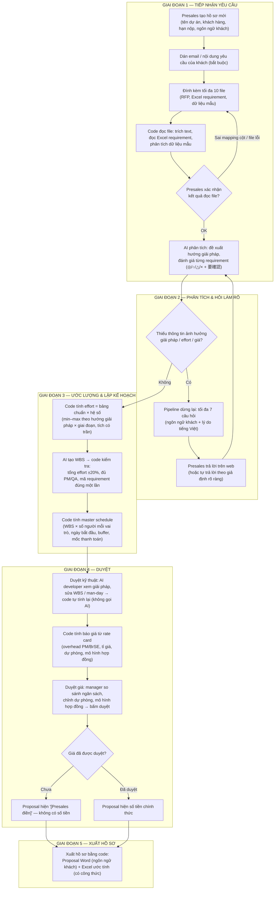
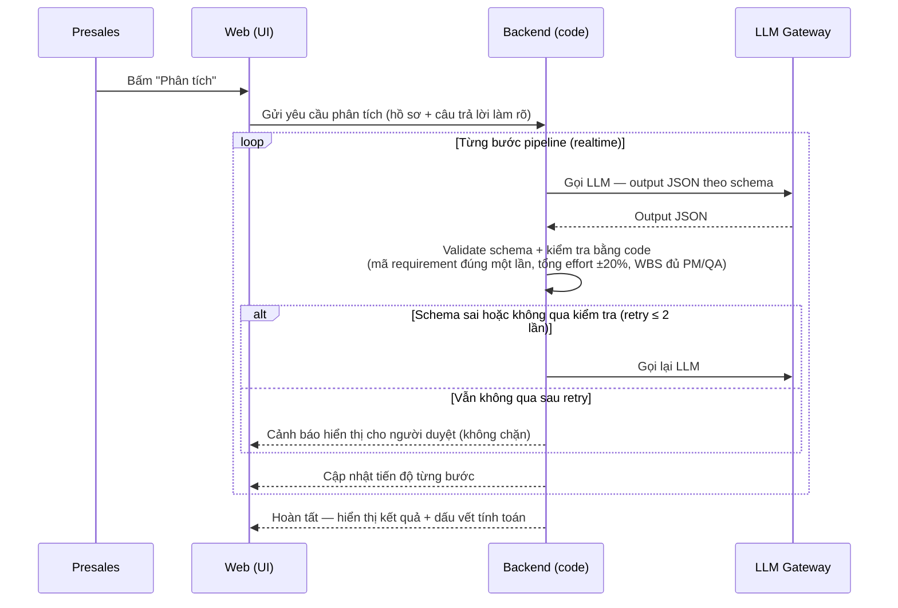

# SRS — Phần mềm hỗ trợ presales làm hồ sơ dự thầu (Presales Bidding Assistant)

| Thuộc tính | Giá trị |
|---|---|
| Tên tài liệu | Đặc tả yêu cầu phần mềm (Software Requirements Specification — SRS) |
| Phiên bản | 1.1 |
| Ngày | 2026-10-09 |
| Trạng thái | Draft — đã review, chờ duyệt |
| Phạm vi | MVP (Minimum Viable Product) |
| Nguồn đầu vào | `docs/01_idea.md` (ý tưởng và phạm vi MVP), `docs/02_research.md` (nghiên cứu nền tảng) |
| Ngôn ngữ | Tiếng Việt (tài liệu nội bộ) |

**Lịch sử thay đổi (changelog):**

| Phiên bản | Ngày | Thay đổi |
|---|---|---|
| 1.0 | 2026-10-09 | Bản draft đầu tiên. |
| 1.1 | 2026-10-09 | Áp dụng review (`docs/03_requirements/srs_review.md`): sửa thang đánh giá thành ◎/○/△/× (+ nhãn phụ 要確認); thêm FR-007 (danh sách/mở lại hồ sơ) và FR-025 (kiểm tra tiếng Nhật); bổ sung luồng từ chối duyệt, khóa hồ sơ sau duyệt giá, ràng buộc người duyệt ≠ người tạo, cổng duyệt kỹ thuật, hạn nộp trong master schedule, mục Giả định & スコープ外, quy ước 見積書, ngân sách khách, giới hạn vòng hỏi, điểm tham chiếu ±20%, đọc nhiều sheet + mã nội bộ, resume sau lỗi pipeline; làm rõ các điểm SHOULD-FIX (hệ số nhân, đổi hướng giải pháp, tiền tệ, .xls, tỉ giá, bộ test PII, lịch nghỉ lễ, template, validate toàn vẹn bảng chuẩn, snapshot WBS, sửa proposal trong web, chi phí vận hành, ngữ cảnh lô, đánh giá lại 要確認). |

---

## 1. Giới thiệu

### 1.1 Mục đích

Tài liệu này đặc tả các yêu cầu chức năng (FR), yêu cầu phi chức năng (NFR), business rules (BR), use cases và user stories cho **web app nội bộ hỗ trợ đội presales làm hồ sơ dự thầu** cho khách hàng Việt Nam và Nhật Bản. Ứng dụng nhận yêu cầu của khách (email + RFP + file Excel requirement), dùng AI để phân tích và soạn thảo, **dùng code để tính số và kiểm tra**, và có **con người duyệt** trước khi gửi khách. Đầu ra là bộ hồ sơ gồm proposal Word (theo ngôn ngữ khách) và Excel ước tính (WBS, man-day, báo giá, lịch).

### 1.2 Nguyên tắc cốt lõi

> **AI phân tích và soạn thảo, code tính số và kiểm tra, con người quyết định.**

Ba hệ quả bắt buộc:

1. AI **không bao giờ tự bịa con số**: effort và giá luôn do code tính từ bảng chuẩn (YAML).
2. Hệ thống **không bao giờ "tự học"** để thay đổi con số. Muốn đổi effort/đơn giá chuẩn, manager sửa bảng chuẩn ở trang Cài đặt — có chủ đích, có người chịu trách nhiệm.
3. Khi thiếu thông tin, AI **dừng lại và hỏi** (tối đa 7 câu) — không đoán bừa.

### 1.3 Tài liệu tham khảo

- `docs/01_idea.md` — Ý tưởng sản phẩm và phạm vi MVP.
- `docs/02_research.md` — Nghiên cứu nền tảng: quy trình dự thầu Nhật Bản, phương pháp ước lượng effort, công cụ AI viết proposal hiện có.
- `AGENTS.md` — Quy tắc dự án (hiến pháp sản phẩm) mà mọi yêu cầu trong SRS này phải tuân thủ.

### 1.4 Quy ước trong tài liệu

- Từ "phải", "bắt buộc" (shall/must) thể hiện yêu cầu cứng; không dùng "nên" (should) cho yêu cầu chức năng.
- Mỗi yêu cầu có mã duy nhất: `FR-xxx`, `NFR-xxx`, `BR-xx`, `UC-xx`, `US-xxx`.
- Ưu tiên theo MoSCoW: **Must have** (bắt buộc trong MVP) / **Should have** (nên có) / **Could have** (có thì tốt) / **Won't have** (không làm trong MVP).

---

## 2. Bối cảnh, mục tiêu và tiêu chí thành công

### 2.1 Bối cảnh

- Hiện tại presales mất **1–2 ngày** để ra được bản nháp hồ sơ dự thầu.
- Số liệu effort/giá phụ thuộc **kinh nghiệm cá nhân** và dễ sai.
- Khách Nhật **soi rất kỹ từng requirement** — không thể sót hoặc bịa.
- Mục tiêu: có bản nháp đầy đủ trong **vài phút**, để presales dành thời gian cho việc chỉnh sửa và chiến lược giá.

Bối cảnh triển khai: **bài thi nội bộ** — không được dùng dữ liệu công ty hay dữ liệu khách thật. Mọi số liệu là **giả lập nhưng sát mặt bằng thị trường** (team offshore Việt Nam làm cho khách VN/Nhật), ghi rõ "giả lập" trong file. App phải thiết kế để sau này công ty thay bằng số thật **mà không cần sửa code**.

### 2.2 Mục tiêu

1. Rút thời gian tạo bản nháp hồ sơ dự thầu từ 1–2 ngày xuống **vài phút**.
2. Đảm bảo **100% requirement** trong file Excel của khách được đánh giá — không sót, không bịa.
3. Mọi con số effort/giá **truy được về bảng chuẩn và công thức** (dấu vết tính toán).
4. Proposal **không chứa số tiền** khi giá chưa được con người duyệt.
5. Tôn trọng quy ước khách Nhật: thang đánh dấu **◎/○/△/×**, văn hóa **質問記入票** (hỏi rõ ràng thay vì đoán bừa), báo giá **見積書** đúng chuẩn.

### 2.3 Tiêu chí thành công đo được (acceptance targets)

| Mã | Tiêu chí | Ngưỡng đo |
|---|---|---|
| S-01 | Demo trọn luồng với bộ hồ sơ mẫu **tiếng Nhật** | ≤ 10 phút |
| S-02 | Requirement trong file Excel được đánh giá | 100% (không sót) |
| S-03 | Mọi con số effort/giá truy về bảng chuẩn + công thức | 100% |
| S-04 | Proposal khi chưa duyệt giá | 0 số tiền (chỉ `[Presales điền]`) |
| S-05 | Bảng chuẩn thay đổi số liệu | Không cần sửa code |

### 2.4 Vị trí sản phẩm

Sản phẩm chọn định vị **B — Công cụ ước lượng có trách nhiệm (governance)**: "số liệu đáng tin cậy: truy được về bảng chuẩn, có người duyệt, không bịa", dùng thị trường Nhật làm bãi đáp (beachhead). Năm khác biệt so với công cụ hiện có (theo `docs/02_research.md` §5):

1. Làm con số thành "hàng rào", không phải văn bản — mỗi requirement ánh xạ tới cost driver → person-day → giá chào.
2. Tôn trọng tuyệt đối định dạng khách hàng (điền thẳng vào file khách — *sau MVP*; MVP: bảng đáp ứng trên web).
3. Hỏi lại thay vì đoán bừa — khớp văn hóa 質問記入票 của khách Nhật.
4. Governance phê duyệt giá có trách nhiệm, kiểu "ringi-ready" — 2 cấp duyệt.
5. Kiểm tra tự động bằng code, không tin AI — kể cả tiếng Nhật.

---

## 3. Người dùng và vai trò (actors)

| Vai trò | Mô tả | Quyền hạn trong MVP |
|---|---|---|
| **Presales** | Người tạo và điều phối hồ sơ dự thầu | Tạo hồ sơ, nhập thông tin, đính kèm file, xác nhận kết quả đọc file, trả lời câu hỏi làm rõ, soạn thảo, xuất file gửi khách |
| **AI developer / kỹ sư** | Người duyệt kỹ thuật | Xem lại giải pháp, kiến trúc, rủi ro, WBS, effort; sửa trực tiếp WBS (thêm/sửa/xóa task, chỉnh man-day); ghi góp ý; yêu cầu AI chạy lại từ bước WBS |
| **Manager / sales lead** | Người duyệt giá và quản trị bảng chuẩn | So sánh báo giá với ngân sách khách, chỉnh dự phòng, mô hình hợp đồng, bấm duyệt giá; cập nhật bảng chuẩn ở trang Cài đặt |
| **Khách hàng** (gián tiếp) | Người nhận hồ sơ (VN/Nhật) | Không truy cập web; nhận file qua presales |

**Nguyên tắc:** AI **không review thay con người** — con người luôn là người quyết định cuối cùng.

> **Giả định MVP:** chưa có hệ thống xác thực nâng cao; vai trò được chọn/chỉ định thủ công trong giao diện (xem mục 8.2 — ngoài phạm vi). Tuy vậy, hệ thống phải chặn người tạo hồ sơ tự duyệt giá hồ sơ đó (FR-042.2).

---

## 4. Use cases và luồng nghiệp vụ

### 4.1 Danh sách use case chính

| Mã | Use case | Actor chính | FR liên quan |
|---|---|---|---|
| UC-01 | Tạo hồ sơ mới (thông tin + email yêu cầu + đính kèm file) | Presales | FR-001, FR-002 |
| UC-02 | Đọc và xác nhận file đầu vào | Presales | FR-003, FR-004, FR-005 |
| UC-03 | Hỏi làm rõ khi thiếu thông tin (pause/resume) | Presales | FR-010, FR-011 |
| UC-04 | Phân tích và đánh giá requirement | Hệ thống (AI + code) | FR-020, FR-021, FR-022, FR-023 |
| UC-05 | Ước lượng effort và lập WBS + master schedule | Hệ thống (code) | FR-030, FR-031, FR-032, FR-033, FR-034 |
| UC-06 | Duyệt kỹ thuật và chỉnh sửa WBS | AI developer | FR-041 |
| UC-07 | Duyệt giá | Manager | FR-040, FR-042, FR-043, FR-044 |
| UC-08 | Xuất bộ hồ sơ | Presales | FR-025, FR-050, FR-051, FR-052 |
| UC-09 | Cập nhật bảng chuẩn | Manager | FR-060, FR-061 |
| UC-10 | Nạp hồ sơ mẫu giả lập để demo | Presales | FR-006 |
| UC-11 | Mở lại hồ sơ đang dở (dashboard) | Presales | FR-007 |

### 4.2 Luồng nghiệp vụ end-to-end

### 4.3 Pipeline AI với kiểm tra bằng code (chi tiết kỹ thuật nghiệp vụ)

### 4.4 Mô tả chi tiết các use case chính

#### UC-01 — Tạo hồ sơ mới

- **Actor:** Presales.
- **Luồng chính:**
  1. Presales mở trang "Tạo hồ sơ mới".
  2. Nhập tên dự án, khách hàng, hạn nộp, ngôn ngữ khách (vi/en/ja).
  3. Dán email/nội dung yêu cầu của khách vào ô nhập (bắt buộc).
  4. Đính kèm tối đa 10 file (RFP, Excel requirement, dữ liệu mẫu).
  5. Hệ thống lưu hồ sơ ở trạng thái "Nháp".
- **Ngoại lệ:** thiếu email/nội dung → chặn lưu; file vượt giới hạn → từ chối kèm thông báo.

#### UC-02 — Đọc và xác nhận file đầu vào

- **Actor:** Presales.
- **Luồng chính:**
  1. Hệ thống tự đoán loại file (RFP/doc, Excel requirement, dữ liệu mẫu); presales đổi lại được.
  2. Code trích text từ PDF/DOCX/TXT/MD; code đọc Excel/CSV requirement thành danh sách requirement chính xác từng dòng; code phân tích dữ liệu mẫu thành profile.
  3. Web hiển thị kết quả đọc file: số requirement đọc được, file nào lỗi.
  4. Presales kiểm tra, sửa mapping cột nếu cần, rồi bấm "Phân tích".
- **Ngoại lệ:** file parse lỗi → báo lỗi rõ, không đoán; không có file Excel requirement → bỏ qua bảng đáp ứng, ghi rõ trên web.

#### UC-03 — Hỏi làm rõ khi thiếu thông tin (pause/resume)

- **Actor:** Presales (+ khách hàng gián tiếp).
- **Luồng chính:**
  1. Pipeline dừng lại khi thiếu thông tin ảnh hưởng giải pháp/effort/giá.
  2. Hệ thống hiển thị tối đa 7 câu hỏi, viết bằng ngôn ngữ khách, kèm lý do bằng tiếng Việt.
  3. Presales trả lời trên web (hoặc tự trả lời theo "giả định rõ ràng" và đánh dấu).
  4. AI chạy tiếp từ điểm dừng.
- **Ngoại lệ:** presales muốn gửi câu hỏi cho khách qua file Q&A sheet — **ngoài phạm vi MVP** (chỉ trả lời trên web).

#### UC-04 — Phân tích và đánh giá requirement

- **Actor:** Hệ thống (AI + code).
- **Luồng chính:**
  1. AI đề xuất hướng giải pháp (không cần AI / ML truyền thống / RAG / agent / fine-tune) kèm lý do.
  2. AI đánh giá từng requirement theo lô ≤ 40 dòng: ○ đáp ứng / △ một phần / × không / cần làm rõ.
  3. Code kiểm tra: mỗi mã requirement xuất hiện đúng một lần; sai → AI làm lại (≤ 2 lần) → còn sai thì cảnh báo.
  4. Tiến độ từng bước hiển thị realtime trên web.

#### UC-05 — Ước lượng effort, WBS và master schedule

- **Actor:** Hệ thống (code + AI).
- **Luồng chính:**
  1. Code tính effort = bảng chuẩn (min–max theo hướng giải pháp × giai đoạn) × hệ số (tích có trần).
  2. AI tạo WBS theo hướng giải pháp; code kiểm tra tổng effort khớp bảng chuẩn ±20% (cảnh báo) và WBS đủ PM/QA mỗi giai đoạn.
  3. Code tính master schedule từ WBS × số người mỗi vai trò, ngày bắt đầu, buffer, mốc thanh toán.
  4. Mọi con số hiển thị kèm dấu vết tính toán.

#### UC-06 — Duyệt kỹ thuật

- **Actor:** AI developer.
- **Luồng chính:**
  1. Xem lại hướng giải pháp, kiến trúc, rủi ro, WBS, effort.
  2. Sửa trực tiếp trên web (thêm/sửa/xóa task WBS, chỉnh man-day) → code tự tính lại tổng, lịch, giá — **không gọi lại AI**.
  3. Nếu chưa ổn: ghi góp ý và yêu cầu AI chạy lại từ bước WBS.
- **Ngoại lệ:** chạy lại từ bước tùy ý khác — ngoài phạm vi MVP.

#### UC-07 — Duyệt giá

- **Actor:** Manager / sales lead.
- **Luồng chính:**
  1. Xem báo giá (do code tính từ rate card) so với ngân sách khách.
  2. Chỉnh dự phòng, mô hình hợp đồng.
  3. Hệ thống chạy kiểm tra tự động trước khi duyệt (không sót requirement, cảnh báo ±20%, đúng schema).
  4. Bấm duyệt → hồ sơ chuyển trạng thái "Đã duyệt giá".
- **Ngoại lệ:** chưa duyệt → proposal hiện `[Presales điền]`, không có số tiền.

#### UC-08 — Xuất bộ hồ sơ

- **Actor:** Presales.
- **Luồng chính:**
  0. Với ngôn ngữ khách = ja: chạy kiểm tra tiếng Nhật (FR-025) và hiển thị kết quả trước khi xuất.
  1. Xuất proposal Word (.docx) theo template trung tính, ngôn ngữ khách (vi/en/ja) — gồm mục Giả định (前提条件) và Phạm vi không bao gồm (スコープ外).
  2. Xuất Excel ước tính (.xlsx): WBS, tổng man-day, báo giá, master schedule — tổng là công thức Excel để chỉnh tay được.
  3. PDF là bản chuyển từ Word khi cần nộp.
- **Nguyên tắc:** tất cả file xuất bằng code, không để AI tự dựng định dạng.

#### UC-09 — Cập nhật bảng chuẩn

- **Actor:** Manager.
- **Luồng chính:**
  1. Mở trang Cài đặt, sửa bảng effort chuẩn / rate card (YAML) — có validate.
  2. Lưu → thay đổi chỉ áp dụng cho hồ sơ tính lại sau đó; hồ sơ đã duyệt giá giữ nguyên số.

#### UC-10 — Nạp hồ sơ mẫu giả lập

- **Actor:** Presales.
- **Luồng chính:** bấm một nút → nạp 1–2 bộ hồ sơ mẫu giả lập (email + RFP + Excel requirement) để demo nhanh.

#### UC-11 — Mở lại hồ sơ đang dở

- **Actor:** Presales.
- **Luồng chính:**
  1. Mở danh sách hồ sơ (dashboard) — lọc theo trạng thái, tìm theo tên dự án/khách hàng.
  2. Chọn hồ sơ → mở lại đúng trạng thái đang dở (ví dụ "Chờ làm rõ" hiển thị các câu hỏi chưa trả lời).
  3. Tiếp tục làm việc từ trạng thái đó.
- **Ngoại lệ:** hồ sơ "Đã duyệt giá" bị khóa — chỉ xem, không sửa (FR-042.4).

---

## 5. Yêu cầu chức năng (FR)

### Module A — Quản lý hồ sơ và tiếp nhận yêu cầu

#### FR-001: Tạo hồ sơ mới

**Ưu tiên:** Must have · **Trạng thái:** Draft

**Mô tả:** Hệ thống phải cho phép presales tạo hồ sơ dự thầu mới với các trường: tên dự án, khách hàng, hạn nộp, ngôn ngữ khách (vi/en/ja), và nội dung yêu cầu của khách (dán email / văn bản — **bắt buộc**).

**Yêu cầu con:**
- FR-001.1: Trường "nội dung yêu cầu" là bắt buộc; hệ thống phải chặn tạo hồ sơ khi trường này trống.
- FR-001.2: Ngôn ngữ khách phải thuộc tập {vi, en, ja} và được dùng cho mọi tài liệu gửi khách.
- FR-001.3: Hồ sơ mới phải được lưu ở trạng thái "Nháp".

**Tiêu chí chấp nhận:**
1. Tạo hồ sơ với đủ trường bắt buộc → hồ sơ tồn tại ở trạng thái "Nháp".
2. Bỏ trống nội dung yêu cầu → hệ thống từ chối và hiển thị thông báo lỗi.
3. Chọn ngôn ngữ khách = ja → mọi tài liệu gửi khách sau đó sinh bằng tiếng Nhật.

#### FR-002: Đính kèm và phân loại file đầu vào

**Ưu tiêu:** Must have · **Trạng thái:** Draft

**Mô tả:** Hệ thống phải cho phép đính kèm tối đa **10 file**, mỗi file **≤ 20 MB**. Hệ thống phải **tự đoán loại file** (RFP/tài liệu, Excel requirement, dữ liệu mẫu) và cho phép presales đổi lại nếu đoán sai.

**Yêu cầu con:**
- FR-002.1: Loại file hợp lệ: RFP/tài liệu (`.pdf`, `.docx`, `.txt`, `.md`), Excel/CSV requirement (`.xlsx`, `.xlsm`, `.csv`), dữ liệu mẫu (`.csv`, `.xlsx`). File `.xls` (Excel 97–2003) được chấp nhận cho loại Excel requirement/dữ liệu mẫu nhưng phải được chuyển đổi nội bộ; nếu không chuyển được, hệ thống báo rõ "vui lòng lưu lại dưới dạng .xlsx".
- FR-002.2: Vượt quá 10 file hoặc file > 20 MB → từ chối kèm thông báo rõ ràng.
- FR-002.3: Presales phải đổi được loại file khi hệ thống đoán sai (trước bước phân tích).

**Tiêu chí chấp nhận:**
1. Đính kèm 11 file → file thứ 11 bị từ chối, 10 file đầu giữ nguyên.
2. Đính kèm file 25 MB → từ chối với thông báo "vượt 20 MB".
3. Với bộ 20 file mẫu chuẩn, hệ thống đoán đúng loại ≥ 90%; mọi trường hợp đoán sai đều đổi lại được bằng tay.

#### FR-003: Code đọc file đầu vào (trích text, đọc Excel requirement, phân tích dữ liệu mẫu)

**Ưu tiên:** Must have · **Trạng thái:** Draft

**Mô tả:** Hệ thống phải dùng **code** (không để AI) để: (1) trích text từ RFP/tài liệu; (2) đọc file Excel/CSV requirement thành danh sách requirement chính xác từng dòng với các cột mã, nội dung, ưu tiên, phân loại; (3) phân tích dữ liệu mẫu thành profile (số dòng, kiểu cột, % trống, cột nghi chứa thông tin cá nhân). AI chỉ được đọc phần tóm tắt có giới hạn ký tự của tài liệu.

**Yêu cầu con:**
- FR-003.1: Trích text từ `.pdf`, `.docx`, `.txt`, `.md`; phần text gửi cho AI phải bị giới hạn ký tự (tóm tắt).
- FR-003.2: Đọc Excel/CSV requirement: tự nhận diện dòng tiêu đề và cột (mã, nội dung, ưu tiên, phân loại); presales phải sửa được mapping cột khi tự nhận diện sai. Hệ thống phải đọc **tất cả sheet** của file; presales phải gán loại cho từng sheet (sheet requirement / sheet khác).
- FR-003.3: Khi khách **không gửi** file Excel requirement, hệ thống phải bỏ qua bảng đáp ứng và ghi rõ trên web (không bịa).
- FR-003.4: File parse lỗi (merge cell, nhiều dòng tiêu đề, chú thích…) → báo lỗi rõ ràng thay vì đoán.
- FR-003.5: Phân tích dữ liệu mẫu: số dòng, kiểu cột, % trống, cột nghi chứa PII → gợi ý mức sẵn sàng dữ liệu.
- FR-003.6: Mã requirement là **mã nội bộ do code sinh** (ví dụ REQ-001, REQ-002…) khi file khách không có cột mã hoặc cột số thứ tự là công thức (ví dụ 番号 = `=ROW()-1`). Mapping cột 区分 (必須/任意) sang cột "ưu tiên" phải được presales xác nhận. Mã phải duy nhất trên toàn file (mọi sheet).

**Tiêu chí chấp nhận:**
1. Với file Excel requirement chuẩn hóa (theo cấu trúc 番号/大分類/中分類/機能要件/区分/回答/備考), hệ thống đọc đúng **100%** dòng requirement; mỗi dòng có mã duy nhất.
2. Presales sửa mapping cột sai → danh sách requirement cập nhật lại đúng.
3. Không có file Excel requirement → bảng đáp ứng không hiển thị, có ghi chú "Khách không gửi file Excel requirement".
4. File hỏng → thông báo lỗi cụ thể, không tạo requirement giả.
5. File Excel có 2 sheet requirement → presales gán loại cho cả 2, mã nội bộ duy nhất trên toàn file; cột 番号 là công thức `=ROW()-1` → hệ thống sinh mã nội bộ thay thế.

#### FR-004: Gợi ý mức sẵn sàng dữ liệu

**Ưu tiên:** Should have · **Trạng thái:** Draft

**Mô tả:** Từ profile dữ liệu mẫu (FR-003.5), hệ thống phải gợi ý mức sẵn sàng dữ liệu (thấp/trung bình/cao) làm đầu vào cho việc chọn hệ số "dữ liệu chưa sẵn sàng" (FR-031).

**Tiêu chí chấp nhận:**
1. File dữ liệu mẫu có > 50% ô trống hoặc nhiều cột PII → gợi ý "sẵn sàng thấp".
2. Presales phải chỉnh tay được mức sẵn sàng sau khi hệ thống gợi ý.

#### FR-005: Xác nhận kết quả đọc file trước khi phân tích

**Ưu tiên:** Must have · **Trạng thái:** Draft

**Mô tả:** Trước khi chạy bước "Phân tích", hệ thống phải hiển thị kết quả đọc file (số requirement đọc được, file nào lỗi) và yêu cầu presales xác nhận.

**Tiêu chí chấp nhận:**
1. Màn hình xác nhận hiển thị: số requirement, danh sách file + trạng thái (OK/lỗi), mapping cột.
2. Không bấm xác nhận thì pipeline không chạy bước phân tích.

#### FR-006: Nạp hồ sơ mẫu giả lập

**Ưu tiên:** Must have · **Trạng thái:** Draft

**Mô tả:** Hệ thống phải cung cấp ít nhất **1–2 bộ hồ sơ mẫu giả lập** (email + RFP + Excel requirement, dữ liệu hoàn toàn hư cấu) nạp bằng một nút để demo nhanh.

**Tiêu chí chấp nhận:**
1. Bấm một nút → hồ sơ mẫu được tạo đầy đủ (thông tin, email, file đính kèm) và chạy được trọn luồng.
2. Dữ liệu mẫu không chứa tên công ty/khách hàng thật; có ghi chú "giả lập".

#### FR-007: Danh sách hồ sơ và mở lại hồ sơ đang dở

**Ưu tiên:** Must have · **Trạng thái:** Draft

**Mô tả:** Hệ thống phải có danh sách hồ sơ hiển thị tên dự án, khách hàng, trạng thái, hạn nộp, ngôn ngữ khách; presales phải mở lại được hồ sơ ở bất kỳ trạng thái nào (Nháp, Chờ làm rõ, Chờ duyệt…) để tiếp tục làm việc.

**Yêu cầu con:**
- FR-007.1: Danh sách hồ sơ phải lọc được theo trạng thái và tìm được theo tên dự án/khách hàng.
- FR-007.2: Mở lại hồ sơ đang ở trạng thái "Chờ làm rõ" phải hiển thị các câu hỏi chưa trả lời.

**Tiêu chí chấp nhận:**
1. Tạo 3 hồ sơ ở các trạng thái khác nhau → danh sách hiển thị đủ 3, lọc theo trạng thái đúng.
2. Mở lại hồ sơ "Chờ làm rõ" → hiển thị câu hỏi còn thiếu câu trả lời và cho phép trả lời tiếp.

### Module B — Hỏi làm rõ (pause/resume)

#### FR-010: Dừng lại và hỏi tối đa 7 câu khi thiếu thông tin

**Ưu tiên:** Must have · **Trạng thái:** Draft

**Mô tả:** Khi thiếu thông tin **ảnh hưởng tới giải pháp / effort / giá**, pipeline phải **dừng lại** và đưa **tối đa 7 câu hỏi làm rõ**. Câu hỏi phải viết bằng **ngôn ngữ khách** (vi/en/ja) kèm **lý do bằng tiếng Việt** cho presales. Hệ thống **không được đoán bừa**.

**Yêu cầu con:**
- FR-010.1: Số câu hỏi ≤ 7 trong một vòng dừng.
- FR-010.2: Mỗi câu hỏi có: nội dung (ngôn ngữ khách), lý do hỏi (tiếng Việt), mức ảnh hưởng (giải pháp / effort / giá).
- FR-010.3: Trạng thái hồ sơ chuyển sang "Chờ làm rõ"; pipeline không chạy tiếp cho tới khi presales trả lời hoặc tự trả lời theo giả định.
- FR-010.4: Số vòng hỏi tối đa là **2**. Sau vòng 2, hệ thống không hỏi thêm mà bắt buộc presales tự trả lời theo giả định rõ ràng (FR-011.2) để pipeline tiếp tục.

**Tiêu chí chấp nhận:**
1. Pipeline gặp thiếu thông tin → dừng, hiển thị ≤ 7 câu hỏi, mỗi câu có lý do tiếng Việt.
2. Câu hỏi hiển thị đúng ngôn ngữ khách (khách Nhật → tiếng Nhật).
3. Hệ thống không tạo ra con số effort/giá nào khi đang ở trạng thái "Chờ làm rõ".

#### FR-011: Trả lời trên web và tiếp tục pipeline

**Ưu tiên:** Must have · **Trạng thái:** Draft

**Mô tả:** Presales phải trả lời các câu hỏi làm rõ **trên web**; sau khi trả lời, AI chạy tiếp từ điểm dừng. Presales phải được phép tự trả lời theo **"giả định rõ ràng"** và đánh dấu giả định đó (không bắt buộc chờ khách).

**Yêu cầu con:**
- FR-011.1: Form trả lời hiển thị đủ câu hỏi; mỗi câu trả lời lưu được.
- FR-011.2: Câu trả lời theo giả định phải được đánh dấu "giả định — cần khách xác nhận" và hiển thị trong dấu vết hồ sơ.
- FR-011.3: Sau khi trả lời đủ, pipeline tiếp tục tự động từ bước bị dừng.

**Tiêu chí chấp nhận:**
1. Trả lời đủ 7 câu → bấm "Tiếp tục" → pipeline chạy tiếp và hoàn thành.
2. Câu trả lời giả định có nhãn "giả định" và xuất hiện trong lịch sử hồ sơ.
3. Trả lời thiếu → hệ thống nhắc trả lời các câu còn lại (hoặc xác nhận bỏ qua có đánh dấu).

### Module C — Phân tích và đánh giá requirement

#### FR-020: AI đánh giá từng requirement theo lô ≤ 40 dòng

**Ưu tiên:** Must have · **Trạng thái:** Draft

**Mô tả:** AI phải đánh giá từng requirement trong file Excel với thang chính **◎ đáp ứng vượt mong đợi / ○ đáp ứng / △ một phần / × không**, xử lý theo **lô ≤ 40 dòng** mỗi lần gọi LLM. Ngoài thang chính, AI có thể gắn **nhãn phụ "cần làm rõ" (要確認)** cho requirement chưa đủ thông tin — nhãn phụ không thay thế thang chính. Đánh giá ○/△/× gắn với hướng giải pháp đang chọn (FR-022).

**Tiêu chí chấp nhận:**
1. Với file 235 dòng requirement, hệ thống gọi LLM ≥ 6 lô (≤ 40 dòng/lô) và đánh giá đủ 235 dòng.
2. Mỗi requirement có đúng một đánh giá thuộc tập {◎, ○, △, ×}; requirement thiếu thông tin có thêm nhãn phụ "cần làm rõ".
3. Mỗi lô gửi LLM phải kèm danh sách mã/tên toàn bộ requirement để giữ ngữ cảnh giữa các lô.
4. Requirement mang nhãn "cần làm rõ" phải được đánh giá lại sau khi presales trả lời vòng hỏi; vẫn chưa đủ thông tin → giữ nhãn và hiển thị trong proposal như giả định.
5. Khi đổi hướng giải pháp (FR-022), hệ thống phải đánh giá lại hoặc hiển thị cảnh báo "đánh giá theo hướng giải pháp cũ".

#### FR-021: Code kiểm tra mã requirement đúng một lần (không sót, không thừa)

**Ưu tiên:** Must have · **Trạng thái:** Draft

**Mô tả:** Code phải kiểm tra mỗi mã requirement xuất hiện **đúng một lần** trong kết quả đánh giá (thang ◎/○/△/× + nhãn phụ 要確認). Thiếu hoặc thừa → AI phải làm lại (tối đa 2 lần); vẫn sai → hiển thị **cảnh báo cho người duyệt**.

**Tiêu chí chấp nhận:**
1. Kết quả đánh giá thiếu 1 mã → hệ thống tự gọi lại AI (≤ 2 lần) rồi mới dừng.
2. Sau retry vẫn thiếu → hiển thị cảnh báo liệt kê mã thiếu/thừa trên màn hình duyệt.
3. Unit test với mock LLM trả về thiếu mã → kiểm tra bắt được lỗi.

#### FR-022: AI đề xuất hướng giải pháp

**Ưu tiên:** Must have · **Trạng thái:** Draft

**Mô tả:** AI phải đề xuất **hướng giải pháp** từ tập cố định {không cần AI / ML truyền thống / RAG / agent / fine-tune} kèm lý do. Hướng giải pháp là khóa chính của bảng effort chuẩn (FR-030).

**Tiêu chí chấp nhận:**
1. Output của AI chứa đúng một hướng giải pháp thuộc tập cho phép (validate schema).
2. Mỗi hướng giải pháp có lý do bằng tiếng Việt, hiển thị cho người duyệt kỹ thuật.
3. AI developer đổi hướng giải pháp → code tính lại effort theo bảng chuẩn của hướng mới (không gọi lại AI phần đánh giá requirement); đánh giá requirement được cảnh báo là "theo hướng cũ" (xem FR-020).

#### FR-023: Hiển thị tiến độ từng bước realtime

**Ưu tiên:** Must have · **Trạng thái:** Draft

**Mô tả:** Hệ thống phải hiển thị tiến độ từng bước của pipeline AI **realtime trên web** (bước đang chạy, hoàn thành, lỗi/retry). Mỗi bước hoàn thành phải được **lưu (persist) ngay**; khi pipeline lỗi/timeout, hồ sơ giữ trạng thái bước cuối cùng và presales phải chạy lại được **từ bước bị lỗi**, không phải từ đầu.

**Tiêu chí chấp nhận:**
1. Khi pipeline chạy, web cập nhật trạng thái bước hiện tại ≤ 5 giây một lần.
2. Bước lỗi/retry hiển thị trạng thái và thông báo tương ứng.
3. Pipeline lỗi giữa chừng → dữ liệu bước đã hoàn thành được giữ; chạy lại từ bước lỗi không làm lại bước trước đó.

### Module D — Ước lượng effort và lập kế hoạch (code tính số)

#### FR-025: Kiểm tra chất lượng tiếng Nhật trước khi xuất tài liệu

**Ưu tiên:** Must have · **Trạng thái:** Draft

**Mô tả:** Với hồ sơ có ngôn ngữ khách = ja, hệ thống phải chạy kiểm tra tiếng Nhật trước khi xuất tài liệu gửi khách: (1) đối chiếu thuật ngữ với glossary trong prompt; (2) phát hiện văn bản lẫn tiếng Anh/ký tự Latin không đúng ngữ cảnh; (3) kiểm tra tên công ty/khách hàng đúng chính tả.

**Tiêu chí chấp nhận:**
1. Kiểm tra chạy tự động trước khi xuất proposal/câu hỏi tiếng Nhật; kết quả (pass/cảnh báo) hiển thị trên màn hình xuất.
2. Với bộ mẫu 20 câu tiếng Nhật chuẩn, hệ thống phát hiện ≥ 90% lỗi ngôn ngữ cố ý chèn vào (unit test).
3. Cảnh báo không chặn xuất nhưng phải hiển thị rõ cho presales trước khi tải file.

#### FR-030: Code tính effort từ bảng chuẩn

**Ưu tiên:** Must have · **Trạng thái:** Draft

**Mô tả:** Effort phải được **code tính** theo công thức `effort = bảng chuẩn × hệ số`, trong đó bảng chuẩn là man-day **min–max** theo (hướng giải pháp × giai đoạn PoC/MVP/Production). LLM **không được** xuất ra con số man-day.

**Yêu cầu con:**
- FR-030.1: Bảng effort chuẩn đọc từ file YAML (xem FR-060).
- FR-030.2: Kết quả là dải min–max, không phải điểm số giả chính xác.
- FR-030.3: Mọi thay đổi bảng chuẩn áp dụng cho hồ sơ tính lại sau đó (xem FR-061).

**Tiêu chí chấp nhận:**
1. Với hướng giải pháp + giai đoạn cho trước, code trả về đúng dải min–max trong bảng chuẩn.
2. Schema output LLM không chứa trường man-day/effort (unit test assert).

#### FR-031: Hệ số nhân có trần

**Ưu tiên:** Must have · **Trạng thái:** Draft

**Mô tả:** Hệ thống phải hỗ trợ các hệ số nhân: on-premise, khách Nhật (tài liệu tiếng Nhật), dữ liệu chưa sẵn sàng, tuân thủ chặt, đa ngôn ngữ, cần OCR, dữ liệu lớn, nhiều requirement. **Tích các hệ số phải có trần** (giá trị tối đa cấu hình được). AI phải **đề xuất bộ hệ số kèm lý do**; presales/AI developer xác nhận hoặc chỉnh trước khi tính effort. Mặc định theo ngữ cảnh: khách Nhật → tự bật hệ số "khách Nhật"; dữ liệu mẫu kém → gợi ý bật hệ số "dữ liệu chưa sẵn sàng" (từ FR-004).

**Tiêu chí chấp nhận:**
1. Bật 8 hệ số → tích hệ số bị chặn ở trần cấu hình, không vượt.
2. Mỗi hệ số có thể bật/tắt và sửa giá trị trong bảng chuẩn YAML.
3. AI đề xuất bộ hệ số kèm lý do; presales chỉnh được trước khi tính effort.

#### FR-032: AI tạo WBS, code kiểm tra tổng effort ±20% và đủ PM/QA

**Ưu tiên:** Must have · **Trạng thái:** Draft

**Mô tả:** AI tạo WBS theo hướng giải pháp; **tổng effort của WBS phải nằm trong dải bảng chuẩn (sau hệ số) và lệch không quá ±20% so với giữa dải (midpoint)** — code kiểm tra. WBS phải đủ hạng mục **PM/QA mỗi giai đoạn**. Kiểm tra ±20% là **cảnh báo**, không phải cổng chặn; AI làm lại tối đa 2 lần, sau đó để người sửa.

**Yêu cầu con:**
- FR-032.1: WBS gồm các task với: mã, tên, giai đoạn, vai trò, man-day.
- FR-032.2: Mỗi giai đoạn có task PM và task QA.
- FR-032.3: Tổng effort phải nằm trong khoảng [min, max] của bảng chuẩn (sau hệ số); điểm tham chiếu hiển thị mức lệch là **giữa dải (midpoint)**. Lệch ngoài ±20% so với midpoint → cảnh báo hiển thị; người duyệt override được nhưng phải ghi chú.

**Tiêu chí chấp nhận:**
1. WBS thiếu PM/QA một giai đoạn → kiểm tra bắt lỗi, AI làm lại (≤ 2 lần).
2. Tổng effort lệch 25% → cảnh báo hiển thị; không chặn duyệt nếu người duyệt ghi chú.

#### FR-033: Hiển thị dấu vết tính toán

**Ưu tiên:** Must have · **Trạng thái:** Draft

**Mô tả:** Mọi con số effort/giá phải hiển thị **dấu vết tính toán**: truy về bảng chuẩn, dòng dữ liệu, hệ số đã chọn, công thức.

**Tiêu chí chấp nhận:**
1. Click vào một con số effort → hiển thị: bảng chuẩn (hướng giải pháp × giai đoạn), hệ số đã chọn, phép tính.
2. Click vào một con số giá → hiển thị: rate card theo vai trò, overhead, tỉ giá, dự phòng.

#### FR-034: Code tính master schedule

**Ưu tiên:** Must have · **Trạng thái:** Draft

**Mô tả:** Master schedule phải do **code tính** từ WBS × số người mỗi vai trò, ngày bắt đầu, buffer; có **mốc thanh toán**. Sửa WBS hoặc số người → lịch và giá **tự tính lại**. Lịch tính trên **lịch làm việc cấu hình** (nghỉ lễ VN và/hoặc Nhật — mặc định theo ngôn ngữ khách). Code phải so sánh ngày kết thúc với **hạn nộp** của hồ sơ; nếu ngày kết thúc > hạn nộp → hiển thị **cảnh báo vượt hạn nộp** và gợi ý điều chỉnh (tăng số người, giảm buffer).

**Tiêu chí chấp nhận:**
1. Đổi số người một vai trò → lịch cập nhật lại; không gọi AI.
2. Lịch có mốc thanh toán theo cấu hình.
3. Ngày kết thúc = f(WBS, số người, buffer, ngày bắt đầu) — unit test với dữ liệu mẫu.
4. Lịch vượt hạn nộp → cảnh báo hiển thị; điều chỉnh số người/buffer → ngày kết thúc cập nhật lại.
5. Lịch trừ đúng ngày nghỉ lễ theo lịch làm việc cấu hình (unit test với mẫu nghỉ lễ Nhật).

### Module E — Báo giá và duyệt

#### FR-040: Code tính báo giá từ rate card

**Ưu tiên:** Must have · **Trạng thái:** Draft

**Mô tả:** Báo giá phải do **code tính** từ rate card: đơn giá/ngày theo vai trò (PM, BA, BrSE, AI engineer, backend, frontend, QA, infra…), tách **offshore/onsite**, overhead (PM ~10%, BrSE ~15% khi khách Nhật), tỉ giá VND/JPY/USD (**có ngày hiệu lực**), % dự phòng theo rủi ro, chi phí vận hành/tháng. Báo giá phải tuân theo quy ước 見積書: **thời hạn hiệu lực (見積有効期限)** mặc định 30 ngày (cấu hình được), thể hiện rõ **税抜/税込** (thuế tiêu dùng Nhật 10%, cấu hình được; với khách Nhật giá chính là 税抜), **làm tròn số yen tròn sạch** (quy tắc cấu hình), và có cấu trúc **内訳** (ngoài gom nhóm hạng mục dễ đọc, trong phân rã theo vai trò). % dự phòng mặc định phụ thuộc **mô hình hợp đồng**: fixed-price 15–30%, lab-type 0–10%, hybrid theo cấu hình.

**Tiêu chí chấp nhận:**
1. Báo giá = Σ(man-day theo vai trò × đơn giá) + overhead + dự phòng — đúng công thức cấu hình.
2. Khách Nhật → overhead BrSE 15% được áp dụng tự động (có thể chỉnh).
3. Mọi con số giá truy về rate card (FR-033).
4. Đổi mô hình hợp đồng → % dự phòng và tổng giá tính lại theo cấu hình.
5. Báo giá khách Nhật có 見積有効期限, rõ 税抜/税込, tổng làm tròn yen, kèm 内訳.
6. Tỉ giá dùng trong tính toán có ngày hiệu lực và được ghi trong dấu vết (FR-033).
7. Chi phí vận hành/tháng hiển thị tách riêng trong 内訳; cấu hình "tính vào tổng" hay "ghi riêng".

#### FR-041: Duyệt kỹ thuật và sửa WBS trực tiếp

**Ưu tiên:** Must have · **Trạng thái:** Draft

**Mô tả:** AI developer phải xem lại hướng giải pháp, kiến trúc, rủi ro, WBS, effort; **sửa trực tiếp trên web** (thêm/sửa/xóa task WBS, chỉnh man-day) → code tự tính lại tổng, lịch, giá — **không gọi lại AI**. Nếu chưa ổn: ghi góp ý và yêu cầu AI **chạy lại từ bước WBS**. Khi không duyệt: ghi lý do từ chối.

**Yêu cầu con:**
- FR-041.1: Sửa WBS → tổng effort, lịch, giá tính lại tự động.
- FR-041.2: Góp ý kèm yêu cầu chạy lại từ bước WBS → pipeline chạy lại từ bước đó; **giữ nguyên đánh giá requirement (FR-020) và hướng giải pháp (FR-022)**, chỉ tạo lại WBS, effort, lịch, giá. Trước khi chạy lại, hệ thống phải **lưu snapshot WBS hiện tại** để so sánh trước/sau.
- FR-041.3: Mọi thay đổi của người duyệt được ghi lại (ai sửa, sửa gì, khi nào).
- FR-041.4: Khi AI developer không duyệt, hệ thống phải yêu cầu ghi lý do, chuyển hồ sơ về trạng thái "Bị từ chối duyệt" kèm lý do hiển thị; presales chỉnh sửa rồi gửi lại duyệt được.

**Tiêu chí chấp nhận:**
1. Thêm 1 task 5 man-day → tổng effort tăng đúng 5, lịch/giá cập nhật lại.
2. Ghi góp ý + "chạy lại từ WBS" → AI tạo WBS mới, không làm lại bước đánh giá requirement; snapshot WBS cũ được lưu và hiển thị khác biệt trước/sau.
3. Log thay đổi ghi đủ thông tin người sửa.
4. Từ chối duyệt → hồ sơ chuyển "Bị từ chối duyệt" kèm lý do; gửi lại duyệt được.

#### FR-042: Duyệt giá bởi manager

**Ưu tiên:** Must have · **Trạng thái:** Draft

**Mô tả:** Manager phải xem báo giá so với **ngân sách khách**, chỉnh **dự phòng** và **mô hình hợp đồng** (fixed-price / lab-type / hybrid), rồi bấm duyệt. Người duyệt giá phải **khác người tạo hồ sơ** (hệ thống chặn tự duyệt). Sau khi duyệt, hồ sơ bị **khóa**: mọi thay đổi WBS/effort/giá phải mở khóa (ghi lý do) và yêu cầu duyệt lại.

**Yêu cầu con:**
- FR-042.1: Presales phải nhập được ngân sách khách (tùy chọn, tiền tệ theo ngôn ngữ khách) ở bước tạo hồ sơ hoặc trước khi gửi duyệt; không có ngân sách → màn hình duyệt chỉ hiển thị báo giá, bỏ cột chênh lệch.
- FR-042.2: Hệ thống phải chặn người tạo hồ sơ tự duyệt giá hồ sơ đó; khi vai trò chọn thủ công, giao diện phải gán người duyệt khác người tạo và cảnh báo nếu vi phạm.
- FR-042.3: Khi manager không duyệt, hệ thống phải yêu cầu ghi lý do từ chối, chuyển hồ sơ về trạng thái "Bị từ chối duyệt"; presales chỉnh sửa rồi gửi lại duyệt. Hồ sơ bị từ chối vẫn xuất được proposal với placeholder `[Presales điền]`.
- FR-042.4: Sau khi duyệt giá, hồ sơ chuyển "Đã duyệt giá" và bị **khóa**: mọi thay đổi WBS/effort/giá phải mở khóa (ghi lý do) và yêu cầu duyệt lại giá.

**Tiêu chí chấp nhận:**
1. Màn hình duyệt hiển thị: báo giá, ngân sách khách (nếu có), chênh lệch, dự phòng, mô hình hợp đồng.
2. Bấm duyệt → hồ sơ chuyển "Đã duyệt giá"; thao tác duyệt được ghi log.
3. Người tạo hồ sơ cố duyệt giá hồ sơ của mình → hệ thống chặn và cảnh báo.
4. Từ chối duyệt → hồ sơ chuyển "Bị từ chối duyệt" kèm lý do; proposal vẫn xuất được với `[Presales điền]`.
5. Sau khi duyệt, sửa WBS → hệ thống yêu cầu mở khóa (ghi lý do) và duyệt lại giá.

#### FR-043: Cổng giá (price gate)

**Ưu tiên:** Must have · **Trạng thái:** Draft

**Mô tả:** Giá **không bao giờ** xuất hiện trong tài liệu gửi khách trước khi được duyệt. Chưa duyệt → proposal hiện `[Presales điền]`.

**Tiêu chí chấp nhận:**
1. Xuất proposal khi hồ sơ chưa duyệt giá → mọi vị trí số tiền là `[Presales điền]`, không có con số nào.
2. Xuất proposal sau khi duyệt → số tiền chính thức hiển thị.
3. Unit test: hàm render proposal với trạng thái chưa duyệt không chứa ký tự số tiền.

#### FR-044: Kiểm tra tự động trước khi duyệt

**Ưu tiên:** Must have · **Trạng thái:** Draft

**Mô tả:** Trước khi duyệt giá, hệ thống phải chạy kiểm tra tự động: không sót requirement, tổng effort trong ±20% (cảnh báo), output đúng schema, WBS đủ PM/QA. Hồ sơ chỉ được chuyển sang "Chờ duyệt giá" khi đã hoàn tất **duyệt kỹ thuật** hoặc presales xác nhận **bỏ qua duyệt kỹ thuật** kèm lý do (ghi log). Khi hồ sơ **không có file Excel requirement** (FR-003.3), kiểm tra "không sót requirement" được bỏ qua và ghi rõ trong báo cáo kiểm tra.

**Tiêu chí chấp nhận:**
1. Kiểm tra chạy và hiển thị kết quả từng mục (pass/cảnh báo/fail).
2. Có mục fail chặn duyệt; mục cảnh báo không chặn nhưng phải hiển thị.
3. Hồ sơ chưa qua duyệt kỹ thuật → không chuyển được sang "Chờ duyệt giá" trừ khi presales xác nhận bỏ qua kèm lý do (ghi log).
4. Hồ sơ không có file Excel → báo cáo kiểm tra ghi "Khách không gửi file Excel requirement — bỏ qua bảng đáp ứng".

### Module F — Xuất hồ sơ

#### FR-050: Xuất proposal Word theo ngôn ngữ khách

**Ưu tiên:** Must have · **Trạng thái:** Draft

**Mô tả:** Hệ thống phải xuất proposal **Word (.docx)** theo template trung tính (bìa, header/footer, logo placeholder — asset trong repo, thư mục `templates/`, thay thế được), viết bằng **ngôn ngữ khách** (vi/en/ja). PDF là bản chuyển từ Word khi cần nộp. MVP cho phép presales sửa các **trường văn bản chính** (mở đầu, tổng quan giải pháp, kết luận) trong web trước khi xuất; phần còn lại sửa sau khi xuất Word.

**Tiêu chí chấp nhận:**
1. File .docx mở được, đúng ngôn ngữ khách, đúng template.
2. Nội dung proposal: bối cảnh, giải pháp, WBS/effort, lịch, báo giá (theo cổng giá FR-043), rủi ro, mục **"Giả định (前提条件)"** — tổng hợp từ câu trả lời giả định (FR-011.2) và hệ số đã chọn (FR-031) — và mục **"Phạm vi không bao gồm (スコープ外)"**.
3. Chuyển PDF từ Word thành công.
4. Presales sửa trường văn bản chính trong web → bản xuất phản ánh đúng nội dung đã sửa.

#### FR-051: Xuất Excel ước tính có công thức

**Ưu tiên:** Must have · **Trạng thái:** Draft

**Mô tả:** Hệ thống phải xuất **Excel (.xlsx)** gồm WBS, tổng man-day, báo giá, master schedule; **tổng là công thức Excel** để presales chỉnh tay được. Tiền tệ mặc định theo ngôn ngữ khách: ja → JPY, vi → VND, en → USD; cấu hình được ở cấp hồ sơ.

**Tiêu chí chấp nhận:**
1. File .xlsx mở được; ô tổng chứa công thức (SUM), không phải giá trị cứng.
2. Sửa man-day một dòng trong Excel → tổng tự cập nhật khi mở lại.

#### FR-052: Tất cả file xuất bằng code

**Ưu tiên:** Must have · **Trạng thái:** Draft

**Mô tả:** Mọi file đầu ra phải được sinh **bằng code** theo template; AI **không được** tự dựng định dạng file.

**Tiêu chí chấp nhận:**
1. Pipeline xuất file không gọi LLM ở bước tạo định dạng.
2. Hai lần xuất cùng dữ liệu → file giống nhau về cấu trúc (deterministic).

### Module G — Bảng chuẩn và cài đặt

#### FR-060: Bảng chuẩn YAML sửa được trên trang Cài đặt

**Ưu tiên:** Must have · **Trạng thái:** Draft

**Mô tả:** Bảng effort chuẩn và rate card lưu dạng **file YAML trong repo**, sửa được trên trang Cài đặt **có validate**. Người cập nhật: manager/presales lead. Cấu hình phải chứa **thông tin công ty gửi thầu** (tên, địa chỉ, mã số thuế, mã 適格請求書発行事業者 — giả lập trong MVP) và **điều khoản thanh toán** (payment terms); các trường này xuất vào proposal/見積書.

**Yêu cầu con:**
- FR-060.1: Trang Cài đặt hiển thị và cho sửa bảng effort chuẩn (min–max, hệ số, trần) và rate card (đơn giá, overhead, tỉ giá, dự phòng, mốc thanh toán).
- FR-060.2: Lưu sai định dạng/thiếu trường bắt buộc → từ chối kèm thông báo validate. Validate phải kiểm tra **toàn vẹn**: mọi tổ hợp hướng giải pháp × giai đoạn đều có min–max; mọi vai trò trong rate card đều có đơn giá offshore và onsite; trần hệ số > 1.

**Tiêu chí chấp nhận:**
1. Sửa đơn giá BrSE → hồ sơ tính lại sau đó dùng giá mới.
2. Lưu YAML sai cú pháp → hệ thống từ chối, giữ giá trị cũ.

#### FR-061: Thay đổi bảng chuẩn chỉ áp dụng cho hồ sơ tính lại sau

**Ưu tiên:** Must have · **Trạng thái:** Draft

**Mô tả:** Mọi thay đổi bảng chuẩn chỉ áp dụng cho hồ sơ **tính lại sau đó**; hồ sơ **đã duyệt giá giữ nguyên số** (bất biến).

**Tiêu chí chấp nhận:**
1. Đổi bảng chuẩn → hồ sơ đã duyệt giá không đổi số, có ghi chú "giữ nguyên theo bảng chuẩn tại thời điểm duyệt".
2. Hồ sơ nháp tính lại sau khi đổi → dùng số mới.

---

## 6. Yêu cầu phi chức năng (NFR)

#### NFR-001: Hiệu năng và thời gian phản hồi

**Ưu tiên:** Must have

- Demo trọn luồng với bộ hồ sơ mẫu tiếng Nhật phải hoàn thành **≤ 10 phút** (S-01).
- Từ lúc presales bấm "Phân tích" đến khi có bản nháp đầy đủ (kèm tối đa 1 vòng hỏi ≤ 7 câu đã trả lời) phải **≤ 15 phút** với hồ sơ 235 requirement (môi trường demo, LLM thật).
- Tiến độ pipeline cập nhật realtime: mỗi bước hiển thị trạng thái ≤ 5 giây sau khi bước thay đổi.
- Đánh giá requirement theo lô ≤ 40 dòng để giới hạn thời gian mỗi lần gọi LLM.

#### NFR-002: Quyền riêng tư và che PII

**Ưu tiên:** Must have

- Email và số điện thoại phải được **che (mask)** trước khi gửi nội dung cho LLM; với bộ test PII chuẩn (≥ 50 mẫu: email, số điện thoại VN +84/0xx, số điện thoại Nhật 0X-XXXX-XXXX/+81, email lẫn trong văn bản tiếng Nhật), tỷ lệ che ≥ 99%.
- Không được commit hoặc in API key ra log/giao diện.
- Dữ liệu mẫu phải là **giả lập** — không tên công ty/khách hàng thật; file xuất ghi rõ "giả lập".

#### NFR-003: Kiểm soát chi phí LLM

**Ưu tiên:** Must have

- Tài liệu gửi LLM phải là bản tóm tắt có giới hạn ký tự (FR-003.1).
- Số lần gọi LLM bị giới hạn: lô ≤ 40 dòng; retry ≤ 2 lần mỗi kiểm tra.
- Unit test và CI **không bao giờ** gọi LLM thật — dùng mock.

#### NFR-004: Ngôn ngữ

**Ưu tiên:** Must have

- Giao diện web và phân tích nội bộ bằng **tiếng Việt**.
- Tài liệu gửi khách (câu hỏi làm rõ, proposal) theo **ngôn ngữ khách** (vi/en/ja).
- Với khách Nhật: pipeline phải có glossary thuật ngữ trong prompt và kiểm tra ngôn ngữ riêng (không tin output thô của LLM).

#### NFR-005: Bảo mật và cấu hình LLM

**Ưu tiên:** Must have

- Mọi lời gọi LLM đi qua **một gateway duy nhất** với implementation `mock` và `openai_compat`.
- Cấu hình qua env vars: `LLM_PROVIDER` (mock|openai_compat), `LLM_BASE_URL`, `LLM_API_KEY`, `LLM_MODEL`.
- Không hardcode key trong code hoặc file cấu hình commit lên repo.

#### NFR-006: Khả năng kiểm thử

**Ưu tiên:** Must have

- Mọi phép tính (effort, schedule, giá) phải có unit test với dữ liệu mẫu.
- Kiểm tra tự động bằng code (mã duy nhất, ±20%, schema, PM/QA) phải là module tách biệt, test được.
- "Done" chỉ được công nhận khi test tự động pass **và** chạy được trong app (Preview) — theo BR-08.

#### NFR-007: Cấu hình số liệu không cần sửa code

**Ưu tiên:** Must have

- Bảng chuẩn (effort, rate card, hệ số, trần, tỉ giá) phải thay đổi được qua YAML/Cài đặt mà **không sửa code**.
- Cấu trúc bảng chuẩn phải có schema để validate khi lưu.

#### NFR-008: Đơn giản hạ tầng

**Ưu tiên:** Must have

- Không dùng vector DB, hàng đợi, auth server nặng trừ khi yêu cầu thực sự cần.
- Ưu tiên thư viện chuẩn và stack đã thống nhất.

#### NFR-009: Toàn vẹn dữ liệu và truy vết

**Ưu tiên:** Must have

- Hồ sơ có trạng thái rõ ràng (Nháp → Chờ làm rõ → Đang phân tích → Chờ duyệt kỹ thuật → Chờ duyệt giá → Đã duyệt giá; ngoài ra: **Bị từ chối duyệt** — từ các trạng thái chờ duyệt, kèm lý do). Hồ sơ "Đã duyệt giá" bị **khóa** (FR-042.4).
- Mọi thay đổi quan trọng (sửa WBS, duyệt, đổi bảng chuẩn) được ghi log: ai, khi nào, gì.
- Dấu vết tính toán truy được cho mọi con số (FR-033).

#### NFR-010: Khả năng sử dụng (UX)

**Ưu tiên:** Should have

- Web hoạt động trên trình duyệt desktop hiện đại; responsive cho màn hình laptop.
- Thông báo lỗi rõ ràng, hành động được (không chỉ mã lỗi).
- Tiến độ pipeline hiển thị realtime (FR-023).

#### NFR-011: Frontend networking

**Ưu tiên:** Must have

- Frontend gọi backend bằng API base **root-relative** (`/api/...`); **không bao giờ** hardcode `http://localhost:...`.

---

## 7. User stories (Given/When/Then) cho mọi yêu cầu Must have

### Module A — Quản lý hồ sơ và tiếp nhận yêu cầu

#### US-001 (FR-001): Tạo hồ sơ dự thầu mới

> **As a** presales
> **I want** tạo hồ sơ dự thầu mới với thông tin dự án, khách hàng, hạn nộp, ngôn ngữ khách và nội dung yêu cầu
> **So that** tôi có nơi làm việc cho thương vụ và hệ thống biết ngôn ngữ để soạn tài liệu gửi khách.

- **Given** tôi mở trang "Tạo hồ sơ mới",
  **when** tôi nhập đủ thông tin và dán nội dung yêu cầu rồi lưu,
  **then** hồ sơ được tạo ở trạng thái "Nháp".
- **Given** trường nội dung yêu cầu đang trống,
  **when** tôi bấm lưu,
  **then** hệ thống từ chối và báo "Nội dung yêu cầu là bắt buộc".

#### US-002 (FR-002): Đính kèm file đầu vào

> **As a** presales
> **I want** đính kèm tối đa 10 file (RFP, Excel requirement, dữ liệu mẫu) và hệ thống tự đoán loại file
> **So that** tôi không phải khai báo thủ công và file sai loại được phát hiện sớm.

- **Given** tôi đính kèm file Excel requirement,
  **when** hệ thống đoán đúng loại,
  **then** file được gắn nhãn "Excel requirement" và tôi có thể đổi nhãn nếu sai.
- **Given** tôi đính kèm file 25 MB,
  **when** hệ thống kiểm tra giới hạn,
  **then** file bị từ chối với thông báo "File vượt quá 20 MB".

#### US-003 (FR-003): Code đọc file Excel requirement

> **As a** presales
> **I want** hệ thống đọc file Excel requirement của khách thành danh sách requirement chính xác từng dòng
> **So that** không sót và không bịa bất kỳ requirement nào.

- **Given** file Excel requirement chuẩn hóa của khách,
  **when** tôi bấm "Đọc file",
  **then** hệ thống hiển thị 100% dòng requirement, mỗi dòng có mã duy nhất.
- **Given** hệ thống nhận diện sai cột "mã requirement",
  **when** tôi sửa mapping cột,
  **then** danh sách requirement được đọc lại đúng theo mapping mới.

#### US-004 (FR-005): Xác nhận kết quả đọc file trước khi phân tích

> **As a** presales
> **I want** xem kết quả đọc file (số requirement, file lỗi) và xác nhận trước khi chạy phân tích
> **So that** tôi kiểm soát được chất lượng đầu vào trước khi tốn chi phí AI.

- **Given** hệ thống đã đọc xong file,
  **when** tôi mở màn hình xác nhận,
  **then** tôi thấy số requirement, trạng thái từng file và mapping cột.
- **Given** tôi chưa bấm xác nhận,
  **when** tôi cố chạy phân tích,
  **then** hệ thống chặn và yêu cầu xác nhận trước.

#### US-005 (FR-006): Nạp hồ sơ mẫu giả lập

> **As a** presales
> **I want** nạp bộ hồ sơ mẫu giả lập bằng một nút
> **So that** tôi demo trọn luồng trong vài phút mà không cần chuẩn bị dữ liệu.

- **Given** tôi ở trang tạo hồ sơ,
  **when** tôi bấm "Nạp hồ sơ mẫu",
  **then** hồ sơ mẫu (email + RFP + Excel requirement giả lập) được tạo và sẵn sàng phân tích.

#### US-027 (FR-007): Mở lại hồ sơ đang dở

> **As a** presales
> **I want** xem danh sách hồ sơ và mở lại hồ sơ đang dở ở bất kỳ trạng thái nào
> **So that** tôi quay lại trả lời câu hỏi làm rõ hoặc tiếp tục hồ sơ chưa xong mà không phải tạo mới.

- **Given** tôi có 3 hồ sơ ở các trạng thái khác nhau,
  **when** tôi mở danh sách hồ sơ,
  **then** danh sách hiển thị tên, khách hàng, trạng thái, hạn nộp và lọc được theo trạng thái.
- **Given** hồ sơ đang ở trạng thái "Chờ làm rõ",
  **when** tôi mở lại hồ sơ đó,
  **then** các câu hỏi chưa trả lời được hiển thị và tôi trả lời tiếp được.

### Module B — Hỏi làm rõ

#### US-006 (FR-010): Dừng lại và hỏi tối đa 7 câu

> **As a** presales
> **I want** hệ thống dừng lại và hỏi tối đa 7 câu bằng ngôn ngữ khách kèm lý do tiếng Việt khi thiếu thông tin
> **So that** tôi không gửi cho khách một hồ sơ đoán bừa và khách Nhật thấy chúng tôi hỏi đúng trọng tâm.

- **Given** pipeline gặp thiếu thông tin ảnh hưởng giải pháp/effort/giá,
  **when** bước phân tích kết thúc,
  **then** pipeline dừng, hiển thị ≤ 7 câu hỏi, mỗi câu có lý do tiếng Việt.
- **Given** khách là người Nhật,
  **when** câu hỏi được hiển thị,
  **then** nội dung câu hỏi bằng tiếng Nhật.

#### US-007 (FR-011): Trả lời và tiếp tục

> **As a** presales
> **I want** trả lời câu hỏi trên web (hoặc tự trả lời theo giả định rõ ràng) và hệ thống chạy tiếp
> **So that** tôi không bị chặn tiến độ khi khách chưa trả lời kịp hạn nộp.

- **Given** hồ sơ ở trạng thái "Chờ làm rõ",
  **when** tôi trả lời đủ câu hỏi và bấm "Tiếp tục",
  **then** pipeline chạy tiếp từ điểm dừng.
- **Given** tôi không có câu trả lời từ khách,
  **when** tôi tự trả lời theo giả định,
  **then** câu trả lời được đánh dấu "giả định — cần khách xác nhận" và pipeline vẫn chạy tiếp.

### Module C — Phân tích và đánh giá requirement

#### US-008 (FR-020): Đánh giá từng requirement

> **As a** presales
> **I want** AI đánh giá từng requirement (◎/○/△/× + nhãn phụ 要確認) theo lô ≤ 40 dòng
> **So that** tôi có bảng đáp ứng đầy đủ cho khách.

- **Given** file có 235 requirement,
  **when** pipeline chạy,
  **then** cả 235 requirement đều có đánh giá thuộc tập {◎, ○, △, ×}; requirement thiếu thông tin có thêm nhãn phụ "cần làm rõ".

#### US-009 (FR-021): Không sót requirement

> **As a** presales
> **I want** code kiểm tra mỗi mã requirement xuất hiện đúng một lần
> **So that** tôi chắc chắn không sót requirement nào trong hồ sơ gửi khách.

- **Given** kết quả đánh giá thiếu một mã requirement,
  **when** code kiểm tra chạy,
  **then** hệ thống tự gọi lại AI (≤ 2 lần).
- **Given** sau retry vẫn thiếu mã,
  **when** màn hình duyệt mở,
  **then** cảnh báo liệt kê mã thiếu/thừa được hiển thị.

#### US-010 (FR-022): Đề xuất hướng giải pháp

> **As a** AI developer
> **I want** AI đề xuất hướng giải pháp từ tập cố định kèm lý do
> **So that** tôi duyệt được hướng đi trước khi ước lượng.

- **Given** pipeline đã phân tích xong yêu cầu,
  **when** kết quả hiển thị,
  **then** có đúng một hướng giải pháp thuộc tập {không cần AI, ML truyền thống, RAG, agent, fine-tune} kèm lý do tiếng Việt.

#### US-011 (FR-023): Tiến độ realtime

> **As a** presales
> **I want** thấy tiến độ từng bước của pipeline realtime
> **So that** tôi biết hệ thống đang làm gì và không tưởng tượng nó treo.

- **Given** pipeline đang chạy,
  **when** một bước thay đổi trạng thái,
  **then** web cập nhật trạng thái bước trong ≤ 5 giây.

#### US-028 (FR-025): Kiểm tra tiếng Nhật trước khi xuất

> **As a** presales
> **I want** hệ thống kiểm tra chất lượng tiếng Nhật trước khi xuất tài liệu cho khách Nhật
> **So that** tôi không gửi một tài liệu lẫn tiếng Anh hoặc sai thuật ngữ cho khách.

- **Given** hồ sơ có ngôn ngữ khách = ja,
  **when** tôi bấm "Xuất proposal",
  **then** kiểm tra tiếng Nhật chạy và kết quả (pass/cảnh báo) hiển thị trước khi tải file.
- **Given** kiểm tra phát hiện lỗi ngôn ngữ,
  **when** tôi xem kết quả,
  **then** các lỗi được liệt kê rõ và tôi vẫn xuất được file sau khi xác nhận.

### Module D — Ước lượng effort và lập kế hoạch

#### US-012 (FR-030): Effort do code tính

> **As a** presales
> **I want** effort được tính bằng code từ bảng chuẩn min–max theo hướng giải pháp × giai đoạn
> **So that** con số đáng tin cậy, không phải do AI bịa.

- **Given** hướng giải pháp "RAG" và giai đoạn "MVP",
  **when** hệ thống tính effort,
  **then** kết quả là dải min–max đúng bảng chuẩn, kèm dấu vết tính toán.

#### US-013 (FR-031): Hệ số nhân có trần

> **As a** manager
> **I want** các hệ số nhân (khách Nhật, on-premise, dữ liệu chưa sẵn sàng…) có trần khi tích
> **So that** effort không bị đội vô hạn khi nhiều rủi ro chồng nhau.

- **Given** tôi bật 8 hệ số rủi ro,
  **when** code tính tích hệ số,
  **then** tích bị chặn ở trần cấu hình.

#### US-014 (FR-032): WBS khớp ±20% và đủ PM/QA

> **As a** AI developer
> **I want** AI tạo WBS và code kiểm tra tổng effort ±20% cùng sự đầy đủ PM/QA
> **So that** WBS nhất quán với bảng chuẩn và không thiếu công việc quản lý.

- **Given** WBS thiếu task QA ở giai đoạn Production,
  **when** code kiểm tra chạy,
  **then** lỗi được bắt và AI làm lại (≤ 2 lần).
- **Given** tổng effort lệch 25% so với bảng chuẩn,
  **when** màn hình duyệt mở,
  **then** cảnh báo ±20% hiển thị và tôi có thể override kèm ghi chú.

#### US-015 (FR-033): Dấu vết tính toán

> **As a** manager
> **I want** click vào mọi con số để xem dấu vết tính toán
> **So that** tôi có thể giải trình con số trước ban lãnh đạo và khách.

- **Given** hồ sơ có con số effort và giá,
  **when** tôi click vào con số,
  **then** hệ thống hiển thị bảng chuẩn, hệ số, công thức đã dùng.

#### US-016 (FR-034): Master schedule tự tính lại

> **As a** AI developer
> **I want** lịch được tính từ WBS × số người, ngày bắt đầu, buffer, mốc thanh toán và tự cập nhật khi tôi sửa
> **So that** lịch luôn nhất quán với WBS mà không cần tính tay.

- **Given** tôi giảm số người một vai trò từ 2 xuống 1,
  **when** tôi lưu thay đổi,
  **then** lịch và giá tự tính lại, không gọi AI.

### Module E — Báo giá và duyệt

#### US-017 (FR-040): Báo giá do code tính

> **As a** manager
> **I want** báo giá được tính từ rate card theo vai trò, offshore/onsite, overhead, tỉ giá, dự phòng
> **So that** giá chào nhất quán với chính sách công ty.

- **Given** WBS có task backend 10 man-day offshore,
  **when** hệ thống tính giá,
  **then** giá = 10 × đơn giá backend offshore + overhead + dự phòng, truy được từng thành phần.

#### US-018 (FR-041): Duyệt kỹ thuật và sửa WBS

> **As a** AI developer
> **I want** xem và sửa trực tiếp WBS trên web, ghi góp ý, yêu cầu chạy lại từ bước WBS
> **So that** tôi kiểm soát chất lượng kỹ thuật mà không phụ thuộc AI.

- **Given** tôi đang duyệt hồ sơ,
  **when** tôi thêm một task 5 man-day,
  **then** tổng effort, lịch, giá cập nhật lại ngay.
- **Given** tôi ghi góp ý và chọn "chạy lại từ bước WBS",
  **when** pipeline chạy lại,
  **then** bước đánh giá requirement không bị làm lại.

#### US-019 (FR-042): Duyệt giá

> **As a** manager
> **I want** so sánh báo giá với ngân sách khách, chỉnh dự phòng và mô hình hợp đồng rồi duyệt
> **So that** tôi chịu trách nhiệm cuối cùng cho con số gửi khách.

- **Given** màn hình duyệt giá mở,
  **when** tôi xem báo giá,
  **then** tôi thấy báo giá, ngân sách khách, chênh lệch, dự phòng, mô hình hợp đồng.
- **Given** tôi đã chỉnh dự phòng,
  **when** tôi bấm "Duyệt",
  **then** hồ sơ chuyển "Đã duyệt giá" và thao tác được ghi log.

#### US-020 (FR-043): Cổng giá

> **As a** presales
> **I want** proposal không chứa số tiền khi giá chưa được duyệt
> **So that** tôi không bao giờ vô tình gửi một con số chưa được phê duyệt cho khách.

- **Given** hồ sơ chưa duyệt giá,
  **when** tôi xuất proposal,
  **then** mọi vị trí số tiền là `[Presales điền]`.
- **Given** hồ sơ đã duyệt giá,
  **when** tôi xuất proposal,
  **then** số tiền chính thức hiển thị.

#### US-021 (FR-044): Kiểm tra trước khi duyệt

> **As a** manager
> **I want** hệ thống chạy kiểm tra tự động trước khi duyệt giá
> **So that** tôi không duyệt một hồ sơ còn sót requirement hoặc sai schema.

- **Given** tôi bấm duyệt giá,
  **when** kiểm tra tự động chạy,
  **then** kết quả từng mục (pass/cảnh báo/fail) hiển thị và mục fail chặn duyệt.

### Module F — Xuất hồ sơ

#### US-022 (FR-050): Xuất proposal Word

> **As a** presales
> **I want** xuất proposal Word theo ngôn ngữ khách
> **So that** tôi gửi được file đúng chuẩn cho khách mà không phải dựng lại.

- **Given** hồ sơ đã hoàn tất,
  **when** tôi bấm "Xuất proposal",
  **then** file .docx đúng ngôn ngữ khách, đúng template được tải về.

#### US-023 (FR-051): Xuất Excel ước tính có công thức

> **As a** presales
> **I want** xuất Excel ước tính với tổng là công thức
> **So that** tôi chỉnh tay được con số sau khi xuất.

- **Given** tôi xuất Excel ước tính,
  **when** tôi mở file,
  **then** ô tổng man-day/giá là công thức SUM và tự cập nhật khi sửa dòng.

#### US-024 (FR-052): File xuất bằng code

> **As a** manager
> **I want** mọi file đầu ra được sinh bằng code theo template
> **So that** định dạng luôn kiểm soát được, không phụ thuộc AI.

- **Given** tôi xuất cùng một hồ sơ hai lần,
  **when** so sánh cấu trúc file,
  **then** hai file giống nhau về cấu trúc (deterministic).

### Module G — Bảng chuẩn và cài đặt

#### US-025 (FR-060): Cập nhật bảng chuẩn

> **As a** manager
> **I want** sửa bảng effort chuẩn và rate card trên trang Cài đặt có validate
> **So that** số liệu thay đổi có chủ đích, không cần sửa code.

- **Given** tôi sửa đơn giá BrSE,
  **when** tôi lưu,
  **then** thay đổi được chấp nhận và hồ sơ tính lại sau đó dùng giá mới.
- **Given** tôi lưu YAML sai cú pháp,
  **when** tôi bấm lưu,
  **then** hệ thống từ chối và giữ giá trị cũ.

#### US-026 (FR-061): Hồ sơ đã duyệt giữ nguyên số

> **As a** manager
> **I want** hồ sơ đã duyệt giá giữ nguyên số khi bảng chuẩn thay đổi
> **So that** con số đã cam kết với khách không bị thay đổi ngầm.

- **Given** hồ sơ A đã duyệt giá,
  **when** tôi đổi bảng chuẩn,
  **then** hồ sơ A giữ nguyên số và ghi chú "giữ nguyên theo bảng chuẩn tại thời điểm duyệt".

---

## 8. Ưu tiên MoSCoW và phạm vi MVP

### 8.1 Tổng hợp MoSCoW

| Mã | Yêu cầu | Ưu tiên |
|---|---|---|
| FR-001 | Tạo hồ sơ mới | Must have |
| FR-002 | Đính kèm và phân loại file | Must have |
| FR-003 | Code đọc file đầu vào | Must have |
| FR-004 | Gợi ý mức sẵn sàng dữ liệu | Should have |
| FR-005 | Xác nhận kết quả đọc file | Must have |
| FR-006 | Nạp hồ sơ mẫu giả lập | Must have |
| FR-007 | Danh sách hồ sơ và mở lại hồ sơ đang dở | Must have |
| FR-010 | Hỏi tối đa 7 câu khi thiếu thông tin | Must have |
| FR-011 | Trả lời trên web và tiếp tục | Must have |
| FR-020 | AI đánh giá requirement theo lô ≤ 40 | Must have |
| FR-021 | Kiểm tra mã requirement đúng một lần | Must have |
| FR-022 | AI đề xuất hướng giải pháp | Must have |
| FR-023 | Tiến độ realtime | Must have |
| FR-025 | Kiểm tra chất lượng tiếng Nhật | Must have |
| FR-030 | Code tính effort từ bảng chuẩn | Must have |
| FR-031 | Hệ số nhân có trần | Must have |
| FR-032 | WBS + kiểm tra ±20% và PM/QA | Must have |
| FR-033 | Dấu vết tính toán | Must have |
| FR-034 | Master schedule tự tính | Must have |
| FR-040 | Code tính báo giá từ rate card | Must have |
| FR-041 | Duyệt kỹ thuật, sửa WBS | Must have |
| FR-042 | Duyệt giá bởi manager | Must have |
| FR-043 | Cổng giá | Must have |
| FR-044 | Kiểm tra tự động trước khi duyệt | Must have |
| FR-050 | Xuất proposal Word | Must have |
| FR-051 | Xuất Excel ước tính có công thức | Must have |
| FR-052 | File xuất bằng code | Must have |
| FR-060 | Bảng chuẩn YAML + trang Cài đặt | Must have |
| FR-061 | Thay đổi bảng chuẩn áp dụng cho hồ sơ tính lại sau | Must have |

### 8.2 Ngoài phạm vi MVP (Won't have trong MVP)

Theo `docs/01_idea.md` mục "Để sau (sau MVP)":

1. **Q&A sheet vòng với khách** — xuất/nhập lại file Q&A; MVP chỉ trả lời trên web.
2. **Điền ◎/○/△/× vào đúng file Excel của khách** (giữ nguyên định dạng); MVP chỉ hiện bảng đáp ứng trên web.
3. **Chạy lại từ bước cụ thể tùy ý** — MVP chỉ hỗ trợ chạy lại từ bước WBS; cơ chế resume pipeline giữa các bước để sau.
4. **Slide PowerPoint (.pptx)** và **upload template riêng** của công ty — MVP dùng template trung tính.
5. **Lịch sử hồ sơ + nhân bản**.
6. **Dự án tham chiếu** (4–6 mẫu Markdown) — giá trị thấp cho demo.
7. **Phân tích source code `.zip`**.
8. **AI trích requirement từ RFP** khi khách không gửi Excel (đánh dấu "cần xác nhận").
9. **Gợi ý "hồ sơ tương tự"** (chấm điểm bằng code).
10. **Kho tri thức tự học / embedding / vector DB** — không bao giờ.
11. **Xác thực người dùng nâng cao / SSO / phân quyền chặt** — MVP giả định vai trò chọn thủ công trong giao diện (nội bộ, không có dữ liệu thật).

---

## 9. Business rules (BR) — hiến pháp sản phẩm dạng yêu cầu kiểm tra được

Các BR dưới đây tái khẳng định 10 quy tắc trong `AGENTS.md` thành yêu cầu kiểm tra được, kèm 3 BR bổ sung từ ý tưởng/nghiên cứu.

#### BR-01: LLM không bao giờ xuất man-day, giá hoặc ngày lịch

- **Nội dung:** LLM chỉ phân loại và giải thích. Effort, man-day, ngày lịch và giá **luôn do code tính** từ bảng chuẩn.
- **Kiểm tra được:** (1) Schema output LLM không chứa trường số tiền/man-day/ngày; (2) unit test assert mọi con số trong hồ sơ truy về code/bảng chuẩn; (3) không có đường dẫn nào cho **con số** (man-day, giá, ngày lịch) từ LLM output đi thẳng vào tài liệu gửi khách — văn bản do AI soạn là hợp lệ nhưng mọi con số phải do code điền.

#### BR-02: Output LLM có cấu trúc, validate schema, retry có giới hạn

- **Nội dung:** Mỗi lần gọi LLM phải trả JSON đúng schema. Output không hợp lệ được thử lại **tối đa 2 lần**; sau đó bước **dừng với lỗi rõ ràng** (với lỗi schema) hoặc **chuyển thành cảnh báo** (với kiểm tra ngữ nghĩa như ±20%, mã duy nhất — theo BR-12).
- **Kiểm tra được:** unit test với mock LLM trả output sai schema → hệ thống retry ≤ 2 rồi fail/cảnh báo đúng quy định.

#### BR-03: Một cổng LLM duy nhất, có mock

- **Nội dung:** Mọi lời gọi LLM đi qua một client interface duy nhất với implementation `mock`. Unit test và CI **không bao giờ** gọi LLM thật. Cấu hình từ env vars `LLM_PROVIDER` (mock|openai_compat), `LLM_BASE_URL`, `LLM_API_KEY`, `LLM_MODEL`.
- **Kiểm tra được:** (1) trong môi trường test, `LLM_PROVIDER=mock` và không có request HTTP ra ngoài; (2) không module nào gọi LLM trực tiếp ngoài gateway.

#### BR-04: Hỏi thay vì đoán

- **Nội dung:** Khi thiếu thông tin ảnh hưởng giải pháp/effort/giá, pipeline **dừng** và hỏi **tối đa 7 câu**; không đoán bừa.
- **Kiểm tra được:** (1) số câu hỏi ≤ 7; (2) không có con số effort/giá nào được tạo khi hồ sơ ở trạng thái "Chờ làm rõ".

#### BR-05: Cổng giá

- **Nội dung:** Giá không xuất hiện trong tài liệu gửi khách trước khi có người duyệt; chưa duyệt → `[Presales điền]`.
- **Kiểm tra được:** unit test render proposal ở trạng thái chưa duyệt → không chứa số tiền.

#### BR-06: Quyền riêng tư

- **Nội dung:** Che email/số điện thoại trước khi gửi LLM; không commit/print API key; dữ liệu mẫu giả lập, không tên thật.
- **Kiểm tra được:** (1) test PII: tỷ lệ che ≥ 99%; (2) scan repo không có key; (3) file mẫu ghi rõ "giả lập".

#### BR-07: Ngôn ngữ

- **Nội dung:** UI và phân tích nội bộ bằng tiếng Việt; tài liệu gửi khách theo ngôn ngữ khách (vi/en/ja).
- **Kiểm tra được:** (1) chuỗi UI không chứa chuỗi tiếng Anh thô (trừ thuật ngữ); (2) tài liệu xuất ra đúng ngôn ngữ khách của hồ sơ.

#### BR-08: Done nghĩa là được chứng minh

- **Nội dung:** Một tính năng chỉ "done" khi test tự động pass **và** chạy được trong app (Preview).
- **Kiểm tra được:** quy trình CI/quality gate: test pass + smoke test Preview trước khi đóng milestone.

#### BR-09: Giữ đơn giản

- **Nội dung:** Không vector DB, hàng đợi, auth server nặng trừ khi yêu cầu thực sự cần; ưu tiên thư viện chuẩn.
- **Kiểm tra được:** review kiến trúc: không dependency không cần thiết; không service ngoài stack đã thống nhất.

#### BR-10: Frontend gọi API root-relative

- **Nội dung:** Frontend gọi backend qua `/api/...`; không hardcode `http://localhost:...`.
- **Kiểm tra được:** grep code frontend không có `http://localhost` trong base URL.

#### BR-11: Hồ sơ đã duyệt giá bất biến

- **Nội dung:** Hồ sơ đã duyệt giá giữ nguyên số khi bảng chuẩn thay đổi; ghi chú bảng chuẩn tại thời điểm duyệt.
- **Kiểm tra được:** đổi bảng chuẩn → số hồ sơ đã duyệt không đổi (unit test).

#### BR-12: Kiểm tra ±20% là cảnh báo, không phải cổng chặn

- **Nội dung:** Tổng effort lệch ngoài ±20% hiển thị cảnh báo; người duyệt override được nhưng **phải ghi chú**.
- **Kiểm tra được:** override không có ghi chú → hệ thống chặn; có ghi chú → cho qua và ghi log.

#### BR-13: Mỗi mã requirement đúng một lần

- **Nội dung:** Trong kết quả đánh giá (thang ◎/○/△/× + nhãn phụ 要確認), mỗi mã requirement xuất hiện đúng một lần (không sót, không thừa).
- **Kiểm tra được:** unit test: danh sách mã đánh giá = danh sách mã đầu vào (so sánh tập hợp).

---

## 10. Mô hình dữ liệu khái niệm (sơ bộ)

> Mô hình chi tiết (schema, quan hệ, API) do role Solution Architect xác định ở bước sau. Phần này chỉ liệt kê thực thể nghiệp vụ chính để đảm bảo truy vết yêu cầu.

| Thực thể | Thuộc tính chính | FR liên quan |
|---|---|---|
| Hồ sơ dự thầu (Bid) | id, tên dự án, khách hàng, hạn nộp, ngôn ngữ khách, ngân sách khách (tùy chọn), trạng thái, ngày tạo | FR-001, FR-005, FR-007, FR-042 |
| File đính kèm | id, loại file (RFP/Excel requirement/dữ liệu mẫu), tên, kích thước, trạng thái đọc | FR-002, FR-003 |
| Requirement | mã, nội dung, ưu tiên, phân loại, nguồn file | FR-003 |
| Đánh giá requirement | mã requirement, mức (◎/○/△/×), nhãn phụ (要確認), ghi chú | FR-020, FR-021 |
| Câu hỏi làm rõ | id, nội dung (ngôn ngữ khách), lý do (tiếng Việt), ảnh hưởng, câu trả lời, nhãn giả định | FR-010, FR-011 |
| Hướng giải pháp | giá trị (không cần AI/ML truyền thống/RAG/agent/fine-tune), lý do | FR-022 |
| WBS Task | mã, tên, giai đoạn (PoC/MVP/Production), vai trò, man-day, người sửa | FR-032, FR-041 |
| Master schedule | ngày bắt đầu, buffer, số người theo vai trò, mốc thanh toán | FR-034 |
| Báo giá | mô hình hợp đồng, dự phòng, tỉ giá, tổng (theo công thức) | FR-040, FR-042 |
| Bảng effort chuẩn | hướng giải pháp, giai đoạn, min–max man-day, hệ số, trần | FR-030, FR-031, FR-060 |
| Rate card | vai trò, đơn giá offshore/onsite, overhead, tỉ giá, mốc thanh toán | FR-040, FR-060 |
| Log thay đổi | ai, khi nào, thao tác, nội dung | FR-041, FR-042, NFR-009 |

---

## 11. Glossary

| Thuật ngữ | Định nghĩa |
|---|---|
| **RFP** (Request for Proposal — 提案依頼書) | Văn bản khách hàng phát hành mời nhà thầu đề xuất giải pháp và báo giá. Ở Nhật, RFP là "luật chơi" bắt buộc: phải điền đúng biểu mẫu khách phát hành, không đổi format. |
| **別紙 (betsushi)** | Phụ lục của RFP Nhật chứa thông tin riêng của từng hệ thống, thường là Excel/PowerPoint (ví dụ 機能要件一覧 — danh sách yêu cầu chức năng). |
| **WBS** (Work Breakdown Structure) | Cấu trúc phân rã công việc thành các gói công việc (task). Tuân theo quy tắc 100%: tổng các work package bằng đúng toàn bộ phạm vi dự án. |
| **Man-day / man-month** | Đơn vị công lao động: man-day = 1 ngày công của 1 người (mặc định 8 giờ); man-month = 1 tháng công (mặc định 20 ngày làm việc ở Nhật). |
| **PoC / MVP / Production** | Ba giai đoạn dự án: PoC (Proof of Concept — chứng minh khả thi), MVP (Minimum Viable Product — sản phẩm tối thiểu khả dụng), Production (vận hành chính thức). Bảng effort chuẩn phân theo giai đoạn này. |
| **◎ / ○ / △ / ×** | Thang đánh giá mức đáp ứng yêu cầu của khách Nhật: ◎ = đáp ứng bằng tính năng chuẩn (vượt mong đợi), ○ = đáp ứng bằng tính năng chuẩn, △ = đáp ứng một phần/có điều kiện (tùy biến), × = không đáp ứng. Ngoài ra còn nhãn phụ "cần làm rõ" (要確認) — mức này cần xác nhận thêm từ người làm nghề (xem `docs/02_research.md` §6). |
| **質問記入票 (shitsumon kinyūhyō)** | Bảng ghi câu hỏi của vendor gửi khách Nhật. Văn hóa Nhật kỳ vọng vendor hỏi nhiều câu rõ ràng dạng YES/NO; câu trả lời được công bố giống nhau cho mọi nhà thầu để tránh chênh lệch thông tin (情報格差). |
| **見積書 (mitsumorisho)** | Báo giá kiểu Nhật. Quy ước: giá yen tròn sạch, ghi rõ 税抜/税込 (chưa thuế/gồm thuế), có 見積有効期限 (thời hạn hiệu lực), kèm 内訳 (bảng phân rã chi phí), ghi rõ phạm vi không bao gồm (スコープ外). |
| **内訳 (uchiwake)** | Bảng phân rã chi tiết các hạng mục chi phí trong báo giá. |
| **稟議 (ringi)** | Thủ tục phê duyệt nội bộ của doanh nghiệp Nhật. Khảo sát cho thấy 52,5% doanh nghiệp duyệt trong 2–3 ngày. Đề xuất cần "ringi-ready" — dễ chuyển tiếp nội bộ để khách dùng làm tài liệu phê duyệt. |
| **BrSE** (Bridge System Engineer) | Kỹ sư cầu nối giữa khách Nhật và đội offshore Việt Nam; kiêm phần việc presales: giải pháp, estimate, lập kế hoạch. |
| **Rate card** | Bảng đơn giá/ngày theo vai trò (PM, BA, BrSE, AI engineer, backend, frontend, QA, infra…), tách offshore/onsite. |
| **Dấu vết tính toán** | Khả năng truy ngược mỗi con số về bảng chuẩn + hệ số + công thức đã dùng. |
| **Q&A sheet** | File (thường Excel) chứa câu hỏi làm rõ gửi khách; khách điền rồi gửi lại. **Ngoài phạm vi MVP** (MVP chỉ trả lời trên web). |
| **Buffer / dự phòng** | Khoản cộng thêm cho rủi ro; tập quán Nhật thường 15–30% tổng công. |
| **Offshore / onsite** | Offshore: làm tại Việt Nam; onsite: làm tại chỗ khách (Nhật). |
| **FIT/GAP** | Cách đánh giá requirement: FIT = đáp ứng bằng chức năng chuẩn; GAP = cần customize, kèm lý do. |
| **Compliance matrix** | Bảng ánh xạ yêu cầu → trạng thái tuân thủ/đáp ứng. Trong sản phẩm này là bảng đánh giá ○/△/×. |
| **Ringi-ready** | Đặc tính của đề xuất: dễ chuyển tiếp nội bộ, logic phê duyệt rõ, kiểm soát rủi ro nhìn thấy được. |

---

## 12. Ma trận truy vết yêu cầu (tóm tắt)

| Yêu cầu | Use case | User story | Business rule | NFR |
|---|---|---|---|---|
| FR-001 | UC-01 | US-001 | — | NFR-004 |
| FR-002 | UC-01 | US-002 | — | NFR-001 |
| FR-003 | UC-02 | US-003 | BR-13 | NFR-001 |
| FR-004 | UC-02 | — | — | — |
| FR-005 | UC-02 | US-004 | — | — |
| FR-006 | UC-10 | US-005 | BR-06 | NFR-002 |
| FR-007 | UC-11 | US-027 | — | — |
| FR-010 | UC-03 | US-006 | BR-04 | NFR-004 |
| FR-011 | UC-03 | US-007 | BR-04 | — |
| FR-020 | UC-04 | US-008 | BR-02 | NFR-001, NFR-003 |
| FR-021 | UC-04 | US-009 | BR-02, BR-13 | NFR-006 |
| FR-022 | UC-04 | US-010 | BR-01, BR-02 | — |
| FR-023 | UC-04 | US-011 | — | NFR-001, NFR-010 |
| FR-025 | UC-08 | US-028 | BR-07 | NFR-004 |
| FR-030 | UC-05 | US-012 | BR-01 | NFR-006, NFR-007 |
| FR-031 | UC-05 | US-013 | BR-01 | NFR-007 |
| FR-032 | UC-05 | US-014 | BR-02, BR-12 | NFR-006 |
| FR-033 | UC-05 | US-015 | BR-01 | NFR-009 |
| FR-034 | UC-05 | US-016 | BR-01 | NFR-006 |
| FR-040 | UC-07 | US-017 | BR-01 | NFR-006 |
| FR-041 | UC-06 | US-018 | BR-12 | NFR-009 |
| FR-042 | UC-07 | US-019 | — | NFR-009 |
| FR-043 | UC-07 | US-020 | BR-05 | — |
| FR-044 | UC-07 | US-021 | BR-02, BR-12, BR-13 | NFR-006 |
| FR-050 | UC-08 | US-022 | BR-05, BR-07 | NFR-004 |
| FR-051 | UC-08 | US-023 | BR-01 | — |
| FR-052 | UC-08 | US-024 | BR-01 | — |
| FR-060 | UC-09 | US-025 | BR-07 | NFR-007 |
| FR-061 | UC-09 | US-026 | BR-11 | NFR-009 |
| NFR-002 | — | — | BR-06 | — |
| NFR-003 | — | — | BR-02, BR-03 | — |
| NFR-005 | — | — | BR-03 | — |
| NFR-008 | — | — | BR-09 | — |
| NFR-011 | — | — | BR-10 | — |