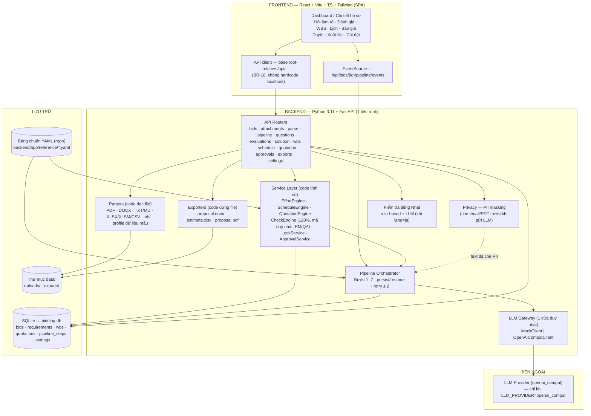
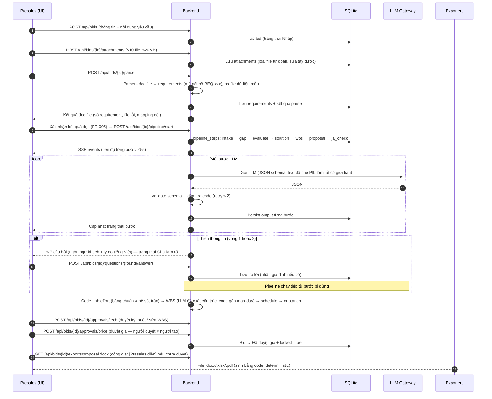
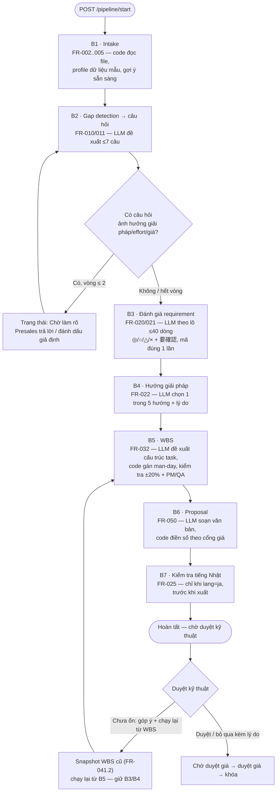

# Kiến trúc MVP — Presales Bidding Assistant

| Thuộc tính | Giá trị |
|---|---|
| Tên tài liệu | Kiến trúc hệ thống MVP (Solution Architecture) |
| Phiên bản | 1.0 |
| Ngày | 2026-10-09 |
| Trạng thái | Đề xuất — chờ review (PM + coordinator reconcile) |
| Nguồn | `docs/03_requirements/srs.md` (v1.1), `docs/03_requirements/handoff_to_design.md`, `AGENTS.md` |
| Sản phẩm đi kèm | `llm_pipeline.md`, `data_model.md`, `api_contract.md` |

---

## 1. Tổng quan kiến trúc

MVP là **monolith 2 tầng** (SPA + API) chạy trong một tiến trình, theo đúng BR-09/NFR-008: không vector DB, không hàng đợi, không auth server. Pipeline AI chạy **trong tiến trình** (asyncio task) với tiến độ persist vào DB và đẩy realtime qua **SSE** (ADR-002). Mọi con số (effort, schedule, giá) do **code** tính từ **bảng chuẩn YAML** (ADR-003); LLM chỉ phân loại và soạn văn bản (BR-01).



### Nguyên tắc phân lớp

1. **Router (HTTP)** → chỉ nhận request, gọi service, trả response theo `api_contract.md`. Không chứa logic nghiệp vụ.
2. **Service layer (code)** → mọi phép tính số, kiểm tra, chuyển trạng thái, khóa hồ sơ. Được unit test trực tiếp.
3. **Pipeline orchestrator** → điều phối các bước LLM, gọi gateway, persist từng bước, emit SSE.
4. **LLM Gateway** → duy nhất một cửa gọi LLM (BR-03); mọi module khác không được gọi LLM trực tiếp.
5. **Parsers/Exporters** → code thuần, deterministic, không gọi LLM (FR-052).

---

## 2. Components chi tiết

### 2.1 Backend (Python 3.11 + FastAPI)

| Component | Trách nhiệm | FR/BR liên quan |
|---|---|---|
| `api/routers/*` | Endpoint HTTP theo contract đóng băng | toàn bộ |
| `core/config.py` | Đọc env vars (không hardcode secret) | NFR-005 |
| `core/db.py` | SQLAlchemy engine/session (SQLite) | — |
| `models/*` | ORM theo `data_model.md` | — |
| `schemas/*` | Pydantic: schema API + schema output LLM | BR-02 |
| `services/effort_engine.py` | Effort = bảng chuẩn × hệ số (có trần), dải min–max, midpoint | FR-030, FR-031 |
| `services/wbs_engine.py` | Gán man-day lá từ trọng số + midpoint bảng chuẩn (≤ 10), dựng cây 3 cấp, tổng theo phase | FR-032, BR-01 |
| `services/wbs_service.py` | CRUD WBS (thêm/sửa/xóa, xóa sub-tree), override ±20% bắt buộc ghi chú, tính lại tổng/lịch, changelog | FR-041, BR-12 |
| `services/schedule_engine.py` | Master schedule từ WBS × số người, ngày bắt đầu, buffer, nghỉ lễ VN/Nhật, mốc thanh toán, cảnh báo vượt hạn nộp; trả tasks[] cho Gantt | FR-034 |
| `services/quotation_engine.py` | Báo giá từ rate card, overhead, tỉ giá, dự phòng, 見積書 (税抜/税込, làm tròn, 内訳) | FR-040 |
| `services/check_engine.py` | Kiểm tra bằng code: mã requirement đúng một lần, ±20% midpoint, đủ PM/QA mỗi phase, phụ thuộc không vòng, lá man-day ≤ 10, schema | FR-021, FR-032, FR-044, BR-02/12/13 |
| `services/lock_service.py` | Khóa hồ sơ sau duyệt giá; mở khóa phải ghi lý do | FR-042.4, BR-11 |
| `services/approval_service.py` | Cổng duyệt kỹ thuật/giá, chặn tự duyệt, từ chối kèm lý do, kiểm tra trước duyệt | FR-041, FR-042, FR-044 |
| `services/settings_service.py` | Đọc/ghi bảng chuẩn (DB override repo), validate toàn vẹn, snapshot | FR-060, FR-061 |
| `pipeline/orchestrator.py` | Điều phối 7 bước, persist/resume, SSE | FR-023, FR-041.2 |
| `llm/gateway.py` | Protocol `LLMClient` + `MockLLMClient` + `OpenAICompatClient` | BR-03 |
| `llm/prompts/*` | Prompt từng bước, glossary tiếng Nhật | FR-025, NFR-004 |
| `parsers/*` | Đọc PDF/DOCX/TXT/MD/XLSX/XLSM/CSV/.xls, đọc nhiều sheet, sinh mã nội bộ, profile dữ liệu mẫu | FR-002, FR-003, FR-004 |
| `privacy/mask.py` | Che email/SĐT (VN +84/0xx, JP 0X-XXXX-XXXX/+81) | NFR-002, BR-06 |
| `exporters/*` | Sinh .docx/.xlsx/.pdf bằng code, template trung tính | FR-050, FR-051, FR-052 |
| `services/ja_check.py` | Kiểm tra tiếng Nhật trước xuất | FR-025 |
| `reference/*.yaml` | Bảng chuẩn mặc định (repo): effort, factors, rate_card, **holidays (nghỉ lễ VN/Nhật)**, **payment (mốc thanh toán)**, company, glossary_ja, rounding | FR-060, FR-034 |

### 2.2 Frontend (React 18 + Vite + TypeScript + Tailwind)

| Component | Trách nhiệm |
|---|---|
| `pages/Dashboard` | Danh sách hồ sơ, lọc theo trạng thái, tìm kiếm (FR-007) |
| `pages/BidNew` | Tạo hồ sơ, dán nội dung yêu cầu, upload file, nạp hồ sơ mẫu (FR-001, 002, 006) |
| `pages/BidDetail` | Xác nhận kết quả đọc file, mapping cột, mức sẵn sàng dữ liệu (FR-003, 004, 005) |
| `pages/Clarify` | Hiển thị/trả lời câu hỏi làm rõ, đánh dấu giả định (FR-010, 011) |
| `pages/PipelineProgress` | Tiến độ realtime qua SSE, trạng thái từng bước, lỗi/retry (FR-023) |
| `pages/Evaluation` | Bảng đáp ứng ◎/○/△/× + 要確認, cảnh báo mã thiếu/thừa (FR-020, 021) |
| `pages/SolutionReview` | Hướng giải pháp + lý do, đổi hướng (FR-022) |
| `pages/WBS` | Xem/sửa WBS, snapshot trước/sau, dấu vết ±20% (FR-032, 041) |
| `pages/Schedule` | Master schedule, số người/vai trò, buffer, mốc thanh toán, cảnh báo hạn nộp (FR-034) |
| `pages/Quotation` | Báo giá, ngân sách khách, dự phòng, mô hình hợp đồng (FR-040, 042) |
| `pages/Approvals` | Duyệt kỹ thuật, duyệt giá, chặn tự duyệt, lý do từ chối (FR-041, 042, 044) |
| `pages/Export` | Kiểm tra tiếng Nhật, xuất proposal/estimate/PDF (FR-025, 050–052) |
| `pages/Settings` | Sửa bảng chuẩn YAML có validate (FR-060, 061) |
| `api/client.ts` | Fetch wrapper — base root-relative `/api` (BR-10) |
| `api/events.ts` | EventSource wrapper cho SSE |

### 2.3 Lưu trữ

- **SQLite** (file `data/bidding.db`, cấu hình qua `DATABASE_URL`): dữ liệu nghiệp vụ + trạng thái pipeline + settings override (ADR-001).
- **Thư mục `data/uploads/`**: file đính kèm gốc; **`data/exports/`**: file xuất.
- **Repo `backend/app/reference/*.yaml`**: bảng chuẩn mặc định (nguồn gốc, có version theo git). Bản sửa trên web lưu ở DB `settings`, **override** bản repo (ADR-003).

---

## 3. Data flow

### 3.1 Luồng tổng thể (end-to-end)



### 3.2 Luồng pipeline AI (7 bước)



---

## 4. Tech stack và lý do chọn

**Stack mặc định (theo chỉ định): Python 3.11 + FastAPI, React + Vite + TypeScript + Tailwind, SQLite. Không đổi — lý do giữ nguyên bên dưới.**

| Lớp | Công nghệ | Phiên bản | Lý do chọn |
|---|---|---|---|
| Backend runtime | Python | 3.11 | Hệ sinh thái xử lý file/Excel/tài liệu mạnh (openpyxl, python-docx, pdfplumber); typing + Pydantic phù hợp validate JSON LLM |
| Web framework | FastAPI + uvicorn | 0.1xx | Async (chạy pipeline song song với SSE), OpenAPI tự sinh, Pydantic v2 tích hợp sẵn — dùng lại cho schema LLM |
| ORM | SQLAlchemy | 2.0 | Mapping rõ ràng sang SQLite, dễ nâng cấp lên Postgres sau MVP nếu cần (không phải thiết kế lại) |
| Schema/validation | Pydantic | v2 | Một bộ schema dùng cho cả API lẫn output LLM (BR-02) |
| LLM gateway | httpx (gọi endpoint `/chat/completions` tương thích openai) | — | Tránh dependency SDK nặng; `openai_compat` = POST JSON tới `LLM_BASE_URL`; `mock` trả fixture theo schema (BR-03) |
| Đọc file | pdfplumber (PDF), python-docx (DOCX), openpyxl (XLSX/XLSM), csv (stdlib), xlrd (`.xls`), unicodedata (chuẩn hóa) | — | Code đọc file theo FR-003; `.xls` đọc trực tiếp bằng xlrd, không cần dịch vụ ngoài |
| Xuất file | python-docx (.docx), openpyxl (.xlsx — giữ công thức SUM), LibreOffice headless (docx→pdf) | — | FR-050/051/052: xuất bằng code, deterministic, tổng là công thức Excel |
| Frontend | React + Vite + TypeScript + Tailwind | React 18 | Stack mặc định; Vite dev server + proxy `/api` → backend (hợp BR-10); TS đảm bảo type khớp contract |
| Server state FE | TanStack Query | v5 | Cache/refetch đơn giản, phối hợp tốt với SSE cập nhật |
| Realtime | SSE (EventSource) | — | Một chiều server→client, đủ cho tiến độ ≤5s (FR-023), không cần WebSocket (ADR-002) |
| Test backend | pytest + pytest-asyncio + httpx TestClient | — | Unit test mọi phép tính (NFR-006); CI dùng `LLM_PROVIDER=mock` (BR-03) |
| Test frontend | Vitest + React Testing Library + Playwright | — | Smoke test Preview theo BR-08 |
| Lưu trữ | SQLite | 3.x | Đơn người dùng nội bộ, không cần server DB; BR-09 (ADR-001) |

**Lý do KHÔNG đổi stack mặc định:** mọi yêu cầu MVP đều thỏa được bằng stack này; đổi sẽ vi phạm BR-09 (giữ đơn giản) mà không mang lại lợi ích MVP. Điểm lưu ý duy nhất: nếu sau này nhiều người dùng đồng thời, nâng SQLite → Postgres qua SQLAlchemy mà không đổi code nghiệp vụ.

---

## 5. Cấu hình qua env vars

> Chỉ liệt kê **tên biến và mục đích** — KHÔNG bao giờ ghi giá trị secret vào repo/log (NFR-005, BR-06). API key do người dùng đặt qua Cài đặt dự án / `.env.preview` của VibeFlow. Backend tự đọc thêm file `.env` (python-dotenv) — env vars thật ưu tiên hơn giá trị trong file.

| Biến | Bắt buộc | Mặc định | Mục đích |
|---|---|---|---|
| `LLM_PROVIDER` | ✅ | `mock` | `mock` (test/CI/demo offline) hoặc `openai_compat` (gọi LLM thật) — BR-03 |
| `LLM_BASE_URL` | khi `openai_compat` | — | Base URL endpoint tương thích OpenAI Chat Completions |
| `LLM_API_KEY` | khi `openai_compat` | — | Khóa API — chỉ đặt qua env, không commit |
| `LLM_MODEL` | khi `openai_compat` | — | Tên model dùng cho mọi lời gọi |
| `DATABASE_URL` | — | `sqlite:///./data/bidding.db` | Chuỗi kết nối DB (SQLite trong MVP) |
| `DATA_DIR` | — | `./data` | Thư mục chứa `uploads/` và `exports/` |
| `APP_ENV` | — | `development` | `development` / `test` / `production` (đổi log level, CORS) |
| `MAX_UPLOAD_MB` | — | `20` | Giới hạn file đính kèm (FR-002.2) |
| `MAX_ATTACHMENTS` | — | `10` | Giới hạn số file đính kèm (FR-002.2) |
| `MAX_QUESTIONS_PER_ROUND` | — | `7` | Trần câu hỏi mỗi vòng (FR-010.1) |
| `MAX_CLARIFY_ROUNDS` | — | `2` | Trần số vòng hỏi (FR-010.4) |
| `LLM_MAX_RETRIES` | — | `2` | Số lần retry tối đa mỗi kiểm tra (BR-02) |
| `LLM_VERIFY_SSL` | — | `true` | Kiểm tra chứng chỉ TLS khi gọi provider; `false` cho endpoint nội bộ self-signed |
| `LLM_CA_BUNDLE` | — | _(trống)_ | Đường dẫn CA bundle tùy chỉnh — verify bằng CA nội bộ thay vì tắt hẳn |
| `EVAL_BATCH_SIZE` | — | `40` | Số requirement tối đa mỗi lô gọi LLM (FR-020) |
| `PIPELINE_STEP_TIMEOUT_S` | — | `300` | Timeout một bước pipeline (resume theo FR-023) |
| `EXPORT_TMP_DIR` | — | `./data/tmp` | Thư mục tạm khi chuyển docx→pdf |
| `LOG_LEVEL` | — | `INFO` | Mức log; cấm in API key |

---

## 6. Cách chạy và test

> Chi tiết lệnh vận hành Preview theo skill `app-preview` của VibeFlow (podman-compose). Dưới đây là lệnh chuẩn cho nhà phát triển.

### 6.1 Backend

```bash
# 1. Môi trường
python3.11 -m venv .venv && source .venv/bin/activate
pip install -r backend/requirements.txt

# 2. Chạy (mặc định dùng mock LLM — không cần key)
cd backend
uvicorn app.main:app --reload --port 8000

# 3. Chạy với LLM thật (chỉ dev; CI/test LUÔN dùng mock)
export LLM_PROVIDER=openai_compat
export LLM_BASE_URL=https://...   # do người dùng đặt qua env dự án
export LLM_API_KEY=...            # do người dùng đặt qua env dự án
export LLM_MODEL=...
uvicorn app.main:app --port 8000
```

### 6.2 Frontend

```bash
cd frontend
npm install
npm run dev        # Vite dev server, proxy /api → http://127.0.0.1:8000 (chỉ trong vite.config, không hardcode trong code FE)
npm run build      # build production
```

### 6.3 Test

```bash
# Backend — unit test mọi phép tính + pipeline với mock LLM (BR-03)
cd backend && pytest -q                      # LLM_PROVIDER=mock mặc định trong test
pytest tests/test_effort.py tests/test_schedule.py tests/test_quotation.py
pytest tests/test_pii_mask.py                # bộ test PII ≥ 50 mẫu (NFR-002)
pytest tests/test_ja_check.py                # bộ mẫu tiếng Nhật (FR-025)
pytest tests/test_pipeline_*.py              # retry ≤2, mã duy nhất, ±20%

# Frontend
cd frontend && npm run test                  # Vitest
npm run lint && npm run build                # type-check + build

# E2E smoke (Preview) — theo skill app-preview
# "Done" = test pass + chạy được trong Preview (BR-08)
```

---

## 7. Cấu trúc thư mục đề xuất

```
backend/
  app/
    main.py
    api/routers/            # bids, attachments, parse, pipeline, questions, evaluations,
                            # solution, wbs, schedule, quotation, approvals, exports, settings
    core/                   # config.py (env), db.py, logging.py
    models/                 # SQLAlchemy models (theo data_model.md)
    schemas/                # Pydantic: api_schemas/, llm_schemas/
    services/               # effort_engine, schedule_engine, quotation_engine, check_engine,
                            # lock_service, approval_service, settings_service, ja_check
    pipeline/               # orchestrator.py, steps/b1_intake.py .. b7_ja_check.py, sse.py
    llm/                    # gateway.py, mock_client.py, openai_compat_client.py,
                            # prompts/*.py, glossary_ja.yaml
    parsers/                # pdf.py, docx.py, text.py, excel.py, xls.py, sample_profile.py, detect.py
    privacy/                # mask.py
    exporters/              # proposal_docx.py, estimate_xlsx.py, pdf.py
    reference/              # effort.yaml, factors.yaml, rate_card.yaml, holidays.yaml,
                            # company.yaml, glossary_ja.yaml, rounding.yaml, payment.yaml
  tests/                    # test_*.py (không gọi LLM thật)
frontend/
  src/
    api/                    # client.ts (root-relative /api), events.ts, types/
    pages/                  # theo mục 2.2
    components/
    hooks/
  vite.config.ts            # proxy /api → backend (dev)
templates/                  # proposal template trung tính (logo placeholder)
sample_data/                # hồ sơ mẫu giả lập (FR-006) — ghi rõ "giả lập"
data/                       # runtime: bidding.db, uploads/, exports/ (gitignore)
```

---

## 8. ADRs — Architecture Decision Records

### ADR-001: SQLite cho tầng dữ liệu MVP

**Status:** Accepted

**Context:** Ứng dụng nội bộ, đơn/đa người dùng nhẹ, không có yêu cầu đồng thời cao. BR-09/NFR-008 cấm hạ tầng nặng. SRS không yêu cầu multi-tenant hay HA.

**Decision:** Dùng SQLite qua SQLAlchemy 2.0. Mọi truy cập qua service layer; không dùng raw SQL rải rác.

**Consequences:**
- *Positive:* zero-ops, một file DB, dễ backup/demo; SQLAlchemy cho phép nâng Postgres sau MVP không đổi code nghiệp vụ.
- *Negative:* ghi đồng thời bị khóa toàn file — chấp nhận được vì MVP ít người dùng; không hỗ trợ connection pool mạnh.
- *Risks:* nếu roadmap mở rộng nhiều người dùng → migration Postgres (đã được che chắn bởi ORM).

### ADR-002: SSE cho tiến độ realtime (FR-023)

**Status:** Accepted

**Context:** Yêu cầu cập nhật trạng thái bước ≤ 5 giây, một chiều server→client. Không cần client→server realtime.

**Decision:** Dùng **Server-Sent Events** (`GET /api/bids/{id}/pipeline/events`), không dùng WebSocket, không dùng polling.

**Consequences:**
- *Positive:* EventSource có sẵn trong trình duyệt; chạy trên HTTP thường (proxy Preview không cần cấu hình upgrade); tự reconnect; tiết kiệm so với polling.
- *Negative:* một chiều (đủ dùng); giới hạn kết nối đồng thời của trình duyệt (~6/domain) — chấp nhận vì mỗi hồ sơ tối đa 1 luồng tiến độ.
- *Risks:* nếu sau này cần chat/đồng bộ 2 chiều → cân nhắc WebSocket; MVP không cần.

### ADR-003: Bảng chuẩn YAML trong repo + override ở DB

**Status:** Accepted

**Context:** FR-060 yêu cầu bảng chuẩn là "file YAML trong repo" nhưng sửa được trên trang Cài đặt; FR-061/BR-11 yêu cầu hồ sơ đã duyệt giá bất biến khi bảng chuẩn đổi.

**Decision:** Bảng chuẩn mặc định nằm ở `backend/app/reference/*.yaml` (version theo git). Trang Cài đặt ghi bản sửa vào bảng `settings` (DB) — **override** bản repo. Tại thời điểm tính toán, service lấy **effective YAML** (repo + override) và **snapshot** vào bảng `reference_snapshots` gắn với hồ sơ → mọi con số truy được về đúng bảng chuẩn tại thời điểm tính (FR-033, FR-061).

**Consequences:**
- *Positive:* repo là nguồn mặc định an toàn; sửa web không cần deploy; snapshot đảm bảo bất biến hồ sơ đã duyệt; rollback bằng cách chọn version cũ trong DB.
- *Negative:* hai nguồn sự thật (repo + DB) — phải có luật rõ "DB override repo"; validate toàn vẹn (FR-060.2) chạy cả 2 phía.
- *Risks:* nhầm lẫn khi ai đó sửa file repo trực tiếp → log + hiển thị nguồn đang dùng trên trang Cài đặt.

### ADR-004: Một LLM gateway duy nhất với mock

**Status:** Accepted

**Context:** BR-03/NFR-005: mọi lời gọi LLM qua một client interface; unit test/CI không bao giờ gọi LLM thật; config qua env vars.

**Decision:** Định nghĩa protocol `LLMClient` với `complete(schema, prompt, context) -> JSON`. Hai implementation: `MockLLMClient` (trả fixture theo schema, dùng cho test/CI/demo) và `OpenAICompatClient` (httpx POST tới `LLM_BASE_URL`). Mọi module gọi qua `get_llm_client()` duy nhất; không module nào import thư viện LLM trực tiếp.

**Consequences:**
- *Positive:* test nhanh, deterministic, không tốn chi phí; đổi provider chỉ sửa một file; mock tái hiện được lỗi schema/thiếu mã để test retry.
- *Negative:* mock phải bảo trì song song schema thật; không cover được hành vi "lạ" của model thật.
- *Risks:* mock quá "ngoan" → sót lỗi thật; giảm bằng bộ fixture đa dạng + smoke test Preview với `openai_compat` ở milestone cuối.

### ADR-005: Snapshot WBS dạng JSON trong DB

**Status:** Accepted

**Context:** FR-041.2: trước khi chạy lại từ bước WBS phải lưu snapshot WBS hiện tại để so sánh trước/sau.

**Decision:** Bảng `wbs_snapshots` lưu toàn bộ WBS dạng JSON (`wbs_json`) + metadata (lý do, người tạo, thời điểm) + `diff_summary` (danh sách task thêm/sửa/xóa so với bản mới nhất). Không lưu file, không dùng git cho việc này.

**Consequences:**
- *Positive:* đơn giản, đọc/so sánh nhanh bằng code; hiển thị diff ở mức task (thêm/sửa/xóa, đổi man-day, đổi cha/phụ thuộc).
- *Negative:* JSON không query được chi tiết — chấp nhận vì snapshot chỉ để so sánh/hiển thị.
- *Risks:* kích thước lớn nếu WBS khổng lồ — giới hạn MVP không đáng ngại.

### ADR-006: WBS 3 cấp + phụ thuộc + master schedule sửa được

**Status:** Accepted

**Context:** Yêu cầu milestone M4: AI sinh **WBS 3 cấp (nhóm / task / sub-task)** theo giai đoạn, task lá có loại công việc và man-day ≤ 10; code kiểm tra tổng khớp effort ±20%, mỗi giai đoạn có PM/QA, phụ thuộc không vòng; lịch tính bằng code từ số người mỗi loại, ngày bắt đầu, ngày nghỉ, buffer, có mốc thanh toán; giao diện bảng WBS sửa được + Gantt, sửa xong tự tính lại không gọi AI. Contract FROZEN §8.1–8.4 hiện mô hình WBS **phẳng** (một cấp) và không có endpoint cập nhật tham số lịch.

**Decision:**
1. `wbs_items` chuyển sang **3 cấp**: thêm `parent_code` (độ sâu ≤ 3) và `depends_on` (danh sách phụ thuộc, kiểm tra không vòng bằng DFS); `role`/`weight`/`man_day` chỉ trên **task lá**, lá `man_day ≤ 10`; nhóm/task cha có man_day = tổng con (code tính).
2. LLM (B5) chỉ đề xuất cấu trúc + trọng số; **code gán man-day** lá từ midpoint bảng chuẩn theo phase (BR-01). Kiểm tra ±20%, PM/QA, vòng, lá > 10 → retry ≤ 2 → cảnh báo.
3. Bổ sung `PUT /api/bids/{id}/schedule` (tham số: số người/vai trò, ngày bắt đầu, buffer, lịch nghỉ, mốc thanh toán) → `ScheduleEngine` tính lại ngay, không gọi AI; `GET /schedule` trả `tasks[]` (ngày từng task — dữ liệu Gantt), `by_role`, `holidays_applied`.
4. Mô hình lịch MVP (giữ đơn giản — BR-09): phase tuần tự `poc → mvp → production`; trong phase task tuần tự theo thứ tự topo của `depends_on`; thời lượng task = `ceil(man_day ÷ headcount[role])` ngày làm việc (trừ T7/CN + nghỉ lễ từ `holidays.yaml`); `end_date` sau buffer; cảnh báo vượt hạn nộp.

**Consequences:**
- *Positive:* WBS phản ánh đúng cấu trúc công việc thực tế (gom nhóm theo giai đoạn); Gantt có dữ liệu ngày từng task do code tính (deterministic, test được); sửa WBS/số người → tổng + lịch tính lại không tốn LLM.
- *Negative:* contract FROZEN phải mở rộng (đã ghi chú thay đổi trong `api_contract.md`); mô hình lịch tuần tự chưa tận dụng song song thực tế (chấp nhận cho MVP — critical path là nâng cấp sau).
- *Risks:* LLM sinh cấu trúc quá nông (ít lá → lá > 10 md) hoặc vòng phụ thuộc → retry ≤ 2 → cảnh báo + người sửa tay; nghỉ lễ thiếu/đổi năm → `holidays.yaml` cấu hình được (FR-060 ở M8).

---

## 9. Mapping AGENTS.md rules → design elements

| Rule AGENTS.md | Phần tử thiết kế thực thi |
|---|---|
| **1. No invented numbers** | `EffortEngine`/`WbsEngine`/`ScheduleEngine`/`QuotationEngine` là code thuần đọc `reference/*.yaml`; schema output LLM **không chứa** trường man-day/giá/ngày (assert trong unit test); WBS 3 cấp: LLM chỉ đề xuất cấu trúc + trọng số, **code gán man-day** lá (≤ 10) từ midpoint bảng chuẩn (xem `llm_pipeline.md` B5); cổng giá `[Presales điền]` khi chưa duyệt |
| **2. Structured LLM output** | Mọi bước LLM khai báo Pydantic schema (`schemas/llm_schemas/`); orchestrator validate + retry ≤ 2 (BR-02); lỗi schema → fail rõ; lỗi ngữ nghĩa → cảnh báo |
| **3. One LLM gateway** | `llm/gateway.py` (protocol + Mock + OpenAICompat); config env `LLM_PROVIDER/LLM_BASE_URL/LLM_API_KEY/LLM_MODEL`; test/CI ép `LLM_PROVIDER=mock`; scan repo không có key |
| **4. Ask instead of guess** | Pipeline B2: gap detection → ≤7 câu/vòng, ≤2 vòng (biến `MAX_QUESTIONS_PER_ROUND`, `MAX_CLARIFY_ROUNDS`); trạng thái "Chờ làm rõ" chặn mọi phép tính số; trả lời giả định có nhãn |
| **5. Price gate** | `ApprovalService` + cổng giá trong `exporters/proposal_docx.py`: chưa duyệt → placeholder `[Presales điền]`; unit test render không chứa số tiền |
| **6. Privacy** | `privacy/mask.py` che email/SĐT trước khi vào prompt (test ≥ 50 mẫu PII, ≥ 99%); env vars không commit; `sample_data/` ghi rõ "giả lập" |
| **7. Languages** | `bid.customer_language` (vi/en/ja) điều khiển ngôn ngữ tài liệu gửi khách (câu hỏi, proposal); UI + lý do phân tích tiếng Việt; glossary tiếng Nhật trong prompt + `ja_check` |
| **8. Done means proven** | Quality gate: `pytest` + `vitest` + smoke test Preview (skill app-preview) trước khi đóng milestone; CI chạy test với mock LLM |
| **9. Keep it simple** | Monolith 2 tầng, SQLite, pipeline trong tiến trình (asyncio), SSE thay WebSocket, không queue/vector DB/auth server (ADR-001, ADR-002) |
| **10. Frontend networking** | `frontend/src/api/client.ts` dùng base root-relative `/api`; `vite.config.ts` proxy `/api` → backend chỉ ở dev; grep CI cấm `http://localhost` trong base URL (BR-10) |

---

## 10. Quyết định cho các câu hỏi mở (handoff §4)

| # | Câu hỏi | Quyết định kiến trúc |
|---|---|---|
| 1 | Lưu trữ bảng chuẩn | Repo YAML = mặc định; DB `settings` = override; snapshot tại thời điểm tính (ADR-003) |
| 2 | Persist pipeline | Bảng `pipeline_steps` lưu trạng thái + `output_json` từng bước; resume từ bước lỗi (chi tiết `llm_pipeline.md` §9) |
| 3 | Snapshot WBS | JSON trong `wbs_snapshots` + diff task-level (ADR-005) |
| 4 | Khóa hồ sơ | `bids.locked` + `lock_reason`; enforce ở service layer (409 STATE_CONFLICT); mở khóa bởi manager, ghi lý do + changelog |
| 5 | Real-time | SSE (ADR-002) |
| 6 | Kiểm tra tiếng Nhật | Rule-based (phát hiện Latin, glossary, chính tả tên) + 1 lượt LLM đánh giá ngữ cảnh; cảnh báo không chặn xuất (FR-025) |
| 7 | Excel công thức / PDF kanji | openpyxl giữ công thức `=SUM(...)`; docx→pdf bằng LibreOffice headless + font Noto Sans CJK (bundle trong image preview) |
| 8 | Tiền tệ hiển thị | Web nội bộ hiển thị theo tiền tệ mặc định của hồ sơ (ja→JPY, vi→VND, en→USD), cấu hình được ở cấp hồ sơ; tỉ giá có ngày hiệu lực trong rate card |
| 9 | Trần hệ số | Mặc định `factor_cap: 2.0` (cấu hình trong `factors.yaml`) — số giả lập hợp lý, sửa được |
| 10 | Overhead PM/BrSE | Overhead áp trên **phần chi phí offshore** (tham số `apply_on: offshore|all` trong rate card, mặc định offshore); BrSE 15% tự bật khi khách Nhật (FR-040) |

---

## 11. Điểm cần coordinator reconcile với PM

1. **Endpoint ↔ milestone:** mỗi milestone cần một nhóm endpoint cụ thể — xem bảng "Ánh xạ milestone → endpoint" ở cuối `api_contract.md`. Coordinator nên chốt thứ tự triển khai theo nhóm endpoint, không theo trang UI.
2. **Bảng chuẩn giả lập (R4, R5):** cần bộ số giả lập sát mặt bằng thị trường (effort min–max, rate card, tỉ giá, trần hệ số, overhead) **trước milestone 3** — BA/PM phê duyệt số; kiến trúc chỉ định vị trí file YAML, không tự đặt số.
3. **Bộ test PII + bộ mẫu tiếng Nhật:** cần xây sớm (milestone 1–2) — đã có chỗ trong `tests/`; PM cần giao người tạo dữ liệu mẫu.
4. **LibreOffice headless trong Preview:** docx→pdf cần cài `libreoffice` + font Noto CJK trong image podman-compose — cần PM/DevOps xác nhận sớm để không tắc milestone 5.
5. **`.xls` (FR-002.1):** dùng xlrd đọc trực tiếp; nếu file lỗi → báo "vui lòng lưu lại dưới dạng .xlsx" — cần PM xác nhận ngưỡng chấp nhận.
6. **Chặn tự duyệt (FR-042.2) với vai trò chọn tay:** MVP dùng header `X-Role` (giả lập) — PM cần xác nhận luồng demo: người demo phải đổi vai trò khi duyệt.
7. **Snapshot bảng chuẩn khi duyệt giá:** quyết định ADR-003 làm hồ sơ đã duyệt bất biến — PM nên đưa vào tiêu chí chấp nhận milestone 4 (test "đổi bảng chuẩn → hồ sơ đã duyệt không đổi").