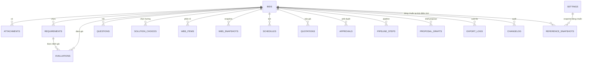
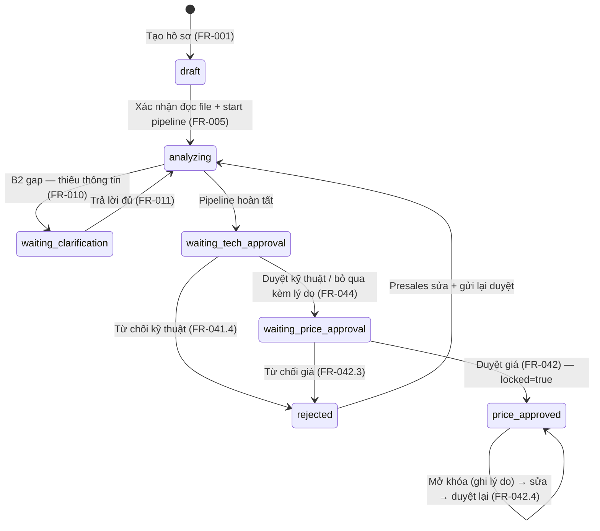

# Mô hình dữ liệu — Presales Bidding Assistant

| Thuộc tính | Giá trị |
|---|---|
| Tên tài liệu | Mô hình dữ liệu MVP (SQLite / SQLAlchemy 2.0) |
| Phiên bản | 1.0 |
| Ngày | 2026-10-09 |
| Trạng thái | Đề xuất — chờ review |
| Nguồn | `srs.md` §10 (mô hình khái niệm), `llm_pipeline.md`, `api_contract.md` |

---

## 0. Quy ước chung

- **DB:** SQLite (file `data/bidding.db`). Kiểu dùng chung: `INTEGER` (id, số), `TEXT` (chuỗi, enum lưu dạng TEXT + CHECK), `REAL` (số thập phân — man-day, giá), `BOOLEAN` (0/1), `DATE` (yyyy-mm-dd), `DATETIME` (ISO 8601), `JSON` (SQLite JSON1 — lưu object/list).
- **Enum** khai báo ở tầng Python (Pydantic/SQLAlchemy Enum), lưu TEXT để dễ đọc DB.
- **Timestamps:** mọi bảng có `created_at`; bảng có sửa đổi thêm `updated_at`.
- **Audit:** mọi thay đổi quan trọng ghi vào `changelog` (NFR-009) — không dùng trigger DB, ghi từ service layer.
- **Khóa ngoại:** `ON DELETE CASCADE` cho dữ liệu con của bid (attachment, requirement, ...); `ON DELETE RESTRICT` cho reference snapshots.

---

## 1. Sơ đồ quan hệ (ER)

---

## 2. Bảng `bids` — Hồ sơ dự thầu

| Field | Kiểu | Ràng buộc | Ghi chú / FR |
|---|---|---|---|
| `id` | INTEGER | PK, autoincrement | |
| `project_name` | TEXT | NOT NULL | Tên dự án (FR-001) |
| `customer_name` | TEXT | NOT NULL | Khách hàng (FR-001) |
| `submission_deadline` | DATE | NOT NULL | Hạn nộp — so sánh với master schedule (FR-034) |
| `customer_language` | TEXT | NOT NULL, CHECK IN ('vi','en','ja') | Ngôn ngữ khách — điều khiển tài liệu gửi khách (FR-001.2) |
| `request_content` | TEXT | NOT NULL | Nội dung yêu cầu (dán email/văn bản) — bắt buộc (FR-001.1) |
| `budget_amount` | REAL | NULL | Ngân sách khách (tùy chọn) (FR-042.1) |
| `budget_currency` | TEXT | NULL, CHECK IN ('VND','JPY','USD') | Tiền tệ ngân sách |
| `status` | TEXT | NOT NULL, CHECK IN ('draft','waiting_clarification','analyzing','waiting_tech_approval','waiting_price_approval','price_approved','rejected') | Máy trạng thái (NFR-009) — xem §11 |
| `locked` | BOOLEAN | NOT NULL DEFAULT 0 | Khóa sau duyệt giá (FR-042.4) |
| `lock_reason` | TEXT | NULL | Lý do khóa/mở khóa (ghi log) |
| `no_requirement_file` | BOOLEAN | NOT NULL DEFAULT 0 | Khách không gửi Excel requirement (FR-003.3) |
| `data_readiness` | TEXT | NULL, CHECK IN ('low','medium','high') | Mức sẵn sàng dữ liệu — gợi ý + chỉnh tay (FR-004) |
| `display_currency` | TEXT | NOT NULL DEFAULT 'VND', CHECK IN ('VND','JPY','USD') | Tiền tệ hiển thị web (quyết định câu hỏi mở #8) |
| `created_by` | TEXT | NOT NULL | Người tạo (tên/role giả lập) — dùng chặn tự duyệt (FR-042.2) |
| `created_at` | DATETIME | NOT NULL | Ngày tạo (FR-001) |
| `updated_at` | DATETIME | NOT NULL | |

**Quan hệ:** 1—N với mọi bảng con. **FR:** FR-001, FR-003.3, FR-004, FR-005, FR-007, FR-034, FR-042.

---

## 3. Bảng `attachments` — File đính kèm

| Field | Kiểu | Ràng buộc | Ghi chú / FR |
|---|---|---|---|
| `id` | INTEGER | PK | |
| `bid_id` | INTEGER | FK → bids.id, NOT NULL, CASCADE | |
| `filename` | TEXT | NOT NULL | Tên gốc |
| `stored_path` | TEXT | NOT NULL | Đường dẫn trong `data/uploads/` |
| `size_bytes` | INTEGER | NOT NULL | ≤ 20 MB (FR-002.2) |
| `file_type` | TEXT | NOT NULL, CHECK IN ('rfp','requirement','sample_data') | Loại — tự đoán, sửa tay được (FR-002.3) |
| `detected_type` | TEXT | NULL | Loại hệ thống đoán (để so sánh) |
| `mime_type` | TEXT | NULL | |
| `parse_status` | TEXT | NOT NULL DEFAULT 'pending', CHECK IN ('pending','ok','error') | Trạng thái đọc file (FR-005) |
| `parse_error` | TEXT | NULL | Lỗi parse cụ thể (FR-003.4) |
| `sheet_mappings` | JSON | NULL | Mapping cột/sheet từng sheet: `[{sheet_name, sheet_kind, col_map:{code,content,priority,category}}]` (FR-003.2/.6) |
| `uploaded_at` | DATETIME | NOT NULL | |

**Ràng buộc:** mỗi bid ≤ 10 attachments (kiểm tra service — FR-002.2). **FR:** FR-002, FR-003, FR-005.

---

## 4. Bảng `requirements` — Requirement (mã nội bộ)

| Field | Kiểu | Ràng buộc | Ghi chú / FR |
|---|---|---|---|
| `id` | INTEGER | PK | |
| `bid_id` | INTEGER | FK → bids.id, NOT NULL, CASCADE | |
| `attachment_id` | INTEGER | FK → attachments.id, NULL | Nguồn file (có thể NULL khi nhập tay) |
| `internal_code` | TEXT | NOT NULL | Mã nội bộ `REQ-001...` — code sinh, duy nhất toàn file (FR-003.6) |
| `sheet_name` | TEXT | NULL | Sheet gốc |
| `original_row` | INTEGER | NULL | Dòng gốc trong file |
| `content` | TEXT | NOT NULL | Nội dung requirement |
| `priority` | TEXT | NOT NULL DEFAULT 'unknown', CHECK IN ('mandatory','optional','unknown') | ưu tiên — mapping 区分 (必須/任意) xác nhận tay (FR-003.6) |
| `category` | TEXT | NULL | Phân loại (大分類/中分類) |
| `source_cols` | JSON | NULL | Bản đồ cột gốc (truy vết) |
| `created_at` | DATETIME | NOT NULL | |

**Ràng buộc:** UNIQUE(`bid_id`, `internal_code`). **FR:** FR-003, FR-020, FR-021.

---

## 5. Bảng `evaluations` — Đánh giá requirement

| Field | Kiểu | Ràng buộc | Ghi chú / FR |
|---|---|---|---|
| `id` | INTEGER | PK | |
| `bid_id` | INTEGER | FK → bids.id, NOT NULL, CASCADE | |
| `requirement_id` | INTEGER | FK → requirements.id, NOT NULL | |
| `rating` | TEXT | NOT NULL, CHECK IN ('◎','○','△','×') | Thang chính (FR-020) |
| `needs_clarification` | BOOLEAN | NOT NULL DEFAULT 0 | Nhãn phụ 要確認 (FR-020) |
| `note_vi` | TEXT | NULL | Ghi chú tiếng Việt |
| `solution_direction` | TEXT | NULL | Hướng giải pháp khi đánh giá — để cảnh báo "theo hướng cũ" (FR-020.5) |
| `evaluated_after_round` | INTEGER | NULL | Vòng trả lời sau cùng đã đánh giá lại (FR-020.4) |
| `batch_no` | INTEGER | NULL | Số lô LLM (truy vết) |
| `evaluated_at` | DATETIME | NOT NULL | |

**Ràng buộc:** UNIQUE(`bid_id`, `requirement_id`) — mỗi requirement đúng một đánh giá (BR-13). **FR:** FR-020, FR-021.

---

## 6. Bảng `questions` — Câu hỏi làm rõ & trả lời

| Field | Kiểu | Ràng buộc | Ghi chú / FR |
|---|---|---|---|
| `id` | INTEGER | PK | |
| `bid_id` | INTEGER | FK → bids.id, NOT NULL, CASCADE | |
| `round_no` | INTEGER | NOT NULL, CHECK IN (1,2) | Vòng hỏi (FR-010.4) |
| `question` | TEXT | NOT NULL | Nội dung — NGÔN NGỮ KHÁCH (FR-010.2) |
| `reason_vi` | TEXT | NOT NULL | Lý do hỏi — tiếng Việt (FR-010.2) |
| `impact` | TEXT | NOT NULL, CHECK IN ('solution','effort','price') | Mức ảnh hưởng (FR-010.2) |
| `related_req_codes` | JSON | NULL | Mã requirement liên quan |
| `answer` | TEXT | NULL | Trả lời (FR-011.1) |
| `is_assumption` | BOOLEAN | NOT NULL DEFAULT 0 | Trả lời theo giả định — nhãn "giả định — cần khách xác nhận" (FR-011.2) |
| `answered_by` | TEXT | NULL | |
| `answered_at` | DATETIME | NULL | |
| `status` | TEXT | NOT NULL DEFAULT 'awaiting_answer', CHECK IN ('awaiting_answer','answered','skipped') | |

**Ràng buộc:** mỗi vòng ≤ 7 câu (kiểm tra service — FR-010.1); tối đa 2 vòng. **FR:** FR-010, FR-011.

---

## 7. Bảng `solution_choices` — Hướng giải pháp

| Field | Kiểu | Ràng buộc | Ghi chú / FR |
|---|---|---|---|
| `id` | INTEGER | PK | |
| `bid_id` | INTEGER | FK → bids.id, NOT NULL, CASCADE | |
| `direction` | TEXT | NOT NULL, CHECK IN ('none','traditional_ml','rag','agent','fine_tune') | Hướng giải pháp (FR-022) |
| `reason_vi` | TEXT | NOT NULL | Lý do tiếng Việt |
| `risks_vi` | JSON | NULL | Danh sách rủi ro |
| `architecture_notes_vi` | TEXT | NULL | Ghi chú kiến trúc |
| `chosen_by` | TEXT | NULL | Người chọn (AI đề xuất / AI developer đổi) |
| `chosen_at` | DATETIME | NOT NULL | |
| `superseded_at` | DATETIME | NULL | Bản hiện tại = superseded_at IS NULL |

**FR:** FR-022, FR-030, FR-041.

---

## 8. Bảng `wbs_items` — WBS task (3 cấp: nhóm / task / sub-task)

| Field | Kiểu | Ràng buộc | Ghi chú / FR |
|---|---|---|---|
| `id` | INTEGER | PK | |
| `bid_id` | INTEGER | FK → bids.id, NOT NULL, CASCADE | |
| `task_code` | TEXT | NOT NULL | Mã task (WBS-001...) — duy nhất trong hồ sơ |
| `name_vi` | TEXT | NOT NULL | Tên công việc |
| `phase` | TEXT | NOT NULL, CHECK IN ('poc','mvp','production') | Giai đoạn (FR-032) |
| `parent_code` | TEXT | NULL | Item cha — `null` = cấp 1 (nhóm); độ sâu tối đa 3 (ADR-006) |
| `depends_on` | JSON | NULL | Danh sách `task_code` phụ thuộc (tối đa 5) — code kiểm tra không vòng |
| `role` | TEXT | NULL, CHECK IN ('pm','ba','brse','ai_engineer','backend','frontend','qa','infra') | Vai trò — **chỉ task lá** (FR-032.1) |
| `weight` | INTEGER | NULL | Trọng số LLM đề xuất (1–100) — **chỉ task lá** (BR-01) |
| `man_day` | REAL | NULL | **DO CODE TÍNH** — **chỉ task lá**, ≤ 10; nhóm/task cha = tổng con (BR-01, FR-032.1) |
| `sort_order` | INTEGER | NOT NULL | Thứ tự hiển thị |
| `created_by` | TEXT | NULL | |
| `created_at` | DATETIME | NOT NULL | |
| `updated_by` | TEXT | NULL | Người sửa (FR-041.3) |
| `updated_at` | DATETIME | NULL | |

**Ràng buộc:** UNIQUE(`bid_id`, `task_code`); depth ≤ 3 (service); lá `man_day ≤ 10` (service); `depends_on` không vòng (service). **FR:** FR-032, FR-041.

---

## 9. Bảng `wbs_snapshots` — Snapshot WBS (FR-041.2)

| Field | Kiểu | Ràng buộc | Ghi chú |
|---|---|---|---|
| `id` | INTEGER | PK | |
| `bid_id` | INTEGER | FK → bids.id, NOT NULL, CASCADE | |
| `reason` | TEXT | NOT NULL | Lý do snapshot (vd: "chạy lại từ WBS theo góp ý") |
| `created_by` | TEXT | NOT NULL | |
| `wbs_json` | JSON | NOT NULL | Toàn bộ WBS (items + man_day + dấu vết) |
| `diff_summary` | JSON | NULL | `{added, removed, modified}` — code tính |
| `created_at` | DATETIME | NOT NULL | |

**FR:** FR-041.2 (ADR-005).

---

## 10. Bảng `schedules` — Master schedule

| Field | Kiểu | Ràng buộc | Ghi chú / FR |
|---|---|---|---|
| `id` | INTEGER | PK | |
| `bid_id` | INTEGER | FK → bids.id, NOT NULL, CASCADE | |
| `start_date` | DATE | NOT NULL | Ngày bắt đầu (FR-034) |
| `buffer_days` | INTEGER | NOT NULL DEFAULT 0 | Buffer (FR-034) |
| `team_allocation` | JSON | NOT NULL | Số người/vai trò: `{"backend": 2, "qa": 1, ...}` (FR-034) — mọi role trong WBS phải có headcount ≥ 1 |
| `payment_milestones` | JSON | NULL | Mốc thanh toán: `[{name, percent, due_offset_days}]` — mặc định từ `reference/payment.yaml` |
| `by_role` | JSON | NULL | **DO CODE TÍNH**: `{role: {man_day, headcount, duration_days}}` (ADR-006) |
| `tasks_json` | JSON | NULL | **DO CODE TÍNH**: ngày từng task `[{task_code, phase, role, man_day, start_date, end_date}]` — dữ liệu Gantt |
| `holidays_applied` | JSON | NULL | Danh sách ngày nghỉ lễ đã trừ (từ `reference/holidays.yaml`) |
| `end_date` | DATE | NULL | **DO CODE TÍNH** (FR-034) |
| `deadline_violation` | BOOLEAN | NOT NULL DEFAULT 0 | end_date > submission_deadline → cảnh báo (FR-034) |
| `computed_at` | DATETIME | NULL | |
| `updated_by` | TEXT | NULL | |

**FR:** FR-034. Mọi thay đổi WBS/team → code tính lại, không gọi AI.

---

## 11. Bảng `quotations` — Báo giá

| Field | Kiểu | Ràng buộc | Ghi chú / FR |
|---|---|---|---|
| `id` | INTEGER | PK | |
| `bid_id` | INTEGER | FK → bids.id, NOT NULL, CASCADE | |
| `contract_model` | TEXT | NOT NULL, CHECK IN ('fixed_price','lab_type','hybrid') | Mô hình hợp đồng (FR-040, FR-042) |
| `contingency_percent` | REAL | NOT NULL | % dự phòng (FR-040) |
| `fx_rate_id` | INTEGER | NULL | FK → settings(id) của rate card có tỉ giá dùng (FR-040.6) |
| `fx_rate_value` | REAL | NULL | Tỉ giá dùng (snapshot giá trị) |
| `fx_rate_date` | DATE | NULL | Ngày hiệu lực tỉ giá |
| `totals` | JSON | NOT NULL | **DO CODE TÍNH**: `{by_role:{role:{man_day,rate,amount}}, overhead:{pm,brse}, contingency_amount, subtotal, tax_excluded, tax_included, grand_total, operating_cost}` (FR-040) |
| `valid_until` | DATE | NULL | 見積有効期限 — mặc định +30 ngày (FR-040) |
| `tax_mode` | TEXT | NOT NULL DEFAULT 'tax_excluded', CHECK IN ('tax_excluded','tax_included') | 税抜/税込 (FR-040) |
| `rounding_note` | TEXT | NULL | Quy tắc làm tròn yen đã áp dụng |
| `reference_snapshot_id` | INTEGER | FK → reference_snapshots.id, NOT NULL | Bảng chuẩn tại thời điểm tính (FR-061, BR-11) |
| `computed_at` | DATETIME | NOT NULL | |
| `computed_by` | TEXT | NULL | |

**FR:** FR-040, FR-042, FR-061, FR-033 (dấu vết).

---

## 12. Bảng `approvals` — Phê duyệt

| Field | Kiểu | Ràng buộc | Ghi chú / FR |
|---|---|---|---|
| `id` | INTEGER | PK | |
| `bid_id` | INTEGER | FK → bids.id, NOT NULL, CASCADE | |
| `kind` | TEXT | NOT NULL, CHECK IN ('tech','price') | Duyệt kỹ thuật / duyệt giá (FR-041, FR-042) |
| `approver` | TEXT | NOT NULL | Người duyệt (role giả lập) |
| `status` | TEXT | NOT NULL, CHECK IN ('approved','rejected') | |
| `reason` | TEXT | NULL | Bắt buộc khi rejected (FR-041.4, FR-042.3) |
| `checks_report` | JSON | NULL | Kết quả kiểm tra tự động trước duyệt (FR-044): `[{check, status: pass|warning|fail, detail}]` |
| `created_at` | DATETIME | NOT NULL | |
| `decided_at` | DATETIME | NULL | |

**Ràng buộc (service):** duyệt giá: `approver != bids.created_by` (FR-042.2); fail check → chặn duyệt (FR-044). **FR:** FR-041, FR-042, FR-044.

---

## 13. Bảng `pipeline_steps` — Persist/resume pipeline (FR-023)

| Field | Kiểu | Ràng buộc | Ghi chú |
|---|---|---|---|
| `id` | INTEGER | PK | |
| `bid_id` | INTEGER | FK → bids.id, NOT NULL, CASCADE | |
| `step_key` | TEXT | NOT NULL, CHECK IN ('intake','gap','evaluate','solution','wbs','proposal','ja_check') | 7 bước (xem `llm_pipeline.md`) |
| `status` | TEXT | NOT NULL, CHECK IN ('pending','running','completed','failed','waiting_clarification','skipped') | |
| `attempts` | INTEGER | NOT NULL DEFAULT 0 | Số lần thử (retry ≤ 2 — BR-02) |
| `output_json` | JSON | NULL | Output trung gian từng bước (persist ngay khi xong) |
| `error_message` | TEXT | NULL | Lỗi rõ ràng (BR-02) |
| `started_at` | DATETIME | NULL | |
| `finished_at` | DATETIME | NULL | |

**Ràng buộc:** UNIQUE(`bid_id`, `step_key`). **FR:** FR-023, FR-041.2.

---

## 14. Bảng `proposal_drafts` — Draft proposal (FR-050.4)

| Field | Kiểu | Ràng buộc | Ghi chú |
|---|---|---|---|
| `id` | INTEGER | PK | |
| `bid_id` | INTEGER | FK → bids.id, NOT NULL, CASCADE | |
| `sections` | JSON | NOT NULL | `{introduction, solution_overview, approach, risks, conclusion}` — LLM soạn, presales sửa trên web |
| `assumptions_phrased` | JSON | NULL | Diễn đạt giả định (ngôn ngữ khách) |
| `scope_out_phrased` | JSON | NULL | Diễn đạt スコープ外 |
| `edited_by` | TEXT | NULL | |
| `updated_at` | DATETIME | NOT NULL | |

**FR:** FR-050. Bản xuất render từ draft + số hiện tại (cổng giá FR-043).

---

## 15. Bảng `export_logs` — Lịch sử xuất file

| Field | Kiểu | Ràng buộc | Ghi chú |
|---|---|---|---|
| `id` | INTEGER | PK | |
| `bid_id` | INTEGER | FK → bids.id, NOT NULL, CASCADE | |
| `kind` | TEXT | NOT NULL, CHECK IN ('proposal_docx','estimate_xlsx','proposal_pdf') | |
| `file_path` | TEXT | NOT NULL | Đường dẫn trong `data/exports/` |
| `ja_check_result` | JSON | NULL | Kết quả kiểm tra tiếng Nhật (FR-025) |
| `price_gate` | TEXT | NOT NULL, CHECK IN ('placeholder','approved') | Trạng thái cổng giá lúc xuất (FR-043) |
| `exported_by` | TEXT | NOT NULL | |
| `exported_at` | DATETIME | NOT NULL | |

**FR:** FR-025, FR-043, FR-050–052.

---

## 16. Bảng `settings` — Bảng chuẩn (override) + `reference_snapshots`

### `settings`
| Field | Kiểu | Ràng buộc | Ghi chú |
|---|---|---|---|
| `id` | INTEGER | PK | |
| `key` | TEXT | NOT NULL, UNIQUE | `effort` / `factors` / `rate_card` / `holidays` / `company` / `glossary_ja` / `rounding` / `payment` |
| `yaml_content` | TEXT | NOT NULL | YAML đã sửa trên web (validate toàn vẹn — FR-060.2) |
| `version` | INTEGER | NOT NULL | Tăng dần — rollback được |
| `updated_by` | TEXT | NOT NULL | |
| `updated_at` | DATETIME | NOT NULL | |

**Nguồn mặc định:** file repo `backend/app/reference/*.yaml`; dòng `settings` (nếu có) **override** (ADR-003). Không có dòng → dùng repo.

### `reference_snapshots`
| Field | Kiểu | Ràng buộc | Ghi chú |
|---|---|---|---|
| `id` | INTEGER | PK | |
| `bid_id` | INTEGER | FK → bids.id, NULL | NULL = snapshot toàn cục |
| `payload` | JSON | NOT NULL | Effective YAML tại thời điểm tính (effort + factors + rate_card + ...) |
| `captured_at` | DATETIME | NOT NULL | |

**Vai trò:** hồ sơ đã duyệt giá giữ nguyên số khi bảng chuẩn đổi (FR-061, BR-11); mọi con số truy về snapshot (FR-033). **FR:** FR-060, FR-061.

---

## 17. Bảng `changelog` — Audit log (NFR-009)

| Field | Kiểu | Ràng buộc | Ghi chú |
|---|---|---|---|
| `id` | INTEGER | PK | |
| `bid_id` | INTEGER | FK → bids.id, NOT NULL, CASCADE | |
| `actor` | TEXT | NOT NULL | Ai |
| `action` | TEXT | NOT NULL | Thao tác: `create_bid`, `upload_attachment`, `confirm_parse`, `answer_question`, `change_solution`, `edit_wbs`, `edit_schedule`, `snapshot_wbs`, `rerun_pipeline`, `approve_tech`, `reject_tech`, `approve_price`, `reject_price`, `unlock_bid`, `update_settings`, `export` |
| `field_changed` | TEXT | NULL | Trường bị đổi |
| `old_value` | TEXT | NULL | |
| `new_value` | TEXT | NULL | |
| `note` | TEXT | NULL | Lý do (bắt buộc với unlock/override ±20%/reject) |
| `created_at` | DATETIME | NOT NULL | |

**FR:** FR-041.3, FR-042, NFR-009.

---

## 18. Máy trạng thái hồ sơ

- **Khóa (FR-042.4):** `locked=true` chỉ khi `status=price_approved`. Mọi mutation WBS/effort/giá trên hồ sơ khóa → API trả `409 STATE_CONFLICT`; mở khóa qua service `LockService` (manager, ghi lý do, changelog).
- **Chặn tự duyệt (FR-042.2):** `approvals.approver != bids.created_by` — kiểm tra trong `ApprovalService`.

---

## 19. Truy vết FR → bảng

| Bảng | FR chính |
|---|---|
| bids | FR-001, 003.3, 004, 005, 007, 034, 042 |
| attachments | FR-002, 003, 005 |
| requirements | FR-003, 020, 021 |
| evaluations | FR-020, 021 |
| questions | FR-010, 011 |
| solution_choices | FR-022, 030, 041 |
| wbs_items | FR-032, 041 |
| wbs_snapshots | FR-041.2 |
| schedules | FR-034 |
| quotations | FR-040, 042, 061 |
| approvals | FR-041, 042, 044 |
| pipeline_steps | FR-023, 041.2 |
| proposal_drafts | FR-050 |
| export_logs | FR-025, 043, 050–052 |
| settings / reference_snapshots | FR-060, 061 |
| changelog | FR-041.3, 042, NFR-009 |