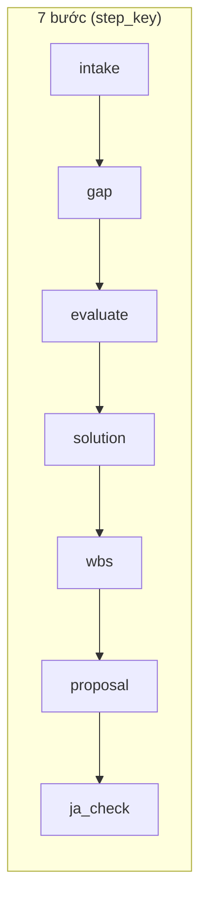
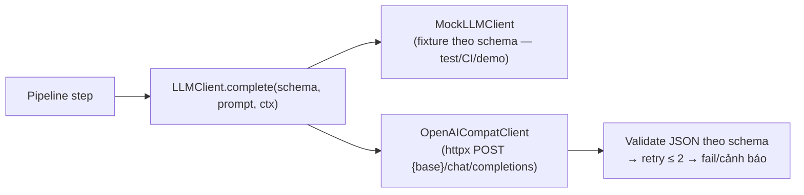

# LLM Pipeline — Presales Bidding Assistant

| Thuộc tính | Giá trị |
|---|---|
| Tên tài liệu | Đặc tả pipeline LLM nhiều bước (MVP) |
| Phiên bản | 1.0 |
| Ngày | 2026-10-09 |
| Trạng thái | Đề xuất — chờ review |
| Nguồn | `srs.md` (FR-002..005, FR-010/011, FR-020..023, FR-025, FR-030..034, FR-041.2, FR-050), `handoff_to_design.md` (BR-01..04, BR-12, BR-13) |

---

## 0. Nguyên tắc xuyên suốt

1. **BR-01 — LLM không bao giờ xuất con số.** Schema output của mọi bước **không chứa** trường man-day, giá, ngày lịch (unit test assert). LLM chỉ: phân loại, giải thích, soạn văn bản. Mọi con số do **code** tính từ bảng chuẩn YAML.
2. **BR-02 — JSON theo schema, retry ≤ 2.** Lỗi schema → fail rõ (dừng bước, báo lỗi). Lỗi ngữ nghĩa (mã trùng, ±20%) → retry ≤ 2 rồi **cảnh báo** cho người duyệt.
3. **BR-03 — Một gateway duy nhất.** Mọi bước gọi qua `LLMClient.complete()`. Test/CI dùng `mock`.
4. **BR-06 — Che PII trước khi gửi.** Text vào prompt đã qua `privacy/mask.py` (email, SĐT VN/Nhật).
5. **NFR-003 — Giới hạn chi phí.** Tài liệu RFP chỉ gửi bản tóm tắt giới hạn ký tự; lô đánh giá ≤ 40 dòng; retry ≤ 2.
6. **Persist/resume (FR-023).** Mỗi bước hoàn thành được lưu ngay vào `pipeline_steps`; lỗi/timeout → chạy lại từ bước lỗi, không làm lại bước trước.
7. **Ngôn ngữ.** Nội dung gửi khách (câu hỏi, proposal) theo `bid.customer_language`; lý do/giải thích nội bộ tiếng Việt.

---

## 1. Sơ đồ pipeline và trạng thái bước



Mỗi bước có trạng thái: `pending → running → completed | failed | waiting_clarification | skipped`. Trạng thái lưu ở bảng `pipeline_steps` (xem `data_model.md`). SSE phát sự kiện mỗi khi trạng thái đổi (FR-023, ≤ 5s).

**Bảng tóm tắt — ai làm gì:**

| Bước | LLM làm | Code làm | Gọi LLM? |
|---|---|---|---|
| B1 Intake | trích xuất thông tin yêu cầu (mục tiêu / người dùng / dữ liệu / ràng buộc / ngân sách / thời hạn / ngôn ngữ khách) + tóm tắt giới hạn ký tự | đọc file, sinh mã REQ, profile dữ liệu mẫu, gợi ý sẵn sàng | 0–1 lần |
| B2 Gap | đề xuất ≤ 7 câu hỏi (ngôn ngữ khách + lý do vi) | kiểm tra ≤7, ≤2 vòng, chuyển trạng thái | 1 lần/vòng |
| B3 Evaluate | đánh giá lô ≤ 40 dòng (◎/○/△/× + 要確認) | mã đúng một lần (BR-13), gộp lô, retry | ⌈N/40⌉ lần |
| B4 Solution | chọn 1 trong 5 hướng + lý do | validate tập cố định; đổi hướng → tính lại effort, cảnh báo đánh giá cũ | 1 lần |
| B5 WBS | đề xuất cấu trúc **3 cấp** (mã, tên, giai đoạn, cha, vai trò lá, **trọng số**, phụ thuộc) | gán man-day lá từ bảng chuẩn (≤ 10), kiểm tra ±20% + PM/QA + không vòng | 1–3 lần (retry) |
| B6 Proposal | soạn văn bản (ngôn ngữ khách) | ráp Giả định/スコープ外, điền số theo cổng giá | 1–3 lần |
| B7 Ja-check | (phụ) đánh giá ngữ cảnh lỗi ngôn ngữ | rule-based: Latin, glossary, chính tả tên | 0–1 lần |

---

## 2. Bước 1 — Intake / phân tích đầu vào (FR-002, FR-003, FR-004, FR-005)

### Mục đích
Biến file đầu vào thành dữ liệu có cấu trúc: danh sách requirement (mã nội bộ duy nhất), profile dữ liệu mẫu, mức sẵn sàng dữ liệu — để presales **xác nhận** trước khi tốn chi phí AI (FR-005). Bước này **chủ yếu là code**; LLM chỉ tham gia tùy chọn ở phần tóm tắt RFP.

### Input context
- Danh sách attachment đã upload (loại đã đoán/sửa tay).
- File gốc trong `data/uploads/`.

### Xử lý (code — không gọi LLM)
1. `parsers/detect.py`: đoán loại file theo extension + magic bytes (FR-002).
2. `parsers/excel.py`: đọc mọi sheet của `.xlsx/.xlsm/.csv/.xls`; tự nhận diện dòng tiêu đề + cột (mã, nội dung, ưu tiên, phân loại); đọc cột 番号 là công thức `=ROW()-1` → **sinh mã nội bộ** `REQ-001...` duy nhất toàn file (FR-003.2/.6). Presales sửa mapping cột → đọc lại.
3. `parsers/pdf.py / docx.py / text.py`: trích text RFP; tạo **tóm tắt giới hạn ký tự** (`RFP_SUMMARY_MAX_CHARS`, mặc định 8.000) — phần duy nhất được gửi LLM (FR-003.1).
4. `parsers/sample_profile.py`: profile dữ liệu mẫu (số dòng, kiểu cột, % trống, cột nghi PII).
5. **Gợi ý mức sẵn sàng dữ liệu (FR-004)** — rule-based, code:
   - > 50% ô trống hoặc nhiều cột PII → `low`; 20–50% → `medium`; còn lại → `high`. Presales chỉnh tay được.
6. Không có file Excel requirement → đánh dấu `no_requirement_file=true`, bỏ qua bảng đáp ứng, ghi rõ trên web (FR-003.3).

### LLM — trích xuất thông tin yêu cầu (bắt buộc từ M2)

> **Ghi chú thay đổi (2026-10-09, theo yêu cầu milestone M2):** schema LLM của B1 được mở rộng từ "tóm tắt RFP" thành **trích xuất cấu trúc** 7 nhóm thông tin (mục tiêu, người dùng, dữ liệu, ràng buộc, ngân sách, thời hạn, ngôn ngữ khách) — đúng yêu cầu milestone "Bước AI 1 trích xuất mục tiêu, người dùng, dữ liệu, ràng buộc, ngân sách, thời hạn, ngôn ngữ khách". Ở M2 bước này chạy trên **text dán** (email/RFP, đã che PII); phần đọc file (PDF/DOCX/Excel) thuộc M6.

- **Mục đích:** từ nội dung yêu cầu (đã che PII, giới hạn ký tự) trích xuất thông tin cấu trúc làm nền cho bước gap (B2) và hiển thị cho presales trên màn hình phân tích.
- **⚠️ BR-01:** schema **không chứa trường số/ngày** (man-day, giá, ngày lịch — unit test assert). Ngân sách / thời hạn trích xuất dưới dạng **ghi chú văn bản tiếng Việt** (`budget_note_vi`, `deadline_note_vi`) + cờ boolean; con số chính thức do người dùng nhập ở form hồ sơ (FR-001) và do code xử lý ở M3+.
- **Output JSON schema (`IntakeExtraction`):**
```json
{
  "objectives_vi": "string — mục tiêu dự án, tiếng Việt, ≤ 300 từ",
  "users_vi": "string — người dùng / đối tượng sử dụng, tiếng Việt, ≤ 200 từ",
  "data_vi": "string — mô tả dữ liệu liên quan, tiếng Việt, ≤ 200 từ",
  "constraints_vi": ["string — tối đa 5 ràng buộc"],
  "budget_mentioned": "boolean — email/RFP có đề cập ngân sách?",
  "budget_note_vi": "string — ghi chú ngân sách, tiếng Việt, ≤ 100 từ (bắt buộc khi budget_mentioned=true)",
  "deadline_mentioned": "boolean — email/RFP có đề cập thời hạn?",
  "deadline_note_vi": "string — ghi chú thời hạn, tiếng Việt, ≤ 100 từ (bắt buộc khi deadline_mentioned=true)",
  "customer_language_detected": "enum: vi | en | ja | unknown — ngôn ngữ chính của nội dung yêu cầu",
  "summary_vi": "string — tóm tắt nội dung, tiếng Việt, ≤ 500 từ",
  "keywords": ["string, tối đa 10 từ khóa"],
  "notes": ["string, tối đa 5 điểm cần chú ý"]
}
```
- **Validation (code):** độ dài từng trường; `customer_language_detected` thuộc enum; `budget_note_vi`/`deadline_note_vi` bắt buộc khi cờ tương ứng = `true`; schema không chứa trường man-day/giá/ngày (BR-01).
- **Retry:** schema sai → retry ≤ 2 → fail bước với lỗi rõ (BR-02).

### Output persist
`pipeline_steps.output_json`:
```json
{
  "attachments_status": [{"attachment_id": 1, "filename": "...", "status": "ok|error", "error": null}],
  "requirement_count": 235,
  "no_requirement_file": false,
  "sample_profile": {"row_count": 1200, "columns": [{"name": "email", "type": "string", "empty_pct": 5, "pii_suspected": true}], "readiness_suggestion": "low"},
  "rfp_summary": {"summary_vi": "...", "keywords": []}
}
```

---

## 3. Bước 2 — Gap detection → clarifying questions (FR-010, FR-011)

### Mục đích
Phát hiện thiếu thông tin ảnh hưởng **giải pháp / effort / giá**; nếu có → dừng pipeline, hỏi ≤ 7 câu (ngôn ngữ khách + lý do tiếng Việt). Không đoán bừa (BR-04).

### Input context
- Tóm tắt RFP (hoặc text gốc giới hạn) + danh sách requirement (mã + nội dung, tối đa toàn bộ — chỉ metadata, không gửi file thô).
- Profile dữ liệu mẫu + mức sẵn sàng (đã chỉnh tay nếu có).
- Số vòng hỏi đã dùng (code truyền vào: 0 hoặc 1).
- Câu trả lời vòng trước (nếu vòng 2).

### Output JSON schema
```json
{
  "needs_clarification": "boolean",
  "questions": [
    {
      "question": "string — nội dung câu hỏi bằng NGÔN NGỮ KHÁCH (vi/en/ja)",
      "reason_vi": "string — lý do hỏi bằng tiếng Việt",
      "impact": "enum: solution | effort | price",
      "related_req_codes": ["REQ-012", "REQ-045 — tối đa 10 mã, có thể rỗng"]
    }
  ]
}
```

### Validation rules (code)
| Rule | Hành vi |
|---|---|
| `needs_clarification=false` → `questions` phải rỗng | schema fail → retry |
| `questions.length ≤ 7` (biến `MAX_QUESTIONS_PER_ROUND`) | vượt → cắt/retry → cảnh báo |
| Mỗi câu có đủ `question`, `reason_vi`, `impact` thuộc enum | schema fail → retry |
| `related_req_codes` phải tồn tại trong danh sách requirement | mã lạ → retry → cảnh báo. **M2:** chưa có bảng `requirements` (thuộc M6) → prompt dặn LLM để `related_req_codes` rỗng; khi danh sách requirement rỗng thì kiểm tra tồn tại được bỏ qua |
| Vòng hỏi đã = 2 → **không gọi LLM nữa**, chuyển thẳng yêu cầu presales tự trả lời theo giả định (FR-010.4) | code chặn |

### Retry policy
Schema sai → retry ≤ 2 → fail bước với lỗi rõ (BR-02). Vượt 7 câu sau retry → giữ tối đa 7 câu đầu + cảnh báo.

### Con số do code
Không có con số nào ở bước này. Trạng thái hồ sơ chuyển `Chờ làm rõ` → **code chặn mọi phép tính effort/giá** (BR-04).

### Persist/resume
- Lưu câu hỏi vào bảng `questions` (round_no, status `awaiting_answer`).
- Pipeline dừng ở bước `gap` (trạng thái `waiting_clarification`).
- Presales trả lời qua `POST /api/bids/{id}/questions/{round}/answers` → pipeline **chạy tiếp từ bước `gap`** (không làm lại `intake`).

---

## 4. Bước 3 — Đánh giá requirement theo lô ≤ 40 dòng (FR-020, FR-021)

### Mục đích
Mỗi requirement có đúng một đánh giá thuộc {◎, ○, △, ×}, gắn với hướng giải pháp đang chọn; requirement thiếu thông tin có thêm nhãn phụ `要確認` (không thay thế thang chính).

### Input context (mỗi lô)
- **Danh sách mã + tên TOÀN BỘ requirement** (giữ ngữ cảnh giữa các lô — FR-020.3).
- Lô hiện tại: ≤ 40 dòng (mã, nội dung, ưu tiên, phân loại).
- Hướng giải pháp đang chọn (nếu có; bước này chạy sau B4 khi chạy lại).
- Hệ số/giả định đã chọn (tóm tắt).

### Output JSON schema (mỗi lô)
```json
{
  "batch": [
    {
      "req_code": "string — mã nội bộ REQ-xxx, phải có trong lô",
      "rating": "enum: ◎ | ○ | △ | ×",
      "needs_clarification": "boolean — true nếu gắn nhãn phụ 要確認",
      "note_vi": "string — ghi chú tiếng Việt, ≤ 200 ký tự, có thể rỗng"
    }
  ]
}
```

### Validation rules (code)
| Rule | Hành vi |
|---|---|
| Mọi `req_code` trong lô đều xuất hiện **đúng một lần** trong `batch` (BR-13) | thiếu/thừa → retry ≤ 2 → cảnh báo liệt kê mã thiếu/thừa (FR-021) |
| `rating` thuộc enum; `needs_clarification` là boolean | schema fail → retry |
| Gộp toàn pipeline: tổng mã đánh giá = tổng mã requirement (mọi lô) | lệch → retry lô thiếu → cảnh báo |
| Requirement `要確認` phải được **đánh giá lại** sau vòng trả lời; vẫn thiếu → giữ nhãn, hiển thị như giả định trong proposal (FR-020.4) | code theo dõi `evaluated_after_round` |
| Đổi hướng giải pháp → đánh giá cũ bị đánh dấu "theo hướng cũ" hoặc đánh giá lại (FR-020.5) | code so sánh `solution_direction` trên evaluation |

### Retry policy
- Schema sai → retry ≤ 2 → fail bước.
- Thiếu/thừa mã → retry ≤ 2 → **cảnh báo** (không chặn pipeline, hiển thị trên màn hình duyệt).

### Con số do code
Không có con số effort/giá. Số lần gọi LLM = ⌈N/40⌉ (N = số requirement) — code tính và hiển thị để kiểm soát chi phí (NFR-003).

### Persist/resume
- Mỗi lô hoàn thành → lưu `evaluations` ngay (không chờ hết pipeline) → crash giữa chừng chỉ chạy lại các lô chưa xong.
- `pipeline_steps.output_json` lưu `batches_done`, `batches_total`.

---

## 5. Bước 4 — Đề xuất hướng giải pháp (FR-022)

### Mục đích
Chọn **đúng một** hướng giải pháp từ tập cố định — khóa chính của bảng effort chuẩn (FR-030).

### Input context
- Tóm tắt RFP, danh sách requirement (mã + nội dung), profile dữ liệu mẫu, câu trả lời làm rõ (nếu có).
- Tập cho phép: `["none", "traditional_ml", "rag", "agent", "fine_tune"]` (nhãn hiển thị: không cần AI / ML truyền thống / RAG / agent / fine-tune).

### Output JSON schema
```json
{
  "direction": "enum: none | traditional_ml | rag | agent | fine_tune",
  "reason_vi": "string — lý do bằng tiếng Việt, ≤ 300 từ",
  "risks_vi": ["string — tối đa 5 rủi ro"],
  "architecture_notes_vi": "string — ghi chú kiến trúc, ≤ 300 từ"
}
```

### Validation rules (code)
| Rule | Hành vi |
|---|---|
| `direction` thuộc tập cố định | schema fail → retry ≤ 2 → fail |
| `reason_vi` không rỗng | schema fail → retry |
| AI developer đổi hướng → code tính lại effort theo bảng chuẩn hướng mới (KHÔNG gọi lại LLM đánh giá); đánh giá requirement hiển thị cảnh báo "theo hướng cũ" | `SolutionChoice` mới + `Evaluations` đánh dấu |

### Retry policy
Schema sai → retry ≤ 2 → fail bước với lỗi rõ.

### Con số do code
Sau khi chốt hướng: `EffortEngine` tính dải min–max từ `effort.yaml[direction][phase]` × hệ số (có trần) — toàn bộ do code.

### Persist/resume
Lưu `solution_choices` (supersede bản cũ). Bước `solution` completed → không chạy lại khi rerun từ WBS (FR-041.2).

---

## 6. Bước 5 — Tạo WBS 3 cấp (FR-032) — điểm nhạy nhất với BR-01

### Mục đích
Tạo **WBS 3 cấp (nhóm / task / sub-task)** theo hướng giải pháp, phân theo giai đoạn; **task lá** có loại công việc (role) và man-day; tổng effort nằm trong dải bảng chuẩn (sau hệ số), lệch ≤ ±20% so với **midpoint**; mỗi giai đoạn đủ task PM/QA; phụ thuộc **không vòng**.

### ⚠️ Cách thực thi BR-01 (LLM không xuất man-day)
LLM **không được** xuất man-day/ngày. Thay vào đó:
1. LLM đề xuất **cấu trúc 3 cấp**: mã, tên, giai đoạn, `parent_code` (cha), `role` (**chỉ task lá**), `depends_on` (phụ thuộc), và **trọng số tương đối** (`weight`, số nguyên 1–100, mang tính "phân loại mức độ" chứ không phải man-day).
2. **Code** chuẩn hóa trọng số và gán man-day cho **task lá**: `man_day(task) = round(target_phase × weight_i / Σweight_phase, 1)`, với `target_phase = midpoint(dải phase sau hệ số)`; cân bằng sai số làm tròn vào task lớn nhất.
3. **Code** kiểm tra: mọi lá `man_day ≤ 10`; tổng lệch ±20% so midpoint; đủ PM/QA mỗi phase; `depends_on` không vòng. Lỗi ngữ nghĩa → retry ≤ 2 → **cảnh báo** (không chặn; người sửa tay trên web — FR-041).
4. Schema output LLM **không có trường man_day/effort/ngày** — unit test assert (BR-01).

### Input context
- Hướng giải pháp đã chọn + lý do (B4).
- Dải effort chuẩn (min–max) sau hệ số theo phase — **do code tính và truyền vào prompt** (LLM chỉ nhìn thấy dải, không tự bịa).
- Danh sách requirement (mã + phân loại) để gom nhóm hạng mục (nếu có từ M6; M4 dùng metadata tối thiểu).
- Các giả định đã chọn (ảnh hưởng phạm vi).

### Output JSON schema (`WbsStructure`)
```json
{
  "tasks": [
    {
      "task_code": "string — mã nội bộ, ví dụ WBS-001",
      "name_vi": "string — tên công việc tiếng Việt",
      "phase": "enum: poc | mvp | production",
      "parent_code": "string | null — mã item cha; null = cấp 1 (nhóm)",
      "role": "enum: pm | ba | brse | ai_engineer | backend | frontend | qa | infra — BẮT BUỘC khi là task lá",
      "weight": "integer 1–100 — trọng số tương đối (code quy man-day), BẮT BUỘC khi là task lá",
      "depends_on": ["string — mã task khác, tối đa 5, có thể rỗng"]
    }
  ],
  "notes_vi": ["string — tối đa 5 ghi chú"]
}
```

### Validation rules (code)
| Rule | Hành vi |
|---|---|
| `task_code` duy nhất; `phase`/`role`/`weight` hợp lệ; `parent_code` trỏ tới task có trong payload | schema fail → retry |
| Độ sâu ≤ 3 (chuỗi `parent_code`); lá = task không có task con; `role`/`weight` chỉ trên lá | schema fail → retry |
| `depends_on` trỏ tới task tồn tại, không tự tham chiếu, **không vòng** (DFS) | vòng → retry ≤ 2 → cảnh báo |
| Mỗi phase có ≥ 1 lá role `pm` và ≥ 1 lá role `qa` (FR-032.2) | thiếu → retry ≤ 2 → cảnh báo |
| Mọi lá `man_day ≤ 10` (FR-032.1) | lá quá nặng → retry ≤ 2 → cảnh báo |
| Tổng man-day (code tính) nằm trong [min, max] sau hệ số và \|Σ − midpoint\|/midpoint ≤ 20% (FR-032.3, BR-12) | ngoài ±20% → retry ≤ 2 → **cảnh báo** (không chặn; override phải ghi chú) |

### Retry policy
Schema sai → retry ≤ 2 → fail. Thiếu PM/QA, lệch ±20%, vòng phụ thuộc, lá > 10 md → retry ≤ 2 → cảnh báo + để người sửa (FR-032, FR-041).

### Con số do code (toàn bộ)
- `man_day` từng task lá (≤ 10), tổng man-day, midpoint, độ lệch %, tổng theo phase.
- `man_day` nhóm/task cha = Σ con (code tính khi trả response).
- Dấu vết tính toán (FR-033): `{direction, phase, min, max, factors[], factor_product, cap, midpoint, deviation_pct}`.

### Reference tables
`backend/app/reference/effort.yaml` (min–max theo direction × phase), `factors.yaml` (hệ số + trần `factor_cap`), `holidays.yaml` (nghỉ lễ VN/Nhật — cho schedule), `payment.yaml` (mốc thanh toán mặc định).

### Persist/resume + snapshot
- Lưu `wbs_items` (3 cấp, `parent_code`/`depends_on`, man_day do code gán) + `pipeline_steps.output_json` (cấu trúc LLM thô, weights).
- **Snapshot (FR-041.2):** trước khi rerun từ bước WBS, code lưu `wbs_snapshots` (JSON toàn bộ WBS + diff_summary). Rerun giữ nguyên B3/B4 (evaluation + solution), chỉ tạo lại WBS/lịch (giá thuộc M5).

---

## 7. Bước 6 — Soạn proposal (FR-050)

### Mục đích
Soạn văn bản proposal theo ngôn ngữ khách; **mọi con số do code điền** theo cổng giá (FR-043). Gồm mục **Giả định (前提条件)** và **Phạm vi không bao gồm (スコープ外)**.

### Input context
- Hướng giải pháp + lý do, kiến trúc, rủi ro (từ B4).
- WBS + effort (tóm tắt dạng văn bản, **không gửi bảng số thô**).
- Bảng đánh giá: requirement `×`/`△` → nguồn cho スコープ外; giả định đã chọn (FR-011.2) + hệ số (FR-031) → nguồn cho 前提条件.
- Template trung tính (bìa, header/footer, logo placeholder) — code dựng khung, LLM chỉ điền văn bản.

### Output JSON schema
**Khóa JSON của `sections` CỐ ĐỊNH bằng tiếng Anh (không dịch); chỉ GIÁ TRỊ viết theo ngôn ngữ khách.** Prompt B6 nêu rõ quy tắc này và kèm ví dụ; schema còn chuẩn hóa bí danh khóa theo ngôn ngữ (ja/vi/en) về khóa chuẩn — lớp phòng thủ khi LLM vẫn dịch khóa (tránh đốt hết lượt retry vì lỗi định dạng khóa).
```json
{
  "sections": {
    "introduction": "string — mở đầu, ngôn ngữ khách",
    "requirements_understanding": "string — hiểu yêu cầu, ngôn ngữ khách",
    "solution_overview": "string — tổng quan giải pháp, ngôn ngữ khách",
    "approach": "string — cách tiếp cận/triển khai, ngôn ngữ khách",
    "schedule": "string — lịch trình, ngôn ngữ khách",
    "team": "string — đội ngũ/體制, ngôn ngữ khách",
    "assumptions_and_scope": "string — giả định và phạm vi ngoài (前提条件・対象外), ngôn ngữ khách",
    "risks": "string — rủi ro và cách giảm thiểu, ngôn ngữ khách"
  },
  "assumptions_phrased": ["string — diễn đạt từng giả định bằng ngôn ngữ khách"],
  "scope_out_phrased": ["string — diễn đạt từng mục ngoài phạm vi bằng ngôn ngữ khách"]
}
```

### Validation rules (code)
| Rule | Hành vi |
|---|---|
| `sections` có đủ đúng 8 khóa chuẩn, mọi section không rỗng | sai → retry ≤ 2 → fail (BR-02); khóa bí danh ja/vi/en được chuẩn hóa về khóa chuẩn trước khi kiểm tra |
| **Không chứa số tiền/man-day/ngày** — kiểm tra regex số tiền (¥/₫/$ + digits) và từ khóa man-day | phát hiện → retry ≤ 2 → fail (BR-01) |
| Phải chứa đúng token `{{QUOTATION}}` cho cổng giá | thiếu → retry ≤ 2 → fail (BR-02) |
| `assumptions_phrased` phải phủ đủ số giả định đã chọn (code so sánh số lượng) | thiếu → retry → cảnh báo |
| `scope_out_phrased` phải phủ đủ requirement ×/△ + mục ngoài phạm vi | thiếu → retry → cảnh báo |

### Con số do code (điền vào template tại thời điểm xuất)
- Effort/WBS/lịch/giá: **code render** từ DB; chưa duyệt giá → mọi vị trí tiền là `[Presales điền]` (FR-043).
- Mục 前提条件: code tổng hợp danh sách giả định + hệ số; LLM chỉ diễn đạt câu chữ.
- Mục スコープ外: code tổng hợp từ evaluation ×/△; LLM chỉ diễn đạt.

### Retry policy
Schema sai / lẫn số → retry ≤ 2 → fail bước. Cảnh báo phủ thiếu giả định → hiển thị, không chặn.

### Persist/resume
Lưu `proposal_draft` (JSON sections) trong `pipeline_steps.output_json` + bảng `proposal_drafts` (cho phép presales sửa trường văn bản chính trên web — FR-050.4). Bản xuất luôn render mới từ draft + số hiện tại.

---

## 8. Bước 7 — Kiểm tra tiếng Nhật (FR-025) — chỉ khi `customer_language = ja`

### Mục đích
Trước khi xuất tài liệu tiếng Nhật: phát hiện văn bản lẫn Latin không đúng ngữ cảnh, sai thuật ngữ (glossary), sai chính tả tên công ty/khách hàng. **Cảnh báo không chặn xuất** nhưng phải hiển thị rõ (FR-025.3).

### Input context
- Toàn bộ văn bản tiếng Nhật sẽ xuất (proposal sections, câu hỏi làm rõ).
- Glossary: `reference/glossary_ja.yaml` (thuật ngữ chuẩn dùng trong prompt).
- Tên công ty gửi thầu + tên khách hàng (từ hồ sơ).

### Xử lý (rule-based — code, deterministic, unit-test được)
1. **Phát hiện Latin lạ:** regex ký tự Latin nằm giữa văn bản Nhật không thuộc whitelist (tên sản phẩm, thuật ngữ kỹ thuật trong glossary).
2. **Đối chiếu glossary:** thuật ngữ xuất hiện trong văn bản phải khớp bản dịch chuẩn; lệch → cảnh báo kèm gợi ý.
3. **Chính tả tên:** so khớp tên công ty/khách hàng với giá trị trong hồ sơ (katakana/kanji); sai → cảnh báo.
4. **LLM (phụ trợ, 0–1 lần):** đánh giá ngữ cảnh các điểm nghi ngờ do rule-based gắn cờ — output có cấu trúc, retry ≤ 2, lỗi → bỏ qua LLM, giữ cảnh báo rule-based.

### Output JSON schema (lưu vào `export_logs.ja_check_result`)
```json
{
  "result": "enum: pass | warning",
  "issues": [
    {
      "severity": "enum: error | warning",
      "section": "string — section chứa lỗi",
      "message_vi": "string — mô tả bằng tiếng Việt",
      "suggestion_ja": "string — gợi ý sửa bằng tiếng Nhật",
      "source": "enum: latin | glossary | name | llm_context"
    }
  ]
}
```

### Validation rules (code)
| Rule | Hành vi |
|---|---|
| `result=pass` → `issues` rỗng | schema fail → retry |
| Mỗi issue có đủ severity/section/message/source | schema fail → retry |
| Tỷ lệ phát hiện ≥ 90% trên bộ mẫu lỗi cố ý (unit test `tests/test_ja_check.py`) | quality gate |

### Retry policy
Rule-based không retry (deterministic). LLM phụ trợ: schema sai → retry ≤ 2 → bỏ qua, giữ kết quả rule-based.

### Con số do code
Không có con số. Bước này chỉ tạo cảnh báo.

### Persist/resume
Kết quả lưu vào `export_logs` mỗi lần xuất; bước `ja_check` chạy lại khi xuất (không thuộc pipeline chính — gọi từ endpoint export).

---

## 9. Persist / resume (FR-023) và snapshot WBS (FR-041.2)

### 9.1 Cơ chế persist từng bước
- Bảng `pipeline_steps` (một dòng/bước/bid): `step_key`, `status`, `attempts`, `output_json`, `error_message`, `started_at`, `finished_at`.
- **Ghi ngay khi bước hoàn thành** — không chờ pipeline kết thúc.
- SSE phát event `step:{step_key}:{status}` mỗi lần đổi trạng thái (≤ 5s).

### 9.2 Resume
- `POST /api/bids/{id}/rerun` với body `{"from_step": "wbs"}` (MVP hỗ trợ từ bước WBS — FR-041.2; resume lỗi chạy từ bước `failed` đầu tiên).
- Orchestrator: các bước trước `from_step` có status `completed` → **skip** (giữ dữ liệu); bước `from_step` trở đi chạy lại.
- Rerun từ WBS: **giữ** `evaluations` (B3) và `solution_choices` (B4); **snapshot WBS cũ** trước khi tạo WBS mới (FR-041.2).
- Timeout (`PIPELINE_STEP_TIMEOUT_S`) → bước `failed` với lỗi "timeout" → presales bấm rerun.

### 9.3 Snapshot WBS
- Bảng `wbs_snapshots`: `wbs_json` (toàn bộ items + man_day + dấu vết), `reason`, `created_by`, `created_at`, `diff_summary`.
- `diff_summary` do code tính: `{added: [...], removed: [...], modified: [{task_code, field, old, new}]}` — hiển thị trên màn hình duyệt kỹ thuật.

---

## 10. Gateway LLM và mock (BR-03)



- Chọn client theo `LLM_PROVIDER`; `openai_compat` cần `LLM_BASE_URL`, `LLM_API_KEY`, `LLM_MODEL`.
- TLS khi gọi provider: `LLM_VERIFY_SSL` (mặc định `true`; đặt `false` cho endpoint nội bộ self-signed) và `LLM_CA_BUNDLE` (đường dẫn CA bundle tùy chỉnh — ưu tiên hơn cờ verify).
- Mọi prompt đi qua `privacy/mask.py` trước (BR-06).
- **Mock behavior:** trả fixture hợp lệ theo schema; có chế độ fixture "xấu" (thiếu mã, sai schema, lẫn số tiền) để test retry/cảnh báo.

---

## 11. Ngân sách latency/cost (NFR-001, NFR-003)

| Bước | Số lần gọi (235 req) | Ước tính thời gian (LLM thật, demo) |
|---|---|---|
| B1 Intake | 0–1 | ~10s |
| B2 Gap | 1–2 (tối đa 2 vòng) | ~15–30s |
| B3 Evaluate | ⌈235/40⌉ = 6 (+ retry) | ~2–4 phút (song song hóa tối đa 2 lô) |
| B4 Solution | 1 | ~15s |
| B5 WBS | 1–3 | ~30–60s |
| B6 Proposal | 1–3 | ~30–60s |
| B7 Ja-check | 0–1 | ~10s |
| **Tổng** | ~11–17 | **≤ 15 phút** (mục tiêu S-01/NFR-001) |

- Lô đánh giá chạy tuần tự tối đa 2 luồng song song (kiểm soát rate limit + chi phí).
- Retry chỉ khi schema/kiểm tra lỗi; mỗi lần retry tính vào ngân sách.