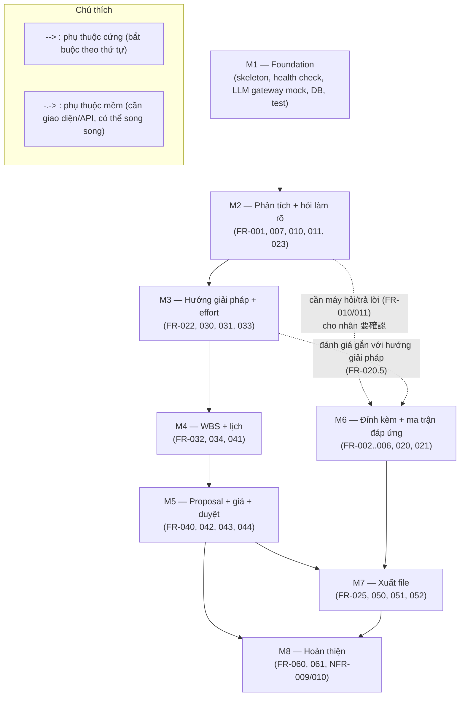

# Roadmap — Presales Bidding Assistant (MVP)

| Thuộc tính | Giá trị |
|---|---|
| Tên tài liệu | Lộ trình triển khai MVP theo milestone (Roadmap) |
| Phiên bản | 1.0 |
| Ngày | 2026-10-09 |
| Trạng thái | Draft — chờ reconcile với Solution Architect |
| Vai trò | Project Manager |
| Nguồn đầu vào | `AGENTS.md`, `docs/03_requirements/srs.md` (v1.1), `docs/03_requirements/handoff_to_design.md` |

---

## 1. Nguyên tắc chia milestone

- **Thin vertical slice:** mỗi milestone chạy được **end-to-end** (UI → API → kết quả hiển thị/tải về), không phải tầng ngang (chỉ backend, chỉ UI). Cuối mỗi milestone, người dùng demo được một luồng nghiệp vụ hoàn chỉnh trên Preview.
- **Thứ tự cốt lõi** theo ghi chú PM: Foundation → Phân tích & hỏi làm rõ → Hướng giải pháp + effort → WBS + lịch → Proposal + giá + duyệt → Đính kèm + ma trận đáp ứng → Xuất file → Hoàn thiện. Thứ tự này giữ nguyên; chỉ dịch chuyển FR khi SRS buộc (FR-007 vào M2, FR-025 vào M7).
- **"Done" = test tự động pass + chạy được trong Preview** (BR-08). Mọi phép tính phải có unit test với dữ liệu mẫu (NFR-006).
- **Không bịa số:** mọi con số effort/giá/lịch do code tính từ bảng chuẩn YAML (BR-01); LLM chỉ phân loại và giải thích.
- **Số liệu giả lập:** toàn bộ dữ liệu mẫu là hư cấu, ghi rõ "giả lập" (NFR-002).

### Tổng quan milestone

| MS | Tên | FR chính | Kết quả end-to-end (vertical slice) |
|----|-----|----------|--------------------------------------|
| M1 | Foundation | (nền tảng) NFR-002/003/005/006/008/011 | Skeleton chạy được: health check, LLM gateway mock, DB, test command |
| M2 | Phân tích yêu cầu + hỏi làm rõ | FR-001, FR-006*, FR-007, FR-010, FR-011, FR-023 | Tạo hồ sơ → dán email → AI phân tích → dừng hỏi ≤ 7 câu → trả lời → resume, tiến độ realtime; mở lại hồ sơ |
| M3 | Hướng giải pháp + effort bằng code | FR-022, FR-030, FR-031, FR-033 | Chọn hướng giải pháp → hệ số có trần → dải effort min–max kèm dấu vết |
| M4 | WBS + lịch (sửa được, code tính lại) | FR-032, FR-034, FR-041 | AI tạo WBS → code kiểm tra ±20%/PM-QA → master schedule → sửa WBS/người → tính lại không gọi AI |
| M5 | Proposal + giá + cổng duyệt | FR-040, FR-042, FR-043, FR-044 | Báo giá từ rate card → kiểm tra trước duyệt → duyệt giá (≠ người tạo, khóa) → cổng giá `[Presales điền]` |
| M6 | Đính kèm file + ma trận đáp ứng | FR-002, FR-003, FR-004, FR-005, FR-006*, FR-020, FR-021 | Upload Excel/RFP → đọc 100% requirement → đánh giá ◎/○/△/× (+要確認) → ma trận đáp ứng, mã đúng một lần |
| M7 | Xuất file (Word, Excel, PowerPoint) | FR-025, FR-050, FR-051, FR-052 | Kiểm tra tiếng Nhật → xuất proposal Word (ngôn ngữ khách), Excel có công thức, PPTX — bằng code, deterministic |
| M8 | Hoàn thiện (lịch sử, cài đặt, UX) | FR-060, FR-061 (+ NFR-009/010) | Trang Cài đặt sửa bảng chuẩn có validate; audit log; hồ sơ đã duyệt bất biến; polish UX states |

> FR-006 (hồ sơ mẫu giả lập) được triển khai 2 giai đoạn: **M2** — bộ mẫu text (email + nội dung yêu cầu) đủ cho demo luồng phân tích/hỏi; **M6** — bộ mẫu đầy đủ kèm file Excel requirement (đáp ứng trọn tiêu chí FR-006).

---

## 2. Sơ đồ phụ thuộc giữa các milestone



**Giải thích phụ thuộc:**
- Chuỗi cứng **M1 → M2 → M3 → M4 → M5 → M7 → M8**: mỗi milestone xây trên dữ liệu/API của milestone trước (hồ sơ → phân tích → effort → WBS → giá → xuất).
- **M6** có thể triển khai **song song** với M3–M5 (phụ thuộc mềm): cần máy hỏi/trả lời của M2 (nhãn 要確認 dùng vòng hỏi) và hướng giải pháp của M3 (FR-020.5). M6 phải xong **trước M7** vì proposal xuất ra cần ma trận đáp ứng.
- **M8** phụ thuộc M5 (cơ chế snapshot/khóa hồ sơ đã duyệt — nền cho FR-061) và M3 (bảng chuẩn YAML đã được code đọc — nền cho trang Cài đặt).

---

## 3. M1 — Foundation

### Goal
Dựng skeleton hai phía (backend + frontend) chạy được end-to-end tối thiểu: health check, một LLM gateway duy nhất có mock, DB, lệnh test chuẩn, README. Đây là nền cho mọi milestone sau; **mọi quyết định kiến trúc/stack do Solution Architect chốt** — roadmap chỉ đặt điều kiện chấp nhận.

### FR/NFR covered
- **NFR-005** (một LLM gateway duy nhất, cấu hình env `LLM_PROVIDER`/`LLM_BASE_URL`/`LLM_API_KEY`/`LLM_MODEL`) — BR-03
- **NFR-002** (che PII trước khi gửi LLM; bộ test PII ≥ 50 mẫu, tỷ lệ ≥ 99%; không commit/print key; dữ liệu mẫu giả lập) — BR-06
- **NFR-003** (mock trong test/CI; retry ≤ 2; tài liệu gửi LLM là bản tóm tắt giới hạn ký tự) — BR-02
- **NFR-006** (lệnh test chuẩn, module kiểm tra tách biệt) — BR-08
- **NFR-008** (không vector DB/hàng đợi/auth nặng) — BR-09
- **NFR-011** (frontend gọi API root-relative `/api/...`) — BR-10
- **BR-01** (schema output LLM không chứa trường man-day/giá/ngày — khởi tạo kỷ luật schema)

> Chưa có FR chức năng — milestone nền tảng. FR-007 được gắn vào M2 (cần entity hồ sơ + màn hình tạo hồ sơ trước khi có danh sách để mở lại).

### Deliverables
- Backend skeleton: app khởi động được, endpoint `/api/health`, cấu hình env.
- LLM gateway: interface duy nhất + implementation `mock` (+ `openai_compat` nếu SA chốt) + **mask PII** + retry ≤ 2 + validate JSON schema.
- DB: kết nối + migration tối thiểu (entity Hồ sơ dự thầu sơ bộ theo SRS §10).
- Frontend skeleton: layout tối thiểu, gọi `/api/health` từ UI, base URL root-relative.
- Lệnh test chuẩn + CI quality gate sơ bộ; README (cách chạy test, cách chạy app, cấu hình env).
- Bộ test PII (≥ 50 mẫu: email, SĐT VN `+84/0xx`, SĐT Nhật `0X-XXXX-XXXX/+81`, email lẫn trong văn bản tiếng Nhật).

### Acceptance criteria
**(a) Shell commands (exit 0):**
```bash
cd backend && pytest -q
cd frontend && npm run build
curl -f http://localhost:8000/api/health
cd backend && LLM_PROVIDER=mock pytest -q tests/test_llm_gateway.py
cd backend && pytest -q tests/test_pii.py      # tỷ lệ che ≥ 99% trên bộ ≥ 50 mẫu
```
*(Port 8000 và lệnh test theo API contract/stack do Solution Architect chốt — cập nhật khi có `docs/04_architecture/`.)*

**(b) Manual scenario (Preview):**
1. Mở app → trang chủ hiển thị trạng thái "Backend OK" (lấy từ `/api/health`).
2. Đổi `LLM_PROVIDER=mock` trong cấu hình → gọi một pipeline mẫu (script/demo) trả về JSON đúng schema, không gọi LLM thật.
3. Dán một đoạn văn bản có email + SĐT → kiểm tra log/giao diện: dữ liệu gửi LLM đã bị mask.

### Risks
| Rủi ro | Mức | Giảm thiểu |
|---|---|---|
| Stack chưa chốt (SA chưa có `docs/04_architecture/`) | Cao | M1 chỉ bắt đầu sau khi SA chốt stack + API contract; acceptance commands là placeholder |
| PII masking sót định dạng (SĐT Nhật viết kiểu `0X-XXXX-XXXX`) | Trung bình | Bộ test PII ≥ 50 mẫu xây ngay từ M1; mở rộng ở M2 |
| Retry/schema kỷ luật lỏng → BR-02 vi phạm | Trung bình | Unit test mock LLM trả sai schema → retry ≤ 2 → fail rõ |

### Rough effort (man-day)
**3–5 md** (backend 1.5–2.5, frontend 1–1.5, test/CI 0.5–1). Ước lượng PM — cần dev team validate.

---

## 4. M2 — Phân tích yêu cầu + hỏi làm rõ (pause/resume, tiến độ realtime)

### Goal
Vertical slice đầu tiên có nghiệp vụ: presales tạo hồ sơ (dán email/nội dung yêu cầu), AI phân tích sơ bộ, **dừng lại hỏi ≤ 7 câu** khi thiếu thông tin (ngôn ngữ khách + lý do tiếng Việt), trả lời trên web → pipeline **resume từ điểm dừng**, tiến độ từng bước **realtime ≤ 5 giây**. Có **danh sách hồ sơ + mở lại hồ sơ** ở mọi trạng thái.

### FR/NFR covered
- **FR-001** (tạo hồ sơ mới: tên dự án, khách hàng, hạn nộp, ngôn ngữ khách vi/en/ja, nội dung yêu cầu bắt buộc) — UC-01, US-001
- **FR-007** (danh sách hồ sơ: lọc theo trạng thái, tìm theo tên/khách hàng; mở lại hồ sơ "Chờ làm rõ" hiển thị câu hỏi chưa trả lời) — UC-11, US-027
- **FR-010** (dừng & hỏi ≤ 7 câu/vòng, ≤ 2 vòng; câu hỏi ngôn ngữ khách + lý do tiếng Việt; không tạo con số khi "Chờ làm rõ") — UC-03, US-006
- **FR-011** (trả lời trên web; giả định rõ ràng có nhãn; tiếp tục tự động từ điểm dừng) — UC-03, US-007
- **FR-023** (tiến độ realtime ≤ 5 giây; persist từng bước; resume từ bước lỗi) — UC-04, US-011
- **FR-006*** (phần 1: bộ hồ sơ mẫu giả lập dạng text — nền demo S-01) — UC-10, US-005
- **NFR-001** (tiến độ ≤ 5 giây; demo ≤ 10 phút) · **NFR-002** (mở rộng bộ test PII) · **NFR-004** (câu hỏi theo ngôn ngữ khách; UI tiếng Việt) — BR-04, BR-07
- **NFR-009** (máy trạng thái hồ sơ: Nháp → Chờ làm rõ → Đang phân tích → …) — BR-04

### Deliverables
- Màn hình tạo hồ sơ (validate trường bắt buộc) + danh sách hồ sơ (lọc/tìm) + mở lại hồ sơ.
- Pipeline bước 1 (phân tích yêu cầu text) với output JSON theo schema, retry ≤ 2.
- Máy hỏi làm rõ: sinh ≤ 7 câu (ngôn ngữ khách + lý do tiếng Việt + mức ảnh hưởng), giới hạn 2 vòng, trạng thái "Chờ làm rõ".
- Form trả lời (bao gồm trả lời theo giả định có nhãn "giả định — cần khách xác nhận").
- Cơ chế persist từng bước + resume từ bước lỗi (theo quyết định SA: polling/SSE — câu hỏi mở #5 handoff).
- Bộ hồ sơ mẫu giả lập (text) nạp bằng một nút.
- Bộ mẫu tiếng Nhật (20 câu) — **fixture test xây sớm** cho FR-025 (dùng ở M7).

### Acceptance criteria
**(a) Shell commands (exit 0):**
```bash
cd backend && pytest -q
cd frontend && npm run build
curl -f http://localhost:8000/api/bids
curl -f http://localhost:8000/api/bids/<bid_id>
cd backend && LLM_PROVIDER=mock pytest -q tests/test_clarifying_questions.py
cd backend && LLM_PROVIDER=mock pytest -q tests/test_pipeline_resume.py
```
*(Endpoint path theo API contract của SA.)*

**(b) Manual scenario (Preview):**
1. Bấm "Nạp hồ sơ mẫu" → hồ sơ mẫu (email tiếng Nhật giả lập) được tạo ở trạng thái Nháp.
2. Bấm "Phân tích" → web hiển thị tiến độ từng bước, cập nhật ≤ 5 giây.
3. Pipeline dừng ở "Chờ làm rõ" → hiển thị ≤ 7 câu hỏi **bằng tiếng Nhật**, mỗi câu kèm lý do **tiếng Việt**.
4. Trả lời thiếu → hệ thống nhắc; trả lời 1 câu theo "giả định" → có nhãn giả định.
5. Trả lời đủ → bấm "Tiếp tục" → pipeline chạy tiếp và hoàn thành.
6. Mở danh sách hồ sơ → hồ sơ đang ở "Chờ làm rõ" → mở lại → các câu hỏi chưa trả lời vẫn hiển thị, trả lời tiếp được.
7. (Tùy chọn) Giết pipeline giữa chừng (mock lỗi) → mở lại hồ sơ → chạy lại từ bước lỗi, không làm lại bước đã xong.

### Risks
| Rủi ro | Mức | Giảm thiểu |
|---|---|---|
| Resume pipeline (FR-023) phức tạp — câu hỏi mở #2/#5 handoff chưa chốt | Cao | Chốt schema DB trạng thái bước + cơ chế realtime trước M2; MVP chấp nhận polling nếu đơn giản hơn |
| Chất lượng câu hỏi tiếng Nhật (R1 handoff) | Cao | Glossary thuật ngữ trong prompt (NFR-004); bộ mẫu tiếng Nhật xây sớm; kiểm tra FR-025 hoàn thiện ở M7 |
| Vòng hỏi 2 vòng + tự trả lời giả định dễ bị lạm dụng | Trung bình | Nhãn giả định bắt buộc; hiển thị trong dấu vết hồ sơ (FR-011.2) |

### Rough effort (man-day)
**5–8 md** (backend 3–4.5, frontend 1.5–2.5, test/data mẫu 0.5–1).

---

## 5. M3 — Hướng giải pháp + effort tính bằng code

### Goal
AI đề xuất **hướng giải pháp** từ tập cố định {không cần AI / ML truyền thống / RAG / agent / fine-tune} kèm lý do; **code** tính dải effort min–max từ bảng chuẩn YAML (hướng giải pháp × giai đoạn) nhân hệ số **có trần**; mọi con số hiển thị **dấu vết tính toán**.

### FR/NFR covered
- **FR-022** (đề xuất hướng giải pháp từ tập cố định + lý do; đổi hướng → tính lại effort không gọi lại AI đánh giá) — UC-04, US-010
- **FR-030** (code tính effort = bảng chuẩn × hệ số; min–max; LLM không xuất man-day) — UC-05, US-012
- **FR-031** (hệ số nhân có trần: on-premise, khách Nhật, dữ liệu chưa sẵn sàng, tuân thủ chặt, đa ngôn ngữ, OCR, dữ liệu lớn, nhiều requirement; AI đề xuất bộ hệ số kèm lý do) — UC-05, US-013
- **FR-033** (dấu vết tính toán: bảng chuẩn + hệ số + công thức) — UC-05, US-015
- **NFR-006** (unit test mọi phép tính) · **NFR-007** (bảng chuẩn YAML không cần sửa code) — BR-01

### Deliverables
- Bảng chuẩn effort YAML (min–max theo hướng giải pháp × PoC/MVP/Production) + bảng hệ số + trần — dữ liệu **giả lập sát mặt bằng thị trường**, ghi rõ "giả lập".
- Module code tính effort + module code tính hệ số có trần (tách biệt, test được).
- Bước pipeline "đề xuất hướng giải pháp" (JSON theo schema, retry ≤ 2).
- UI: chọn hướng giải pháp (AI đề xuất + sửa tay), bật/tắt hệ số, hiển thị dải effort min–max + dấu vết (click vào con số → xem bảng chuẩn/hệ số/phép tính).

### Acceptance criteria
**(a) Shell commands (exit 0):**
```bash
cd backend && pytest -q tests/test_effort.py
cd backend && pytest -q tests/test_factors.py
cd backend && pytest -q tests/test_solution_direction.py
cd backend && pytest -q tests/test_trace.py
cd backend && LLM_PROVIDER=mock pytest -q tests/test_llm_schema_no_numbers.py
```
*(`test_llm_schema_no_numbers.py` assert schema LLM không chứa trường man-day/effort — BR-01.)*

**(b) Manual scenario (Preview):**
1. Từ hồ sơ đã phân tích (M2), mở bước "Hướng giải pháp" → AI đề xuất 1 hướng thuộc tập cho phép kèm lý do tiếng Việt.
2. AI đề xuất bộ hệ số (khách Nhật tự bật) → presales bật thêm 8 hệ số → tích hệ số bị chặn ở trần cấu hình.
3. Hiển thị dải effort min–max theo giai đoạn; click vào con số → dấu vết: bảng chuẩn, hệ số, phép tính.
4. Đổi hướng giải pháp → effort tính lại theo bảng chuẩn hướng mới (không gọi lại AI đánh giá).

### Risks
| Rủi ro | Mức | Giảm thiểu |
|---|---|---|
| Số giả lập bảng chuẩn thiếu hợp lý (câu hỏi mở #9/#10 handoff: trần hệ số, overhead) | Cao | Chốt số giả lập trước M3; dữ liệu có schema + validate toàn vẹn |
| LLM cố xuất man-day dù bị cấm | Trung bình | Schema chặt + unit test assert; retry ≤ 2 |
| Đổi hướng giải pháp làm đánh giá requirement (M6) lệch | Trung bình | Cảnh báo "đánh giá theo hướng cũ" (FR-020.5) — chuẩn bị cơ chế ở M3, kích hoạt khi M6 có ma trận |

### Rough effort (man-day)
**4–6 md** (module tính toán 2–3, pipeline hướng giải pháp 1–1.5, UI + dấu vết 1–1.5).

---

## 6. M4 — WBS + master schedule (sửa được, code tính lại)

### Goal
AI tạo **WBS** theo hướng giải pháp; **code kiểm tra** tổng effort nằm trong dải bảng chuẩn (midpoint ±20% — cảnh báo) và đủ PM/QA mỗi giai đoạn; **code tính master schedule** (WBS × số người/vai trò, ngày bắt đầu, buffer, mốc thanh toán, nghỉ lễ, so hạn nộp). AI developer **sửa WBS trực tiếp trên web** → code tính lại tổng/lịch/giá **không gọi AI**.

### FR/NFR covered
- **FR-032** (AI tạo WBS; code kiểm tra ±20% so midpoint + đủ PM/QA; retry ≤ 2; override phải ghi chú) — UC-05, US-014
- **FR-034** (code tính master schedule; sửa WBS/số người → tự tính lại; nghỉ lễ VN/Nhật theo ngôn ngữ khách; cảnh báo vượt hạn nộp) — UC-05, US-016
- **FR-041** (duyệt kỹ thuật: sửa WBS trên web, góp ý, chạy lại từ bước WBS giữ đánh giá requirement, snapshot WBS, log thay đổi, từ chối kèm lý do) — UC-06, US-018
- **NFR-006** (unit test schedule với mẫu nghỉ lễ Nhật) · **NFR-009** (log thay đổi: ai/sửa gì/khi nào) — BR-12

### Deliverables
- Bước pipeline "sinh WBS" (JSON theo schema; task: mã, tên, giai đoạn, vai trò, man-day).
- Module code kiểm tra WBS: ±20% midpoint, PM/QA mỗi giai đoạn, retry ≤ 2 → cảnh báo.
- Module code tính master schedule: lịch làm việc cấu hình (nghỉ lễ), buffer, số người/vai trò, mốc thanh toán, cảnh báo vượt hạn nộp.
- UI duyệt kỹ thuật: xem hướng giải pháp/kiến trúc/rủi ro/WBS/effort; sửa WBS (thêm/sửa/xóa task, man-day); góp ý + "chạy lại từ bước WBS"; snapshot WBS + diff trước/sau; log thay đổi; từ chối kèm lý do.

### Acceptance criteria
**(a) Shell commands (exit 0):**
```bash
cd backend && pytest -q tests/test_wbs.py
cd backend && pytest -q tests/test_wbs_pm_qa.py
cd backend && pytest -q tests/test_schedule.py
cd backend && pytest -q tests/test_schedule_holidays.py
cd backend && pytest -q tests/test_deadline_warning.py
cd backend && pytest -q tests/test_wbs_snapshot.py
```
*(Unit test với dữ liệu mẫu: nghỉ lễ Nhật, WBS thiếu QA → bắt lỗi, lệch 25% → cảnh báo.)*

**(b) Manual scenario (Preview):**
1. Từ hồ sơ (M3), chạy bước "Tạo WBS" → WBS hiển thị, tổng effort nằm trong dải ±20% (hoặc cảnh báo nếu lệch).
2. Mở master schedule → lịch theo WBS × số người, có mốc thanh toán; ngày kết thúc so với hạn nộp.
3. Giảm số người một vai trò từ 2 → 1 → lịch và giá tự tính lại, **không gọi AI**.
4. Thêm task 5 man-day → tổng effort tăng đúng 5, lịch/giá cập nhật.
5. Ghi góp ý + "chạy lại từ bước WBS" → WBS mới được tạo, bước đánh giá requirement **không** chạy lại; snapshot cũ được lưu, xem diff trước/sau.
6. Từ chối duyệt → hồ sơ chuyển "Bị từ chối duyệt" kèm lý do.
7. Lịch vượt hạn nộp → cảnh báo hiển thị; tăng số người → ngày kết thúc cập nhật lại.

### Risks
| Rủi ro | Mức | Giảm thiểu |
|---|---|---|
| Snapshot WBS + diff (FR-041.2) — câu hỏi mở #3 handoff | Trung bình | Chốt định dạng snapshot (JSON) + mức diff trước M4 |
| Lịch nghỉ lễ VN/Nhật — câu hỏi mở #5 (SHOULD-FIX) | Trung bình | Lịch làm việc cấu hình trong YAML; unit test với mẫu nghỉ lễ Nhật |
| Override ±20% không ghi chú | Thấp | Chặn override khi thiếu ghi chú (BR-12) |

### Rough effort (man-day)
**5–8 md** (WBS + kiểm tra 2–3, schedule 1.5–2.5, UI duyệt kỹ thuật + snapshot 1.5–2.5).

---

## 7. M5 — Proposal + báo giá + cổng duyệt

### Goal
**Code tính báo giá** từ rate card (vai trò, offshore/onsite, overhead PM/BrSE, tỉ giá có ngày hiệu lực, dự phòng theo mô hình hợp đồng, quy ước 見積書); manager **duyệt giá** (người duyệt ≠ người tạo, kiểm tra tự động trước duyệt, khóa hồ sơ sau duyệt); **cổng giá**: chưa duyệt → proposal hiện `[Presales điền]`.

### FR/NFR covered
- **FR-040** (báo giá từ rate card; overhead PM ~10%/BrSE ~15% khách Nhật; tỉ giá có ngày hiệu lực; dự phòng theo mô hình hợp đồng; quy ước 見積書: 見積有効期限 30 ngày, 税抜/税込, làm tròn yen, 内訳) — UC-07, US-017
- **FR-042** (duyệt giá: ngân sách khách, chênh lệch, dự phòng, mô hình hợp đồng; chặn tự duyệt; từ chối kèm lý do; khóa sau duyệt + mở khóa ghi lý do + duyệt lại) — UC-07, US-019
- **FR-043** (cổng giá: chưa duyệt → `[Presales điền]`, không số tiền) — UC-07, US-020
- **FR-044** (kiểm tra tự động trước duyệt: không sót requirement, ±20%, schema, PM/QA; cổng duyệt kỹ thuật hoặc bỏ qua kèm lý do) — UC-07, US-021
- **NFR-006** (unit test pricing/price gate) · **NFR-009** (log duyệt; trạng thái Đã duyệt giá/khóa) — BR-05, BR-11, BR-12

> **Lưu ý dependency:** mục "không sót requirement" của FR-044 cần ma trận đáp ứng (M6). Tại M5, kiểm tra này chạy với các mục có sẵn (schema, ±20%, PM/QA); M6 sẽ nối dữ liệu ma trận vào báo cáo kiểm tra. **Cần coordinator reconcile** (xem §11).

### Deliverables
- Bảng rate card YAML (đơn giá theo vai trò offshore/onsite, overhead, tỉ giá có ngày hiệu lực, dự phòng theo mô hình hợp đồng, mốc thanh toán) — dữ liệu giả lập.
- Module code tính báo giá (công thức cấu hình; 見積書-chuẩn) + module kiểm tra trước duyệt (tách biệt, test được).
- Cơ chế **snapshot số liệu tại thời điểm duyệt** (nền cho FR-061 ở M8).
- UI duyệt giá: báo giá vs ngân sách khách, chênh lệch, dự phòng, mô hình hợp đồng; kiểm tra trước duyệt (pass/cảnh báo/fail); duyệt/từ chối; khóa hồ sơ; log.
- UI proposal (xem trong web): nội dung + mục giá theo cổng giá.

### Acceptance criteria
**(a) Shell commands (exit 0):**
```bash
cd backend && pytest -q tests/test_pricing.py
cd backend && pytest -q tests/test_pricing_mitsumorisho.py
cd backend && pytest -q tests/test_price_gate.py
cd backend && pytest -q tests/test_approval.py
cd backend && pytest -q tests/test_pre_approval_checks.py
cd backend && pytest -q tests/test_immutability_snapshot.py
```
*(`test_price_gate.py`: render proposal chưa duyệt → không chứa ký tự số tiền — BR-05.)*

**(b) Manual scenario (Preview):**
1. Từ hồ sơ (M4), chạy bước "Tính báo giá" → báo giá theo rate card, có dấu vết (click số giá → rate card/overhead/tỉ giá/dự phòng).
2. Khách Nhật → overhead BrSE 15% tự áp dụng; báo giá có 見積有効期限, rõ 税抜/税込, tổng yen tròn, kèm 内訳.
3. Nhập ngân sách khách → màn hình duyệt hiển thị chênh lệch; không có ngân sách → bỏ cột chênh lệch.
4. Bấm "Duyệt" → kiểm tra tự động chạy, hiển thị pass/cảnh báo/fail; mục fail chặn duyệt.
5. Người tạo hồ sơ cố duyệt → hệ thống chặn (người duyệt ≠ người tạo).
6. Duyệt thành công → hồ sơ "Đã duyệt giá", bị khóa; proposal hiện số tiền chính thức.
7. Hồ sơ chưa duyệt → proposal hiện `[Presales điền]`, không có số tiền.
8. Từ chối → "Bị từ chối duyệt" kèm lý do; sửa rồi gửi lại duyệt được.
9. Sửa WBS sau khi duyệt → hệ thống yêu cầu mở khóa (ghi lý do) và duyệt lại.

### Risks
| Rủi ro | Mức | Giảm thiểu |
|---|---|---|
| Quy ước 見積書 sai (làm tròn yen, 税抜/税込, 内訳) — R1 handoff | Cao | Quy tắc cấu hình trong YAML; unit test theo bộ mẫu; review với người biết tiếng Nhật |
| Segregation of duties (FR-042.2) — vai trò chọn tay | Trung bình | Chặn cứng ở backend (không chỉ UI); test chặn tự duyệt |
| Khóa hồ sơ (FR-042.4) — câu hỏi mở #4 handoff | Trung bình | Khóa ở tầng dữ liệu + audit log mở khóa |
| Mục "không sót requirement" chưa có dữ liệu (chờ M6) | Trung bình | Báo cáo kiểm tra ghi rõ "chưa có ma trận — sẽ bổ sung ở M6"; không chặn duyệt |

### Rough effort (man-day)
**5–8 md** (module giá + 見積書 2–3, kiểm tra trước duyệt 1–1.5, UI duyệt + khóa + log 2–3).

---

## 8. M6 — Đính kèm file (RFP, Excel requirement) + ma trận đáp ứng

### Goal
Presales **đính kèm tối đa 10 file** (RFP/Excel requirement/dữ liệu mẫu, tự đoán loại, đổi được); **code đọc file** (trích text RFP, đọc Excel requirement **100% dòng, nhiều sheet, mã nội bộ**, phân tích dữ liệu mẫu); xác nhận kết quả đọc trước khi phân tích; **AI đánh giá từng requirement** (◎/○/△/× + 要確認, lô ≤ 40) → **ma trận đáp ứng**; code kiểm tra **mã đúng một lần**.

### FR/NFR covered
- **FR-002** (đính kèm ≤ 10 file, ≤ 20 MB; tự đoán loại; đổi loại được; .xls chuyển nội bộ) — UC-01, US-002
- **FR-003** (code đọc file: trích text PDF/DOCX/TXT/MD; đọc Excel/CSV requirement nhiều sheet, mapping cột sửa được, mã nội bộ khi thiếu mã/cột là công thức; không có Excel → bỏ qua bảng đáp ứng; parse lỗi → báo rõ; profile dữ liệu mẫu) — UC-02, US-003
- **FR-004** (gợi ý mức sẵn sàng dữ liệu: thấp/trung bình/cao; sửa tay được) — UC-02 *(Should have)*
- **FR-005** (xác nhận kết quả đọc file trước khi phân tích) — UC-02, US-004
- **FR-006*** (phần 2: bộ hồ sơ mẫu đầy đủ kèm file Excel requirement) — UC-10, US-005
- **FR-020** (đánh giá từng requirement lô ≤ 40; thang ◎/○/△/× + nhãn 要確認; ngữ cảnh toàn bộ mã giữa các lô; đánh giá lại sau vòng hỏi; cảnh báo khi đổi hướng giải pháp) — UC-04, US-008
- **FR-021** (code kiểm tra mã đúng một lần; retry ≤ 2; cảnh báo liệt kê mã thiếu/thừa) — UC-04, US-009
- **NFR-001** (lô ≤ 40 dòng; 235 requirement → ≥ 6 lô) · **NFR-003** (tóm tắt giới hạn ký tự; retry ≤ 2) — BR-02, BR-13

### Deliverables
- Module code đọc file (PDF/DOCX/TXT/MD text extraction; Excel/CSV multi-sheet; nhận diện tiêu đề/cột; sinh mã nội bộ REQ-xxx; xử lý cột 番号 là công thức; báo lỗi parse).
- Module phân tích dữ liệu mẫu (số dòng, kiểu cột, % trống, cột nghi PII) → gợi ý mức sẵn sàng.
- UI đính kèm + phân loại file + mapping cột + màn hình xác nhận kết quả đọc.
- Bước pipeline "đánh giá requirement" (lô ≤ 40, kèm danh sách mã toàn bộ) + module kiểm tra mã đúng một lần (retry ≤ 2 → cảnh báo).
- Ma trận đáp ứng (bảng ◎/○/△/× + 要確認) hiển thị trên web.
- Bộ hồ sơ mẫu giả lập đầy đủ (email + RFP + Excel requirement) — nền demo S-01.

### Acceptance criteria
**(a) Shell commands (exit 0):**
```bash
cd backend && pytest -q tests/test_file_reader.py
cd backend && pytest -q tests/test_excel_multisheet.py
cd backend && pytest -q tests/test_internal_req_code.py
cd backend && pytest -q tests/test_data_profile.py
cd backend && pytest -q tests/test_evaluation_batches.py
cd backend && pytest -q tests/test_unique_req_codes.py
cd backend && LLM_PROVIDER=mock pytest -q tests/test_evaluation_retry.py
```
*(Test mẫu: file 235 dòng → ≥ 6 lô; đọc 100% dòng; cột 番号 = `=ROW()-1` → mã nội bộ; thiếu mã → retry ≤ 2 → cảnh báo.)*

**(b) Manual scenario (Preview):**
1. Tạo hồ sơ → đính kèm file Excel requirement (giả lập) → hệ thống tự đoán loại "Excel requirement"; đổi loại được.
2. Bấm "Đọc file" → hiển thị 100% dòng requirement, mỗi dòng có mã duy nhất (mã nội bộ nếu file không có cột mã).
3. File có 2 sheet requirement → gán loại cho cả 2; mã duy nhất toàn file.
4. Sửa mapping cột sai → danh sách requirement đọc lại đúng.
5. Màn hình xác nhận: số requirement, trạng thái từng file, mapping cột; chưa xác nhận thì không chạy phân tích.
6. Chạy phân tích → ma trận đáp ứng hiển thị ◎/○/△/× (+ 要確認); mọi requirement có đúng một đánh giá.
7. Requirement 要確認 → vòng hỏi (M2) được tái sử dụng → đánh giá lại sau khi trả lời.
8. Đổi hướng giải pháp (M3) → cảnh báo "đánh giá theo hướng cũ".
9. (Không có file Excel) → bảng đáp ứng không hiển thị, ghi chú "Khách không gửi file Excel requirement".

### Risks
| Rủi ro | Mức | Giảm thiểu |
|---|---|---|
| Đọc file Excel thật (R3 handoff): merge cell, nhiều tiêu đề, cột công thức | Cao | Bộ test file mẫu đa dạng; báo lỗi rõ thay vì đoán (FR-003.4); mapping cột sửa tay |
| Latency/cost LLM (R2 handoff): 235 requirement × retry | Cao | Lô ≤ 40; tóm tắt giới hạn ký tự; mock trong test; theo dõi thời gian demo S-01 |
| 要確認 đánh giá lại sau vòng hỏi phức tạp | Trung bình | Tái sử dụng máy hỏi M2; giữ nhãn nếu vẫn thiếu thông tin (FR-020.4) |

### Rough effort (man-day)
**6–10 md** (đọc file Excel + text 2.5–4, phân tích dữ liệu mẫu 1–1.5, đánh giá lô + kiểm tra mã 2–3, UI đính kèm/xác nhận/ma trận 1.5–2.5).

---

## 9. M7 — Xuất file (Word, Excel, PowerPoint)

### Goal
**Kiểm tra tiếng Nhật (FR-025)** trước khi xuất tài liệu cho khách ja; **xuất proposal Word** theo ngôn ngữ khách (vi/en/ja) với template trung tính; **xuất Excel ước tính** có công thức SUM; mọi file sinh **bằng code**, deterministic. *(PowerPoint tóm tắt là tùy chọn, ngoài MVP — SRS §8.2 loại .pptx khỏi hồ sơ gửi khách.)*

### FR/NFR covered
- **FR-025** (kiểm tra tiếng Nhật trước xuất: đối chiếu glossary, phát hiện Latin lẫn, tên công ty đúng chính tả; ≥ 90% trên bộ 20 câu mẫu; cảnh báo không chặn xuất) — UC-08, US-028
- **FR-050** (proposal Word theo ngôn ngữ khách, template trung tính; PDF từ Word; sửa trường văn bản chính trên web; mục Giả định 前提条件 + Phạm vi không bao gồm スコープ外) — UC-08, US-022
- **FR-051** (Excel ước tính: WBS, tổng man-day, báo giá, master schedule; tổng là công thức; tiền tệ theo ngôn ngữ khách ja→JPY, vi→VND, en→USD) — UC-08, US-023
- **FR-052** (mọi file xuất bằng code; deterministic) — UC-08, US-024
- **NFR-004** (tài liệu gửi khách theo ngôn ngữ khách) — BR-07
- **FR-043/BR-05** (cổng giá áp dụng trong file xuất: chưa duyệt → `[Presales điền]`)

> **FR-025 đặt ở M7** vì kiểm tra tiếng Nhật phục vụ trực tiếp việc xuất tài liệu tiếng Nhật; bộ mẫu 20 câu tiếng Nhật đã được xây làm fixture từ M2. PowerPoint: theo SRS §8.2, slide .pptx **ngoài MVP** — M7 chỉ xuất **PowerPoint tóm tắt nội bộ** (deliverable phụ, không phải hồ sơ gửi khách); xác nhận lại với SA/BA.

### Deliverables
- Module kiểm tra tiếng Nhật (rule-based + LLM theo quyết định SA — câu hỏi mở #6 handoff) + bộ test 20 câu mẫu.
- Template proposal trung tính (thư mục `templates/`, thay thế được, logo placeholder).
- Module xuất Word (.docx) theo ngôn ngữ khách + chuyển PDF.
- Module xuất Excel (.xlsx) có công thức (WBS, man-day, báo giá, schedule).
- Module xuất PowerPoint tóm tắt (nội bộ) — **tùy chọn, không chặn milestone** (ngoài MVP theo SRS §8.2).
- UI màn hình xuất: chọn loại file, hiển thị kết quả kiểm tra tiếng Nhật (pass/cảnh báo), nút tải.

### Acceptance criteria
**(a) Shell commands (exit 0):**
```bash
cd backend && pytest -q tests/test_japanese_check.py
cd backend && pytest -q tests/test_export_word.py
cd backend && pytest -q tests/test_export_word_language.py
cd backend && pytest -q tests/test_export_excel_formulas.py
cd backend && pytest -q tests/test_export_deterministic.py
cd backend && pytest -q tests/test_export_price_gate.py
```
*(`test_japanese_check.py`: ≥ 90% phát hiện lỗi trên bộ 20 câu; `test_export_excel_formulas.py`: ô tổng là công thức SUM; `test_export_price_gate.py`: chưa duyệt → không số tiền.)*

**(b) Manual scenario (Preview):**
1. Hồ sơ khách ja → bấm "Xuất proposal" → kiểm tra tiếng Nhật chạy, hiển thị pass/cảnh báo trước khi tải.
2. Kiểm tra phát hiện lỗi (văn bản lẫn Latin, sai thuật ngữ) → danh sách lỗi hiển thị; vẫn xuất được sau khi xác nhận.
3. Xuất Word → file .docx mở được, đúng ngôn ngữ khách, có mục 前提条件 (tổng hợp giả định + hệ số) và スコープ外.
4. Sửa trường văn bản chính trên web → bản xuất phản ánh đúng.
5. Hồ sơ chưa duyệt giá → file xuất hiện `[Presales điền]`, không số tiền; đã duyệt → số chính thức.
6. Xuất Excel → mở file, sửa man-day một dòng → tổng tự cập nhật (công thức SUM).
7. Xuất cùng hồ sơ 2 lần → cấu trúc file giống nhau.
8. (Tùy chọn) Xuất PowerPoint tóm tắt nội bộ → mở được.

### Risks
| Rủi ro | Mức | Giảm thiểu |
|---|---|---|
| Kiểm tra tiếng Nhật chất lượng (R1 handoff) — câu hỏi mở #6 | Cao | Bộ mẫu 20 câu chuẩn từ M2; kết hợp rule-based + LLM; ngưỡng ≥ 90% đo bằng unit test |
| Font kanji khi chuyển PDF từ Word (câu hỏi mở #7) | Trung bình | Kiểm thử sớm font; dùng LibreOffice/engine SA chốt |
| Excel giữ công thức khi sinh file (câu hỏi mở #7) | Trung bình | Chọn thư viện hỗ trợ công thức (openpyxl…); unit test assert ô công thức |
| Template trung tính chưa đạt chuẩn khách Nhật | Trung bình | Template trong repo, thay thế được (FR-050); review với người biết tiếng Nhật |

### Rough effort (man-day)
**5–8 md** (kiểm tra tiếng Nhật 1.5–2.5, xuất Word/PDF 1.5–2, xuất Excel 1–1.5, PowerPoint + UI xuất 1–2).

---

## 10. M8 — Hoàn thiện (lịch sử, cài đặt, UX states)

### Goal
Trang **Cài đặt** cho manager sửa bảng chuẩn YAML (effort, rate card, hệ số, trần, tỉ giá) **có validate toàn vẹn**; thay đổi chỉ áp dụng cho hồ sơ tính lại sau — hồ sơ **đã duyệt giá bất biến**; hiển thị **audit log/lịch sử thay đổi**; polish **UX states** (empty/loading/error, thông báo rõ ràng).

> "Lịch sử" ở đây = audit log + dấu vết giả định (NFR-009, FR-011.2), **không** bao gồm nhân bản hồ sơ (ngoài MVP — SRS §8.2).

### FR/NFR covered
- **FR-060** (bảng chuẩn YAML sửa trên trang Cài đặt có validate; thông tin công ty gửi thầu + điều khoản thanh toán; validate toàn vẹn: mọi tổ hợp hướng × giai đoạn có min–max, mọi vai trò có đơn giá offshore/onsite, trần hệ số > 1) — UC-09, US-025
- **FR-061** (thay đổi bảng chuẩn chỉ áp dụng hồ sơ tính lại sau; hồ sơ đã duyệt giữ nguyên + ghi chú "giữ nguyên theo bảng chuẩn tại thời điểm duyệt") — UC-09, US-026
- **NFR-009** (audit log: ai/khi nào/gì; trạng thái đầy đủ kể cả "Bị từ chối duyệt") — BR-11
- **NFR-010** (UX: desktop hiện đại, responsive laptop, lỗi rõ ràng hành động được) — BR-08
- **NFR-007** (cấu hình số liệu không cần sửa code)

### Deliverables
- Trang Cài đặt: xem/sửa bảng effort chuẩn, rate card, hệ số/trần, tỉ giá, thông tin công ty, điều khoản thanh toán; validate + từ chối khi sai (giữ giá trị cũ).
- Cơ chế lưu bảng chuẩn (theo quyết định SA — câu hỏi mở #1 handoff: DB/file, snapshot, rollback).
- Kiểm chứng FR-061: hồ sơ đã duyệt giữ nguyên số (dùng snapshot từ M5).
- Màn hình audit log/lịch sử thay đổi (sửa WBS, duyệt, từ chối, đổi bảng chuẩn, mở khóa).
- Polish UX: trạng thái rỗng/đang tải/lỗi, thông báo hành động được, responsive laptop.

### Acceptance criteria
**(a) Shell commands (exit 0):**
```bash
cd backend && pytest -q tests/test_settings.py
cd backend && pytest -q tests/test_settings_integrity.py
cd backend && pytest -q tests/test_immutability.py
cd backend && pytest -q tests/test_audit_log.py
cd frontend && npm run build
```
*(`test_settings_integrity.py`: thiếu tổ hợp hướng × giai đoạn / thiếu đơn giá vai trò / trần ≤ 1 → từ chối; `test_immutability.py`: đổi bảng chuẩn → hồ sơ đã duyệt không đổi — BR-11.)*

**(b) Manual scenario (Preview):**
1. Mở trang Cài đặt → sửa đơn giá BrSE → lưu → hồ sơ tính lại sau dùng giá mới.
2. Lưu YAML sai cú pháp → hệ thống từ chối, giữ giá trị cũ.
3. Tạo hồ sơ mới sau khi đổi bảng chuẩn → dùng số mới; hồ sơ đã duyệt giá → số không đổi, có ghi chú "giữ nguyên theo bảng chuẩn tại thời điểm duyệt".
4. Mở màn hình lịch sử → thấy log: ai sửa WBS, ai duyệt/từ chối, ai đổi bảng chuẩn, khi nào.
5. Duyệt qua các trạng thái rỗng/đang tải/lỗi: thông báo rõ ràng, có hành động (không chỉ mã lỗi).
6. Thu nhỏ cửa sổ laptop → layout vẫn dùng được.

### Risks
| Rủi ro | Mức | Giảm thiểu |
|---|---|---|
| Cơ chế lưu bảng chuẩn runtime (câu hỏi mở #1) chưa chốt | Cao | Chốt trước M8; repo là nguồn mặc định, DB/file là runtime; snapshot + rollback |
| Validate toàn vẹn thiếu sót → bảng chuẩn hỏng | Trung bình | Schema validate + unit test toàn vẹn; giữ giá trị cũ khi lưu lỗi |
| Audit log thiếu sự kiện | Thấp | Log tập trung từ M2–M5; M8 chỉ thêm màn hình hiển thị |

### Rough effort (man-day)
**3–5 md** (trang Cài đặt + validate 1.5–2.5, audit log 0.5–1, UX polish 1–1.5).

---

## 11. Tổng hợp ước lượng

| Milestone | Effort (man-day) |
|---|---|
| M1 Foundation | 3–5 |
| M2 Phân tích + hỏi làm rõ | 5–8 |
| M3 Hướng giải pháp + effort | 4–6 |
| M4 WBS + lịch | 5–8 |
| M5 Proposal + giá + duyệt | 5–8 |
| M6 Đính kèm + ma trận đáp ứng | 6–10 |
| M7 Xuất file | 5–8 |
| M8 Hoàn thiện | 3–5 |
| **Tổng (chưa buffer)** | **36–58** |
| Buffer rủi ro (15–20%) | 6–11 |
| **Tổng có buffer** | **42–69** |

> Ước lượng PM dạng khoảng, **cần dev team validate** trước khi cam kết. Buffer 15–20% theo guideline. M6–M7 có thể chạy song song một phần với M3–M5 nếu đủ nhân sự (phụ thuộc mềm).

---

## 12. Test strategy

Áp dụng cho **toàn bộ** milestone (NFR-006, BR-08):

1. **Unit test mọi phép tính bằng code** (NFR-006):
   - Effort (FR-030/031): dải min–max đúng bảng chuẩn, tích hệ số chặn ở trần.
   - WBS (FR-032): kiểm tra PM/QA mỗi giai đoạn, lệch ±20% so midpoint → cảnh báo.
   - Schedule (FR-034): ngày kết thúc = f(WBS, số người, buffer, ngày bắt đầu); trừ đúng nghỉ lễ (mẫu nghỉ lễ Nhật); cảnh báo vượt hạn nộp.
   - Báo giá (FR-040): công thức rate card + overhead + dự phòng; quy ước 見積書 (làm tròn yen, 税抜/税込, 内訳).
   - Kiểm tra tự động (FR-044): schema, ±20%, PM/QA, không sót requirement (khi có ma trận từ M6).
   - Mã requirement đúng một lần (FR-021/BR-13): so sánh tập hợp mã đầu vào vs mã đánh giá.
   - Immutability (FR-061/BR-11): đổi bảng chuẩn → hồ sơ đã duyệt không đổi.
2. **Bộ test PII (NFR-002/BR-06):** ≥ 50 mẫu (email, SĐT VN `+84/0xx`, SĐT Nhật `0X-XXXX-XXXX/+81`, email lẫn trong văn bản tiếng Nhật); tỷ lệ che ≥ 99%. **Xây từ M1**, mở rộng ở M2.
3. **Bộ mẫu tiếng Nhật (FR-025):** 20 câu tiếng Nhật chuẩn + lỗi cố ý chèn; hệ thống phát hiện ≥ 90%. **Fixture xây từ M2**, kiểm tra chạy ở M7.
4. **Mock LLM (BR-03/NFR-003):** mọi test pipeline dùng `LLM_PROVIDER=mock`; CI không bao giờ gọi LLM thật; test retry ≤ 2 với output sai schema/sai ngữ nghĩa.
5. **Deterministic export (FR-052):** xuất 2 lần cùng dữ liệu → cấu trúc file giống nhau.
6. **Smoke test Preview (BR-08):** trước khi đóng milestone, chạy kịch bản click-through thủ công trên Preview theo acceptance criteria (b) của milestone.

---

## 13. Definition of Done (DoD)

Theo **BR-08** — một milestone/tính năng chỉ "done" khi **cả hai** điều kiện sau đúng:

1. **Test tự động pass:** `cd backend && pytest -q` và `cd frontend && npm run build` exit 0; mọi phép tính có unit test với dữ liệu mẫu (NFR-006); CI quality gate xanh (mock LLM, không gọi LLM thật).
2. **Chạy được trong Preview:** kịch bản click-through thủ công (acceptance criteria phần b) thực hiện thành công trên app đang chạy; không có lỗi chặn luồng chính.

Ngoài ra, mỗi milestone phải:
- Đủ traceability: FR/NFR trong milestone đều có test tương ứng và kịch bản Preview.
- Không vi phạm hiến pháp: không con số do LLM (BR-01), không số tiền khi chưa duyệt (BR-05), dữ liệu mẫu giả lập (BR-06).
- Ghi nhận rủi ro còn mở và bàn giao cho milestone sau (handoff note).

---

## 14. Ma trận truy vết FR → milestone

| FR | Nội dung tóm tắt | Milestone |
|----|------------------|-----------|
| FR-001 | Tạo hồ sơ mới | M2 |
| FR-002 | Đính kèm và phân loại file | M6 |
| FR-003 | Code đọc file đầu vào | M6 |
| FR-004 | Gợi ý mức sẵn sàng dữ liệu *(Should have)* | M6 |
| FR-005 | Xác nhận kết quả đọc file | M6 |
| FR-006 | Nạp hồ sơ mẫu giả lập | M2 (text) + M6 (đầy đủ) |
| FR-007 | Danh sách + mở lại hồ sơ | M2 |
| FR-010 | Dừng & hỏi ≤ 7 câu | M2 |
| FR-011 | Trả lời trên web, tiếp tục | M2 |
| FR-020 | AI đánh giá requirement lô ≤ 40 | M6 |
| FR-021 | Mã requirement đúng một lần | M6 |
| FR-022 | Đề xuất hướng giải pháp | M3 |
| FR-023 | Tiến độ realtime + resume | M2 |
| FR-025 | Kiểm tra tiếng Nhật | M7 |
| FR-030 | Code tính effort từ bảng chuẩn | M3 |
| FR-031 | Hệ số nhân có trần | M3 |
| FR-032 | WBS + kiểm tra ±20%/PM-QA | M4 |
| FR-033 | Dấu vết tính toán | M3 (effort) + M5 (giá) |
| FR-034 | Master schedule tự tính | M4 |
| FR-040 | Code tính báo giá từ rate card | M5 |
| FR-041 | Duyệt kỹ thuật, sửa WBS | M4 |
| FR-042 | Duyệt giá bởi manager | M5 |
| FR-043 | Cổng giá | M5 (mở rộng M7 cho file xuất) |
| FR-044 | Kiểm tra tự động trước duyệt | M5 (mục "không sót requirement" nối dữ liệu ở M6) |
| FR-050 | Xuất proposal Word | M7 |
| FR-051 | Xuất Excel có công thức | M7 |
| FR-052 | File xuất bằng code | M7 |
| FR-060 | Bảng chuẩn YAML + trang Cài đặt | M8 (YAML đọc từ M3) |
| FR-061 | Bảng chuẩn chỉ áp dụng hồ sơ tính lại sau | M8 (snapshot từ M5) |

---

## 15. Điểm cần reconcile với Solution Architect / coordinator

> **Trạng thái: đã reconcile (2026-10-09).** Coordinator đã đối chiếu với `docs/04_architecture/api_contract.md` §12 và sửa ánh xạ milestone→endpoint theo đúng 8 milestone của roadmap này; thêm endpoint `GET /api/bids/{id}/effort` (§8.0) cho M3.

1. ✅ **Stack + API contract:** SA xác nhận Python 3.11 + FastAPI (uvicorn port 8000), React + Vite + TS + Tailwind, SQLite — khớp acceptance commands của roadmap. Root-relative `/api` (BR-10) thống nhất.
2. ✅ **Endpoint API mỗi milestone:** đã ánh xạ đầy đủ tại `api_contract.md` §12 (M1 health · M2 bids/questions/pipeline/SSE/rerun · M3 solution/effort · M4 wbs/schedule · M5 quotation/approvals · M6 attachments/parse/evaluations · M7 exports · M8 settings).
3. ✅ **FR-044 phụ thuộc M6:** ghi nhận trong `api_contract.md` §12 — M5 triển khai các mục còn lại, M6 nối dữ liệu ma trận; giao diện báo cáo kiểm tra thống nhất ngay từ M5.
4. ✅ **FR-025 ở M7:** chấp nhận — kiểm tra tiếng Nhật phục vụ xuất tài liệu; bộ mẫu 20 câu là fixture từ M2. Pipeline LLM của SA có bước ja_check (bước 7) khớp vị trí M7.
5. ✅ **PowerPoint:** thống nhất **ngoài MVP** (SRS §8.2) — M7 xuất Word/Excel/PDF; PowerPoint tóm tắt là tùy chọn, không chặn milestone, không có endpoint API (đã ghi trong contract §12).
6. ⏳ **Câu hỏi mở handoff:** SA đã chốt phương án thiết kế cho cả 10 (#1 ADR-003 repo YAML + override DB · #2/#5 persist + SSE · #3 snapshot JSON · #4 khóa ở service layer · #6 rule-based + LLM · #7 LibreOffice + Noto CJK · #9 trần hệ số 2.0 · #10 overhead trên phần offshore). **Số giả lập cụ thể** (effort min–max, rate card, tỉ giá) cần BA/PM phê duyệt **trước M3** — roadmap M3 đã có deliverable này.
7. ✅ **FR-006 chia 2 giai đoạn** (M2 text, M6 đầy đủ) — chấp nhận; demo S-01 có bộ mẫu đầy đủ trước khi đóng M6.
8. ⏳ **Việc cần làm tiếp:** cài **LibreOffice headless + font Noto CJK** vào image Preview (SA) trước M7; kịch bản demo S-01 phải **đổi X-Role** khi duyệt giá (chặn tự duyệt FR-042.2).

---

**Task PM Roadmap complete. Awaiting prompt for the next role.**