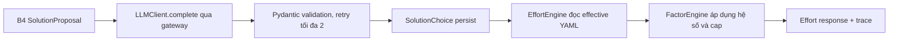

# Slice Spec — M3 Hướng giải pháp + effort tính bằng code

| Thuộc tính | Giá trị |
|---|---|
| Tên tài liệu | Đặc tả milestone M3 — Hướng giải pháp + effort tính bằng code |
| Phiên bản | 1.0 |
| Ngày | 2026-10-10 |
| Trạng thái | Sẵn sàng cho bước Build |
| Vai trò | Solution Architect |
| Nguồn | `AGENTS.md`, `docs/05_roadmap/roadmap.md` §5, `docs/04_architecture/` (4 file), `docs/04_architecture/handoff_to_dev.md`, `docs/slices/M2/spec.md`, `docs/slices/M2/handoff_to_build.md` |

> **Điều kiện trước khi build:** BA/PM phải phê duyệt bộ số giả lập trong `backend/app/reference/effort.yaml` và `factors.yaml`. Slice này không tự đặt hoặc sửa số nghiệp vụ trong tài liệu; mọi số trong YAML phải được gắn nhãn `giả lập` và có version.

---

## 1. Phạm vi

### 1.1 Slice này giao

M3 mở rộng pipeline sau M2 để presales có thể:

1. Nhận một đề xuất hướng giải pháp từ tập cố định: `none`, `traditional_ml`, `rag`, `agent`, `fine_tune`, kèm lý do, rủi ro và ghi chú kiến trúc bằng tiếng Việt.
2. Lưu lựa chọn hiện tại và lịch sử lựa chọn cũ; cho phép AI developer đổi hướng bằng thao tác explicit.
3. Tính effort hoàn toàn bằng code từ bảng chuẩn YAML theo `direction × phase` (`poc`, `mvp`, `production`), trả dải `min–max`, midpoint và tổng.
4. Áp dụng các hệ số cấu hình được, gồm tối thiểu các nhóm: on-premise, khách Nhật, dữ liệu chưa sẵn sàng, tuân thủ chặt, đa ngôn ngữ, OCR, dữ liệu lớn và nhiều requirement. Tích hệ số bị chặn bởi `factor_cap`.
5. Hiển thị dấu vết: version bảng chuẩn, nguồn effective YAML, từng hệ số và lý do, tích hệ số trước/sau trần, dải từng phase, công thức và kết quả.
6. Khi presales/AI developer đổi hướng, tính lại effort ngay từ YAML bằng code, **không gọi lại LLM** cho việc tính số và đánh dấu cảnh báo đánh giá requirement theo hướng cũ.
7. Từ hồ sơ đã qua M2, hiển thị được luồng end-to-end trên Preview; các bước WBS, proposal, schedule và quotation vẫn chưa được kích hoạt.

> **Ràng buộc contract cần lưu ý:** contract FROZEN hiện chưa có field request để FE gửi bộ hệ số bật/tắt. Vì vậy Build **không được tự thêm** `factors` vào `POST /solution`; bản M3 đầu tiên phải lấy hệ số từ context hồ sơ/reference đã persist và expose kết quả qua `GET /effort`. Nếu yêu cầu presales bật/tắt từng hệ số là bắt buộc trong acceptance, phải dừng trước implementation và tạo ADR cập nhật `api_contract.md` trước (kèm cập nhật cả backend/frontend).

### 1.2 Không thuộc M3

- Không thêm hướng giải pháp ngoài 5 giá trị contract.
- Không để LLM xuất `man_day`, effort, giá, ngày lịch, midpoint, hệ số số học hoặc tổng tiền.
- Không cho LLM sửa YAML, trần hệ số hoặc kết quả tính code.
- Không triển khai WBS, schedule, quotation, price gate, approval hoặc export.
- Không triển khai đầy đủ ma trận đánh giá requirement của M6; chỉ giữ endpoint evaluations tối thiểu nếu dữ liệu M2 đã có, và không mở rộng contract ngoài `api_contract.md`.
- Không thay đổi API contract frozen. Nếu phát hiện thiếu field bắt buộc, phải cập nhật `api_contract.md` và tạo ADR trước khi code.
- Không thêm queue, vector DB, RAG runtime, agent runtime, fine-tuning service hay auth server.
- Không tự chọn số liệu thị trường. Các giá trị YAML phải là fixture giả lập đã được BA/PM phê duyệt.

---

## 2. Frozen API contract subset của M3

Nguồn duy nhất: `docs/04_architecture/api_contract.md` bản FROZEN, §7.2, §8.0 và §12. Không thêm endpoint.

### 2.1 `POST /api/bids/{id}/solution` — đề xuất/chọn hướng giải pháp

**Request:**

```json
{
  "direction": "rag",
  "reason_vi": "Dữ liệu phi cấu trúc lớn, cần truy vấn ngữ nghĩa",
  "by": "ai_developer"
}
```

- `direction` chỉ nhận `none | traditional_ml | rag | agent | fine_tune`.
- Với đề xuất từ pipeline, `reason_vi`, `risks_vi`, `architecture_notes_vi` đến từ schema LLM; với đổi tay, `reason_vi` là lý do do người dùng nhập.
- Đổi hướng phải tạo `SolutionChoice` mới, supersede lựa chọn cũ và tính lại effort bằng code; không gọi lại LLM.
- Header `X-Role`/`X-User` vẫn theo contract chung; `by` chỉ là trường audit tương thích MVP, backend phải kiểm tra role khi hành động yêu cầu AI developer.

**Response 200:**

```json
{
  "direction": "rag",
  "effort_recalculated": true,
  "warnings": ["Đánh giá requirement đang theo hướng cũ"]
}
```

Lỗi chuẩn: `404 NOT_FOUND`; `400 VALIDATION_ERROR` cho direction/reason sai; envelope lỗi tiếng Việt.

### 2.2 `GET /api/bids/{id}/effort` — effort do code tính

**Response 200:**

```json
{
  "direction": "rag",
  "factors": [
    { "key": "customer_jp", "value": 1.2, "reason": "Khách Nhật" }
  ],
  "factor_product": 1.2,
  "cap": 2.0,
  "by_phase": {
    "poc": { "min": 8, "max": 12 },
    "mvp": { "min": 20, "max": 30 },
    "production": { "min": 10, "max": 16 }
  },
  "midpoint_total": 57.6,
  "trace": {
    "table_version": 4,
    "source": "reference/effort.yaml + override settings",
    "formula": "Σ midpoint(min,max) × factor_product"
  }
}
```

Quy ước thực thi: `by_phase` là dải sau khi áp dụng tích hệ số và trần; giá trị trả về phải được tính lại từ effective YAML tại thời điểm request. Số chữ số thập phân và cách làm tròn phải lấy từ reference config, không hardcode ở UI.

Lỗi chuẩn: `404 NOT_FOUND`; `409 STATE_CONFLICT` khi chưa chọn hướng giải pháp.

### 2.3 `GET /api/bids/{id}/evaluations` — bản tối thiểu cho M3

M3 không hoàn thiện ma trận M6. Nếu endpoint đã tồn tại từ M2/M6 integration, chỉ dùng các field contract đã frozen để hiển thị cảnh báo đánh giá cũ:

```json
{
  "solution_direction": {
    "direction": "rag",
    "reason_vi": "...",
    "selected_by": "ai_developer",
    "selected_at": "..."
  },
  "warnings": [
    { "type": "stale_solution_direction", "message": "Đánh giá requirement đang theo hướng cũ" }
  ],
  "items": [],
  "stats": {
    "total": 0,
    "evaluated": 0,
    "◎": 0,
    "○": 0,
    "△": 0,
    "×": 0,
    "needs_clarification": 0
  }
}
```

Frontend không được suy diễn effort từ endpoint này; chỉ lấy effort từ `GET /effort`.

### 2.4 Contract dùng chung

- Tất cả request/response JSON dùng prefix `/api`; lỗi theo `{ "error": { "code", "message", "details" } }`.
- `message` lỗi tiếng Việt.
- FE dùng base root-relative `/api`, không hardcode host/localhost.
- Hướng hiển thị bằng nhãn tiếng Việt: `none` = không cần AI; `traditional_ml` = ML truyền thống; `rag` = RAG; `agent` = agent; `fine_tune` = fine-tune.

---

## 3. Các bước LLM chạm tới

### 3.1 B4 — Solution proposal

**Input context:** output intake/gap của M2, câu trả lời làm rõ đã persist, metadata dữ liệu và requirement nếu có; tập 5 hướng cố định được truyền trong prompt.

**Output schema `SolutionProposal`:**

```json
{
  "direction": "rag",
  "reason_vi": "string — bắt buộc, tối đa 300 từ",
  "risks_vi": ["string — tối đa 5 rủi ro"],
  "architecture_notes_vi": "string — tối đa 300 từ"
}
```

Validation:

- `direction` thuộc đúng enum 5 giá trị.
- `reason_vi` không rỗng; giới hạn độ dài của các trường được validate bằng Pydantic.
- Không có field hoặc nested field tên/liên quan đến `man_day`, `effort`, `price`, `amount`, `cost`, `date`, `schedule`, `factor_product`, `min`, `max`, `midpoint`.
- Schema sai retry tối đa 2 lần qua `complete_with_retry`; sau đó bước fail với `422 PIPELINE_ERROR` và `details.step=solution`.
- PII đã mask trước gateway; test phải kiểm tra prompt gửi mock.

**Mock fixtures cần có:**

| Fixture | Mục đích |
|---|---|
| `SolutionProposal` good/rag | happy path khách Nhật, dữ liệu phi cấu trúc |
| `SolutionProposal` good/none | ca không cần AI |
| `SolutionProposal` good/traditional_ml | ca dữ liệu có nhãn |
| `SolutionProposal` good/agent | ca workflow nhiều bước |
| `SolutionProposal` good/fine_tune | ca cần mô hình chuyên biệt |
| `SolutionProposal` bad_schema | retry rồi fail rõ |
| `SolutionProposal` with_forbidden_numbers | bị schema/test chặn, không persist |
| direction invalid | validation không cho lưu |

M3 không tạo thêm bước LLM cho effort. `EffortEngine` không gọi gateway.

### 3.2 Tách bạch LLM và code



LLM chỉ giải thích lựa chọn. Mọi con số trong `GET /effort` phải có nguồn từ YAML/override và công thức deterministic.

---

## 4. Tasks theo file và shared contract

### 4.1 Backend

| File | Hành động | Nội dung |
|---|---|---|
| `backend/app/reference/effort.yaml` | Tạo | Bảng giả lập min–max cho đủ 5 direction × 3 phase; version; metadata nguồn/phê duyệt. |
| `backend/app/reference/factors.yaml` | Tạo | Key, label, value, điều kiện áp dụng, reason template, `factor_cap`; gồm nhóm hệ số M3. |
| `backend/app/schemas/llm_schemas/solution_proposal.py` | Tạo | Pydantic schema B4, enum cố định, cấm field số theo test schema. |
| `backend/app/schemas/api_schemas/solution.py` | Tạo/cập nhật | Request/response của solution và warning stale direction. |
| `backend/app/schemas/api_schemas/effort.py` | Tạo | `EffortOut`, `PhaseRange`, `AppliedFactor`, `EffortTrace`. |
| `backend/app/models/solution_choice.py` | Tạo/cập nhật | Lưu lựa chọn, lý do, rủi ro, người chọn, supersede. |
| `backend/app/services/reference_service.py` | Tạo | Đọc YAML + override nếu đã có; validate đủ tổ hợp và trả effective version/source. |
| `backend/app/services/factor_engine.py` | Tạo | Tính tích, áp trần, trả từng factor và trace; không làm tròn sớm. |
| `backend/app/services/effort_engine.py` | Tạo | Đọc bảng chuẩn, nhân hệ số đã cap, tính range/midpoint theo phase và tổng. |
| `backend/app/services/solution_service.py` | Tạo | Lưu/đổi hướng, audit, tạo warning đánh giá cũ, gọi effort engine; đổi hướng không gọi LLM. |
| `backend/app/pipeline/steps/b4_solution.py` | Tạo/cập nhật | Chạy B4 qua gateway, validate, persist `SolutionChoice`; không tính effort trong prompt response. |
| `backend/app/pipeline/orchestrator.py` | Cập nhật | Kích hoạt solution sau các bước M2 đã hoàn tất; giữ các bước M4+ pending. |
| `backend/app/api/routers/solution.py` | Tạo | `POST /bids/{id}/solution`. |
| `backend/app/api/routers/effort.py` | Tạo | `GET /bids/{id}/effort`. |
| `backend/app/api/routers/evaluations.py` | Cập nhật | Bản tối thiểu warning stale direction, không triển khai ma trận M6. |
| `backend/app/api/routers/__init__.py` | Cập nhật | Include router M3. |
| `backend/app/llm/prompts/b4_solution.py` | Tạo | Prompt tiếng Việt, enum 5 hướng, lý do loại các hướng khác bằng văn bản, cấm mọi số effort/giá/ngày. |
| `backend/app/llm/mock_client.py` | Cập nhật | Fixtures ở §3.1. |
| `backend/app/models/__init__.py` | Cập nhật | Import model mới để `create_all` thấy. |
| `backend/tests/test_effort.py` | Tạo | Range, midpoint, tổng, version/source, nhiều direction/phase. |
| `backend/tests/test_factors.py` | Tạo | Từng hệ số, tổ hợp, cap, boundary, factor không hợp lệ. |
| `backend/tests/test_trace.py` | Tạo | Trace đủ bảng chuẩn, factor, công thức; UI/API không mất provenance. |
| `backend/tests/test_solution_direction.py` | Tạo | Enum, lý do, retry, đổi hướng không gọi LLM, stale warning. |
| `backend/tests/test_llm_schema_no_numbers.py` | Cập nhật | Bao phủ `SolutionProposal`, cấm field số và fixture forbidden numbers. |

### 4.2 Frontend

| File | Hành động | Nội dung |
|---|---|---|
| `frontend/src/api/types.ts` | Cập nhật | `SolutionDirection`, `SolutionChoice`, `AppliedFactor`, `EffortByPhase`, `EffortTrace`, `EffortResponse`. |
| `frontend/src/api/client.ts` | Cập nhật | `chooseSolution(id, request)`, `getEffort(id)`, `getEvaluations(id)` dùng `/api`. |
| `frontend/src/pages/SolutionReviewPage.tsx` | Tạo/cập nhật | Hiển thị đề xuất, lý do, rủi ro, kiến trúc; chọn hướng; cảnh báo stale evaluation. |
| `frontend/src/components/SolutionDirectionSelector.tsx` | Tạo | Select/radio chỉ 5 hướng, không cho nhập giá trị tự do. |
| `frontend/src/components/EffortBreakdown.tsx` | Tạo | Dải min–max theo phase, midpoint/tổng, factor cap và công thức. |
| `frontend/src/components/EffortTracePanel.tsx` | Tạo | Expand/click xem YAML version, source, từng hệ số, tích trước/sau cap, phép tính. |
| `frontend/src/pages/BidDetailPage.tsx` | Cập nhật | Thêm trạng thái/điều hướng M3 sau phân tích M2. |
| `frontend/src/App.tsx` | Cập nhật | Route màn hình M3 nếu routing hiện tại chưa bao phủ. |
| `frontend/src/App.test.tsx` hoặc test component M3 | Cập nhật | Mock API; assert chỉ 5 hướng, hiển thị trace, đổi hướng gọi API không gọi LLM từ FE. |

### 4.3 Shared contract backend ↔ frontend

- BE serializes enum/value theo contract; FE không đổi key thành nhãn khi gửi request.
- FE chỉ render số từ `GET /effort`, không tự nhân hệ số hoặc tính midpoint.
- FE hiển thị `factor_product` và `cap` đúng response; không tự kết luận cap nếu backend chưa trả.
- FE hiển thị cảnh báo stale evaluation nhưng không tự xoá/đánh giá lại requirement.
- Mọi lỗi API đi qua error envelope và hiển thị message tiếng Việt.

---

## 5. Acceptance criteria

### 5.1 Shell commands phải exit 0

Các lệnh dưới đây là acceptance gate của roadmap M3; không thay bằng lệnh tương đương:

```bash
cd backend && pytest -q tests/test_effort.py
cd backend && pytest -q tests/test_factors.py
cd backend && pytest -q tests/test_solution_direction.py
cd backend && pytest -q tests/test_trace.py
cd backend && LLM_PROVIDER=mock pytest -q tests/test_llm_schema_no_numbers.py
```

Quality gate bổ sung bắt buộc cho DoD:

```bash
make test
cd backend && pytest -q
cd frontend && npm run build
make quality-gate
```

Nếu repository có script type-check riêng trong `frontend/package.json`, phải chạy thêm đúng script đó; nếu `npm run build` đã bao gồm TypeScript check thì ghi nhận output trong test report.

### 5.2 Kịch bản thủ công trên Preview

1. Nạp hồ sơ tiếng Nhật giả lập của M2; hoàn thành câu hỏi làm rõ nếu đang `waiting_clarification`.
2. Mở bước **Hướng giải pháp**. Kết quả: hệ thống hiển thị đúng một đề xuất thuộc 5 hướng, lý do/rủi ro/ghi chú bằng tiếng Việt; không có số effort/giá/ngày trong phần LLM.
3. Chọn **Xem effort**. Kết quả: có ba phase PoC/MVP/Production, mỗi phase có min–max; tổng và midpoint do backend trả, có dấu vết bảng chuẩn + version.
4. Kiểm tra context hồ sơ làm bật các hệ số phù hợp, tối thiểu khách Nhật và dữ liệu chưa sẵn sàng. Kết quả: từng hệ số có value/reason; tích hiển thị không vượt `cap`; trace chỉ rõ trước/sau cap. (Không gửi field ngoài contract frozen.)
5. Với bộ context có nhiều hệ số đến khi tích raw vượt trần, gọi trực tiếp `GET /effort`. Kết quả: backend cưỡng chế cap; UI hiển thị raw/capped trong trace, không thể vượt trần. Nếu cần thao tác bật/tắt thủ công, ghi blocker contract và không tự mở rộng API.
6. Đổi hướng từ hướng hiện tại sang hướng khác. Kết quả: effort đổi theo bảng chuẩn hướng mới; response có `effort_recalculated=true`; không phát sinh LLM call mới cho việc tính effort; cảnh báo đánh giá theo hướng cũ xuất hiện nếu có evaluations.
7. Mở lại hồ sơ và refresh trang. Kết quả: hướng hiện tại, factor và trace vẫn khôi phục nhất quán từ API/DB.
8. Gửi request hướng không thuộc 5 giá trị hoặc factor key không hợp lệ. Kết quả: lỗi validate tiếng Việt, không ghi lựa chọn và không làm thay đổi effort trước đó.

### 5.3 Test chứng minh các rule AGENTS.md liên quan M3

| Rule | Test/kiểm tra bắt buộc | Assert |
|---|---|---|
| 1 — No invented numbers | `test_effort.py`, `test_factors.py`, `test_llm_schema_no_numbers.py` | Effort chỉ do engine đọc YAML; schema B4 không có số; cap được code áp dụng. |
| 2 — Structured LLM output | `test_solution_direction.py` | Fixture sai schema retry tối đa 2 rồi lỗi rõ; không persist output sai. |
| 3 — One LLM gateway | `test_solution_direction.py` + mock gateway | B4 chỉ gọi `complete_with_retry`; EffortEngine/FactorEngine không import/gọi client; CI dùng mock. |
| 4 — Ask instead of guess | `test_solution_direction.py` | Khi M2 còn câu hỏi chưa trả lời, không cho chạy B4/không tính effort; API trả trạng thái conflict phù hợp. |
| 6 — Privacy | test gateway/prompt hiện có mở rộng cho B4 | Prompt B4 đã mask email/SĐT; fixture/sample hư cấu. |
| 7 — Languages | test schema/service + Preview | Lý do nội bộ tiếng Việt; nhãn UI tiếng Việt; không dùng customer language để đổi schema số. |
| 8 — Done means proven | toàn bộ lệnh §5.1 + Preview §5.2 | Test tự động pass và click-through Preview pass. |
| 9 — Keep it simple | review dependency/architecture | Không thêm queue, vector DB, auth server hoặc service AI truyền thống runtime. |
| 10 — Frontend networking | quality gate/grep guard | Không có host hardcode trong `frontend/src`; mọi request dùng `/api`. |

---

## 6. Test data và fixture

Nếu chưa có, tạo các file sau; toàn bộ dữ liệu phải ghi rõ **DỮ LIỆU GIẢ LẬP**:

| File | Nội dung |
|---|---|
| `backend/app/reference/effort.yaml` | Đủ 5 hướng × 3 phase, min < max, version và metadata phê duyệt; số do BA/PM cung cấp. |
| `backend/app/reference/factors.yaml` | Các key hệ số M3, value, reason, cap; không để value ngoài schema. |
| `backend/tests/fixtures/solution_samples.py` | Một fixture hợp lệ cho từng hướng, fixture thiếu field, fixture có field cấm số. |
| `backend/tests/fixtures/effort_cases.yaml` | Các tổ hợp direction/factor/cap để test data-driven; ghi expected theo bảng đã phê duyệt, không tự suy diễn. |

Test tối thiểu phải bao phủ: không có factor; một factor; nhiều factor dưới cap; nhiều factor vượt cap; direction có dải khác nhau; thiếu tổ hợp bảng chuẩn; min/max không hợp lệ; đổi hướng; hồ sơ chưa hoàn tất làm rõ.

---

## 7. Rủi ro và điểm bàn giao

| Rủi ro | Giảm thiểu |
|---|---|
| Bộ số giả lập chưa được phê duyệt | Chặn build/acceptance cho tới khi BA/PM cung cấp version YAML; không hardcode số trong test ngoài fixture. |
| UI tính lại số và lệch backend | FE chỉ render response; test API + component với trace cố định. |
| Trần hệ số bị áp dụng hai lần | FactorEngine là nơi duy nhất áp cap; trace ghi rõ raw product và capped product. |
| M3 kích hoạt sai bước pipeline M2 | Chỉ chuyển từ M2 sang B4 khi gap đã hoàn tất; giữ các bước M4+ pending; test state transition. |
| Đổi hướng làm mất lịch sử | `solution_choices` append-only về mặt nghiệp vụ, bản cũ có `superseded_at`; test reload sau đổi hướng. |

---

**Task Slice Spec (M3) complete. Handoff cho Build ở `docs/slices/M3/handoff_to_build.md`.**
