# Slice Spec — M4 WBS 3 cấp + master schedule (sửa được, code tính lại)

| Thuộc tính | Giá trị |
|---|---|
| Tên tài liệu | Đặc tả milestone M4 — WBS 3 cấp + lịch tính bằng code |
| Phiên bản | 1.0 |
| Ngày | 2026-10-10 |
| Trạng thái | Sẵn sàng cho bước Build |
| Vai trò | Solution Architect |
| Nguồn | `AGENTS.md`, `docs/05_roadmap/roadmap.md` §6, `docs/04_architecture/` (4 file, đã cập nhật ADR-006), `docs/slices/M3/spec.md`, `docs/slices/M3/review.md`, `docs/slices/M3/test_report.md`, code M1–M3 hiện có |

> **Điều kiện trước khi build:**
> 1. **M3 phải được fix + approve trước** (các finding M3-REV-001..005 trong `docs/slices/M3/review.md`): đặc biệt M3-REV-002 (mutation chặn `locked`) và M3-REV-001 (danh tính từ header `X-Role`/`X-User`) — M4 dùng chính cơ chế này cho `PUT /wbs`, `PUT /schedule`, `POST /wbs/snapshot`.
> 2. **Bộ số giả lập** `reference/holidays.yaml` (nghỉ lễ VN/Nhật) và `reference/payment.yaml` (mốc thanh toán mặc định) do BA/PM phê duyệt; mọi số gắn nhãn `giả lập` và có version.
> 3. Contract đã được mở rộng cho M4: xem **ADR-006** (`architecture.md` §8) và ghi chú thay đổi đầu `api_contract.md`.

---

## 1. Phạm vi

### 1.1 Slice này giao

M4 mở rộng pipeline sau M3 để presales/AI developer có thể:

1. Chạy **bước AI 5 (WBS)** sinh **WBS 3 cấp (nhóm / task / sub-task)** theo giai đoạn (`poc`/`mvp`/`production`); **task lá** có loại công việc (`pm`, `ba`, `brse`, `ai_engineer`, `backend`, `frontend`, `qa`, `infra`) và **man-day ≤ 10**.
2. **Code kiểm tra** WBS: (a) tổng man-day khớp dải effort ±20% so midpoint; (b) mỗi giai đoạn có ≥ 1 task PM và ≥ 1 task QA; (c) phụ thuộc `depends_on` **không vòng**; (d) mọi task lá man-day ≤ 10. Lỗi ngữ nghĩa → retry ≤ 2 → cảnh báo (không chặn).
3. **Code tính master schedule** từ: WBS × số người mỗi loại (`team_allocation`), ngày bắt đầu, ngày nghỉ (lịch VN/Nhật), buffer; có **mốc thanh toán**; cảnh báo vượt hạn nộp.
4. Sửa WBS trực tiếp trên web (**thêm/sửa/xóa** task, đổi cha/phụ thuộc) → **tổng + lịch tự tính lại, không gọi AI**.
5. Xem **Gantt** (ngày từng task do backend tính, trả trong `GET /schedule`).
6. Chụp **snapshot WBS** + xem diff trước/sau; **chạy lại từ bước WBS** (góp ý) giữ nguyên bước đánh giá requirement (B3) và hướng giải pháp (B4).

### 1.2 Không thuộc M4

- Không triển khai **duyệt kỹ thuật / duyệt giá** (`POST /approvals/tech`, `POST /approvals/price`, `POST /unlock`) — thuộc M5 (contract §12).
- Không tính **báo giá** (`GET /quotation`, rate card, overhead, tỉ giá, 見積書) — thuộc M5. `PUT /wbs` trả `recalculated.schedule`; mục `recalculated.quotation` bỏ trống (bổ sung M5).
- Không triển khai khóa hồ sơ `locked` do duyệt giá (M5) — nhưng **guard `locked → 409` phải có** ngay ở service (contract §1.7, M3-REV-002) và có test.
- Không để LLM xuất `man_day`, effort, giá, ngày lịch, midpoint, tổng tiền (BR-01). Schema `WbsStructure` **không có** trường số/ngày.
- Không cho LLM sửa YAML, trần hệ số, kết quả tính code.
- Không triển khai ma trận đáp ứng đầy đủ (M6), proposal (M6/M7), xuất file (M7), trang Cài đặt (M8).
- Không thêm queue, vector DB, auth server, thư viện chart nặng (Gantt dựng bằng CSS/div — BR-09).

---

## 2. Frozen API contract subset của M4

Nguồn duy nhất: `docs/04_architecture/api_contract.md` (đã cập nhật ADR-006, ghi chú thay đổi 2026-10-10). Endpoint M4: §8.1, §8.2, §8.3, §8.4, §8.4a (mới), §5.2/§5.3 (kích hoạt bước wbs), §8.0 (đầu vào effort). Không thêm endpoint ngoài contract.

### 2.1 `GET /api/bids/{id}/wbs` — Xem WBS 3 cấp (FR-032, FR-041)

**Response 200:**

```json
{
  "items": [
    { "task_code": "WBS-001", "name_vi": "PoC — Khảo sát & thiết kế", "phase": "poc",
      "parent_code": null, "level": 1, "role": null, "weight": null, "man_day": 8.0,
      "depends_on": [], "sort_order": 1, "is_leaf": false },
    { "task_code": "WBS-001-01", "name_vi": "Khảo sát hiện trạng", "phase": "poc",
      "parent_code": "WBS-001", "level": 2, "role": null, "weight": null, "man_day": 5.0,
      "depends_on": [], "sort_order": 1, "is_leaf": false },
    { "task_code": "WBS-001-01-01", "name_vi": "Phỏng vấn khách hàng", "phase": "poc",
      "parent_code": "WBS-001-01", "level": 3, "role": "ba", "weight": 20, "man_day": 3.0,
      "depends_on": [], "sort_order": 1, "is_leaf": true }
  ],
  "totals": { "man_day": 42.0, "by_phase": { "poc": 8.0, "mvp": 22.0, "production": 12.0 } },
  "check": { "midpoint": 40.0, "deviation_pct": 5.0, "within_20pct": true, "pm_qa_ok": true,
             "cycle_free": true, "leaf_max_man_day": 8.0, "leaf_within_limit": true,
             "warning": null },
  "trace": { "direction": "rag", "factors": [ {"key": "customer_jp", "value": 1.2, "reason": "Khách Nhật"} ],
             "factor_product": 1.2, "cap": 2.0, "range": { "min": 32, "max": 48 },
             "formula": "midpoint(range) × Σweight → man_day/task lá (≤ 10); nhóm = Σ con" }
}
```

- `level` ∈ {1,2,3} (suy từ chuỗi `parent_code`); độ sâu tối đa 3.
- `is_leaf` = không có item nhận nó làm cha; `role`/`weight`/`man_day` chỉ trên lá; lá `man_day ≤ 10`.
- `depends_on` ≤ 5 mã, không tự tham chiếu, không vòng.
- `check.pm_qa_ok`, `check.within_20pct`, `check.cycle_free`, `check.leaf_within_limit` như §8.1.
- **Errors:** `404 NOT_FOUND` · `409 STATE_CONFLICT` (chưa có WBS).

### 2.2 `PUT /api/bids/{id}/wbs` — Sửa WBS (FR-041, UC-06)

**Request:**

```json
{ "changes": [
    { "op": "add", "task": { "task_code": "WBS-010", "name_vi": "Test chấp nhận", "phase": "production",
                             "parent_code": null, "role": "qa", "man_day": 3.0, "depends_on": [] } },
    { "op": "update", "task_code": "WBS-001-01-01", "fields": { "man_day": 5.0 } },
    { "op": "update", "task_code": "WBS-001-01", "fields": { "depends_on": ["WBS-002-01"] } },
    { "op": "remove", "task_code": "WBS-001-01" }
  ],
  "by": "ai_developer", "note": "Bổ sung QA giai đoạn production" }
```

- `add`: mã duy nhất; `parent_code` tham chiếu item tồn tại (hoặc null); depth ≤ 3; `role` + `man_day` bắt buộc khi tạo lá (`man_day ≤ 10`); `weight` tùy chọn (thêm tay → null).
- `update`: `fields` ⊆ {`name_vi`, `phase`, `parent_code`, `role`, `man_day`, `depends_on`, `sort_order`}; đổi cha không tạo vòng cây/vượt depth; `role`/`man_day` chỉ trên lá.
- `remove`: xóa item + toàn bộ sub-tree; code dọn `depends_on` trỏ tới item đã xóa.
- Sửa xong → code tính lại tổng + check + lịch, **không gọi AI**; response = WBS mới (§8.1) + `recalculated: { schedule: {...} }`.
- Override ngoài ±20% → bắt buộc `note` (BR-12); thiếu → `400 VALIDATION_ERROR`.
- **Errors:** `409 STATE_CONFLICT` (locked) · `400 VALIDATION_ERROR` (trùng mã, vòng, lá > 10 md, depth > 3, thiếu PM/QA khi override không ghi chú).

### 2.3 `POST /api/bids/{id}/wbs/snapshot` — Snapshot WBS (FR-041.2)

**Request:** `{ "reason": "Trước khi chạy lại từ WBS", "by": "ai_developer" }`
**Response 201:** `{ "snapshot_id": 3, "diff_summary": null }` — `diff_summary` tính ở mức item (thêm/sửa/xóa, gồm `parent_code`, `depends_on`, `man_day`).

### 2.4 `GET /api/bids/{id}/schedule` — Master schedule (FR-034)

**Response 200:**

```json
{
  "start_date": "2026-11-01", "buffer_days": 5, "working_calendar": "jp",
  "team_allocation": { "pm": 1, "ba": 1, "ai_engineer": 1, "backend": 2, "frontend": 1, "qa": 1 },
  "payment_milestones": [ { "name": "Kickoff", "percent": 20, "due_offset_days": 0, "due_date": "2026-11-01" } ],
  "by_role": { "backend": { "man_day": 20.0, "headcount": 2, "duration_days": 10 },
               "qa": { "man_day": 6.0, "headcount": 1, "duration_days": 6 },
               "pm": { "man_day": 4.0, "headcount": 1, "duration_days": 4 } },
  "tasks": [
    { "task_code": "WBS-001-01-01", "phase": "poc", "role": "ba", "man_day": 3.0,
      "start_date": "2026-11-02", "end_date": "2026-11-04" }
  ],
  "holidays_applied": ["2026-11-03", "2026-11-23"],
  "end_date": "2026-12-10", "deadline_violation": false,
  "warning": null,
  "trace": { "formula": "end = start + Σ(ceil(man_day/task ÷ headcount[role])) theo phase + buffer (trừ T7/CN + nghỉ lễ)" }
}
```

- `due_date` của mốc thanh toán = `start_date + due_offset_days` (ngày lịch) — code tính, thêm vào response (tương thích ngược).
- **Errors:** `404 NOT_FOUND` · `409 STATE_CONFLICT` (chưa có lịch — hãy gọi `PUT /schedule`).

### 2.5 `PUT /api/bids/{id}/schedule` — Cập nhật tham số lịch (FR-034, §8.4a — MỚI)

**Request:**

```json
{ "start_date": "2026-11-01", "buffer_days": 5, "working_calendar": "jp",
  "team_allocation": { "pm": 1, "ba": 1, "ai_engineer": 1, "backend": 2, "frontend": 1, "qa": 1 },
  "payment_milestones": [ { "name": "Kickoff", "percent": 20, "due_offset_days": 0 } ],
  "by": "ai_developer" }
```

- `team_allocation`: key ⊆ 8 vai trò, headcount ≥ 0; mọi role xuất hiện trong WBS phải có headcount ≥ 1 → thiếu trả `400 VALIDATION_ERROR` kèm `details.missing_roles`.
- `payment_milestones` tùy chọn; thiếu → mặc định `reference/payment.yaml`; tổng `percent` ≤ 100.
- Lưu → code tính lại lịch ngay, không gọi AI; ghi changelog `edit_schedule`.
- **Response 200:** schedule mới (§8.4). **Errors:** `409 STATE_CONFLICT` (locked) · `400 VALIDATION_ERROR`.

### 2.6 Contract dùng chung

- `POST /api/bids/{id}/rerun` với `{"from_step": "wbs"}` (§5.3): **tự snapshot WBS cũ** (FR-041.2), giữ `evaluate` + `solution` completed, chạy lại `wbs` (+ downstream). MVP chỉ hỗ trợ `from_step ∈ {null, "wbs"}`.
- `GET /api/bids/{id}/effort` (§8.0): đầu vào cho WBS — `midpoint_total` = target, `by_phase` = dải từng phase sau hệ số.
- Header `X-Role`/`X-User` theo contract §1.5: backend lấy danh tính **từ header** làm audit authoritative (không tin `by` từ body — M3-REV-001); role `ai_developer`/`presales` được sửa WBS/lịch.
- Error envelope chuẩn; `message` tiếng Việt; FE base root-relative `/api` (BR-10).
- Nhãn hiển thị tiếng Việt: phase `poc` = PoC, `mvp` = MVP, `production` = Production; role theo bảng nhãn chung.

---

## 3. Các bước LLM chạm tới

### 3.1 B4 — Solution (kích hoạt trong orchestrator)

M3 build chưa nối B4 vào `orchestrator.run()` (`IMPLEMENTED_STEPS = {"intake","gap"}`). M4 **bắt buộc kích hoạt** `solution` trước `wbs` trong vòng lặp pipeline (bước `b4_solution.py` đã tồn tại). Không đổi schema B4.

### 3.2 B5 — WBS 3 cấp (`WbsStructure` — MỚI)

**Input context:** hướng giải pháp đã chọn (B4); dải effort theo phase sau hệ số (code truyền vào prompt); danh sách requirement metadata nếu có; giả định đã chọn.

**Output schema `WbsStructure` (LLM):**

```json
{
  "tasks": [
    {
      "task_code": "string — mã nội bộ, ví dụ WBS-001",
      "name_vi": "string — tên công việc tiếng Việt",
      "phase": "enum: poc | mvp | production",
      "parent_code": "string | null — mã item cha; null = cấp 1 (nhóm)",
      "role": "enum: pm | ba | brse | ai_engineer | backend | frontend | qa | infra — BẮT BUỘC khi là task lá",
      "weight": "integer 1–100 — trọng số tương đối (code quy man-day), BẮT BUỘC khi là task lá",
      "depends_on": ["string — mã task khác, tối đa 5, có thể rỗng"]
    }
  ],
  "notes_vi": ["string — tối đa 5 ghi chú"]
}
```

Validation (code):

- `extra="forbid"`; **không có field/nested field** `man_day`, `effort`, `price`, `amount`, `cost`, `date`, `schedule`, `midpoint`, `min`, `max` (BR-01 — unit test assert).
- `task_code` duy nhất; `phase`/`role`/`weight` hợp lệ; `parent_code` trỏ tới task trong payload; depth ≤ 3; `role`/`weight` chỉ trên lá.
- `depends_on` trỏ tới task tồn tại, không tự tham chiếu, **không vòng** (DFS).
- Schema sai → retry ≤ 2 → fail bước với `422 PIPELINE_ERROR`, `details.step=wbs`.

**Man-day do code gán (BR-01):**

1. `target_phase = midpoint(by_phase[phase])` từ `EffortEngine` (dải sau hệ số).
2. Với mỗi phase: `man_day(lá) = round(target_phase × weight_i / Σweight_phase, 1)`.
3. Cân bằng sai số làm tròn vào lá lớn nhất (tổng phase khớp `target_phase`).
4. Nhóm/task cha: `man_day = Σ con` (tính khi trả response).

**Kiểm tra ngữ nghĩa (code, `check_engine`):** thiếu PM/QA mỗi phase; lệch ±20% so `midpoint_total`; vòng phụ thuộc; lá > 10 md → **retry ≤ 2** → **cảnh báo** (không chặn; người sửa tay).

**Mock fixtures cần có (`MockLLMClient`):**

| Fixture | Mục đích |
|---|---|
| `WbsStructure` good/rag_3level | happy path: 3 phase, đủ PM/QA, không vòng, weights hợp lý |
| `WbsStructure` good/flat_ok | WBS 2 cấp hợp lệ (tối thiểu) |
| `WbsStructure` missing_pm | thiếu PM một phase → retry → cảnh báo |
| `WbsStructure` missing_qa | thiếu QA một phase → retry → cảnh báo |
| `WbsStructure` cycle | `A depends B`, `B depends A` → retry → cảnh báo |
| `WbsStructure` leaf_too_heavy | weights khiến lá > 10 md → retry → cảnh báo |
| `WbsStructure` bad_schema | thiếu `task_code`/role trên nhóm → retry → fail rõ |
| `WbsStructure` with_man_day | chứa `man_day` → bị schema/test chặn (BR-01) |

B5 không gọi LLM cho việc tính số; `wbs_engine`/`schedule_engine`/`check_engine` không import gateway.

### 3.3 Tách bạch LLM và code

```mermaid
flowchart LR
    A["B4 SolutionProposal"] --> B["B5 WbsStructure (qua gateway)"]
    B --> C["Pydantic validation, retry ≤ 2"]
    C --> D["WbsEngine gán man-day lá từ midpoint"]
    D --> E["CheckEngine: ±20% · PM/QA · vòng · lá ≤ 10"]
    E --> F["Persist wbs_items (3 cấp)"]
    F --> G["ScheduleEngine: WBS × headcount + nghỉ lễ + buffer"]
    G --> H["GET /wbs + GET /schedule (Gantt)"]
    F -. "PUT /wbs / PUT /schedule (sửa tay)" .-> G
```



---

## 4. Tasks theo file và shared contract

### 4.1 Backend

| File | Hành động | Nội dung |
|---|---|---|
| `backend/app/reference/holidays.yaml` | Tạo | Nghỉ lễ VN + Nhật 2026 (dữ liệu cấu hình, ghi rõ nguồn/version); `vn: [date...]`, `jp: [date...]` — BA/PM phê duyệt |
| `backend/app/reference/payment.yaml` | Tạo | Mốc thanh toán mặc định `[{name, percent, due_offset_days}]` (giả lập, tổng ≤ 100) |
| `backend/app/schemas/llm_schemas/wbs_structure.py` | Tạo | `WbsStructure` + `WbsTaskItem`; `extra="forbid"`; cấm field số/ngày; validator depth/role-lá |
| `backend/app/schemas/api_schemas/wbs.py` | Tạo | `WbsItemOut` (level/is_leaf), `WbsOut`, `WbsCheckOut`, `WbsTraceOut`, `WbsChangeIn` (add/update/remove), `WbsSnapshotIn/Out` |
| `backend/app/schemas/api_schemas/schedule.py` | Tạo | `ScheduleOut` (tasks[], by_role, holidays_applied), `ScheduleUpdateIn`, `RoleDurationOut`, `TaskDateOut` |
| `backend/app/models/wbs_item.py` | Tạo | `wbs_items` 3 cấp: `parent_code`, `depends_on` (JSON), `role`/`weight`/`man_day` nullable (lá-only) |
| `backend/app/models/wbs_snapshot.py` | Tạo | `wbs_snapshots` (theo data_model §9) |
| `backend/app/models/schedule.py` | Tạo | `schedules`: thêm `by_role`, `tasks_json`, `holidays_applied` (data_model §10) |
| `backend/app/models/__init__.py` | Cập nhật | Import 3 model mới |
| `backend/app/services/reference_service.py` | Cập nhật | `load_holidays()`, `load_payment()` + validate cấu trúc |
| `backend/app/services/wbs_engine.py` | Tạo | Dựng cây 3 cấp từ `WbsStructure`; gán man-day lá (≤ 10); tổng theo phase; cân bằng làm tròn |
| `backend/app/services/check_engine.py` | Tạo | `check_wbs(items, midpoint, by_phase) -> WbsCheckOut` (pm_qa_ok, within_20pct, cycle_free, leaf_within_limit, warning) |
| `backend/app/services/wbs_service.py` | Tạo | CRUD WBS (add/update/remove + sub-tree), override note (BR-12), chặn locked (409), tính lại + changelog `edit_wbs` |
| `backend/app/services/schedule_engine.py` | Tạo | Tính lịch: phase tuần tự, task topo theo `depends_on`, duration = ceil(man_day ÷ headcount), trừ T7/CN + nghỉ lễ, buffer, mốc thanh toán, `deadline_violation` |
| `backend/app/services/schedule_service.py` | Tạo | Lưu/đọc `schedules`, validate `team_allocation` (missing_roles), mặc định payment, changelog `edit_schedule` |
| `backend/app/services/lock_service.py` | Tạo | Helper `ensure_unlocked(bid)` — dùng cho mọi mutation M4 (tie M3-REV-002) |
| `backend/app/pipeline/steps/b5_wbs.py` | Tạo | Chạy B5: prompt → gateway → validate → wbs_engine → check → persist `wbs_items`; retry ngữ nghĩa ≤ 2 |
| `backend/app/pipeline/orchestrator.py` | Cập nhật | `IMPLEMENTED_STEPS = {"intake","gap","solution","wbs"}`; gọi `run_solution` + `run_wbs`; `_finalize` vẫn → `waiting_tech_approval` |
| `backend/app/pipeline/runner.py` | Cập nhật | `resume(from_step="wbs")`: snapshot WBS cũ (nếu có) + reset `wbs` và các bước sau về pending; giữ `evaluate`/`solution` |
| `backend/app/api/routers/wbs.py` | Tạo | `GET/PUT /bids/{id}/wbs`, `POST /bids/{id}/wbs/snapshot` |
| `backend/app/api/routers/schedule.py` | Tạo | `GET/PUT /bids/{id}/schedule` |
| `backend/app/api/routers/__init__.py` | Cập nhật | Include 2 router mới |
| `backend/app/api/deps.py` | Cập nhật | Dependency đọc `X-Role`/`X-User` → trả danh tính authoritative (M3-REV-001) |
| `backend/app/llm/prompts/b5_wbs.py` | Tạo | Prompt tiếng Việt: yêu cầu 3 cấp theo phase, lá có role/weight, phụ thuộc hợp lý, cấm mọi số man-day/ngày |
| `backend/app/llm/mock_client.py` | Cập nhật | Fixtures `WbsStructure` (§3.2) |
| `backend/tests/test_wbs.py` | Tạo | Gán man-day, tổng phase, cân bằng làm tròn, lá ≤ 10, depth ≤ 3 |
| `backend/tests/test_wbs_pm_qa.py` | Tạo | Thiếu PM/QA mỗi phase → retry → cảnh báo; đủ → pass |
| `backend/tests/test_wbs_cycles.py` | Tạo | Phát hiện vòng phụ thuộc (DFS); tự tham chiếu; depends_on mã lạ |
| `backend/tests/test_schedule.py` | Tạo | Lịch theo WBS × headcount; phase tuần tự; buffer; mốc thanh toán (due_date) |
| `backend/tests/test_schedule_holidays.py` | Tạo | Mẫu nghỉ lễ Nhật (vd. 2026-11-03, 2026-11-23) trừ đúng ngày làm việc |
| `backend/tests/test_deadline_warning.py` | Tạo | end_date > submission_deadline → `deadline_violation=true` + warning; tăng headcount → hết vi phạm |
| `backend/tests/test_wbs_snapshot.py` | Tạo | Snapshot + diff_summary (added/removed/modified gồm parent/depends_on) |
| `backend/tests/test_wbs_edit_recalc.py` | Tạo | PUT /wbs: thêm 5 md → tổng +5, lịch đổi, **mock call_count không tăng**; xóa sub-tree; override thiếu note → 400 |
| `backend/tests/test_schedule_update.py` | Tạo | PUT /schedule: đổi headcount 2→1 → duration/end đổi; missing_roles → 400; locked → 409 |
| `backend/tests/test_wbs_lock.py` | Tạo | PUT /wbs, PUT /schedule, POST snapshot trên bid `locked=true` → 409 STATE_CONFLICT |
| `backend/tests/test_llm_schema_no_numbers.py` | Cập nhật | Bao phủ `WbsStructure` + fixture `with_man_day` bị chặn (BR-01) |

### 4.2 Frontend

| File | Hành động | Nội dung |
|---|---|---|
| `frontend/src/api/types.ts` | Cập nhật | `WbsItem` (level/is_leaf/parent_code/depends_on), `WbsResponse`, `WbsCheck`, `WbsChange`, `ScheduleResponse`, `ScheduleUpdateRequest`, `TaskDate`, `PaymentMilestone` |
| `frontend/src/api/client.ts` | Cập nhật | `getWbs(id)`, `updateWbs(id, changes, note)`, `snapshotWbs(id, reason)`, `getSchedule(id)`, `updateSchedule(id, params)` — dùng `/api` |
| `frontend/src/pages/WbsPage.tsx` | Tạo | Bảng WBS 3 cấp sửa được (thêm/sửa/xóa), tổng/check/cảnh báo, nút snapshot + "chạy lại từ WBS" (góp ý), diff trước/sau |
| `frontend/src/pages/SchedulePage.tsx` | Tạo | Form tham số lịch (ngày bắt đầu, số người/vai trò, buffer, lịch nghỉ) + Gantt + mốc thanh toán + cảnh báo hạn nộp |
| `frontend/src/components/WbsTreeTable.tsx` | Tạo | Render cây 3 cấp (indent theo level), cột mã/tên/phase/role/man-day/phụ thuộc |
| `frontend/src/components/WbsRowEditor.tsx` | Tạo | Inline add/edit: chọn cha (≤ depth 2), role (chỉ khi lá), man-day (≤ 10), depends_on |
| `frontend/src/components/CheckWarnings.tsx` | Tạo | Hiển thị `check.warning` + từng cờ (pm_qa_ok, within_20pct, cycle_free, leaf_within_limit) |
| `frontend/src/components/GanttChart.tsx` | Tạo | Thanh task theo `tasks[]` (start/end), trục ngày, màu theo phase — CSS/div, không thư viện nặng |
| `frontend/src/components/ScheduleForm.tsx` | Tạo | Form tham số lịch; gửi `PUT /schedule`; hiển thị missing_roles |
| `frontend/src/components/PaymentMilestonesView.tsx` | Tạo | Danh sách mốc thanh toán (tên/%/ngày đến hạn) |
| `frontend/src/App.tsx` | Cập nhật | Routes `/bids/:id/wbs`, `/bids/:id/schedule` |
| `frontend/src/pages/BidDetailPage.tsx` | Cập nhật | Nút "Xem WBS" khi bước `wbs` completed; nút "Master schedule" khi có lịch |
| `frontend/src/App.test.tsx` | Cập nhật | Mock API: render cây 3 cấp, sửa task → gọi PUT, Gantt render tasks, không tính số ở FE |

### 4.3 Shared contract backend ↔ frontend

- BE serialize đúng §8.1/8.2/8.4/8.4a; FE **không tự tính** tổng/lịch/man-day — chỉ render response.
- FE gửi `changes` đúng op `add/update/remove`; `by` do FE gửi nhưng **backend lấy danh tính từ header** làm authoritative.
- FE hiển thị `check.warning` và từng cờ; không tự suy diễn ±20%.
- Mọi lỗi API qua error envelope, message tiếng Việt.
- Gantt dùng `tasks[]` từ backend; không vẽ lại lịch theo cách khác.

---

## 5. Acceptance criteria

### 5.1 Shell commands phải exit 0

Acceptance gate roadmap M4 (không thay bằng lệnh tương đương; **bắt buộc tạo đúng tên file test** — bài học M3 GAP-M3-001):

```bash
cd backend && pytest -q tests/test_wbs.py
cd backend && pytest -q tests/test_wbs_pm_qa.py
cd backend && pytest -q tests/test_schedule.py
cd backend && pytest -q tests/test_schedule_holidays.py
cd backend && pytest -q tests/test_deadline_warning.py
cd backend && pytest -q tests/test_wbs_snapshot.py
```

Quality gate bổ sung bắt buộc cho DoD (bài học M3 review — phải có test API-level):

```bash
cd backend && pytest -q tests/test_wbs_cycles.py
cd backend && pytest -q tests/test_wbs_edit_recalc.py
cd backend && pytest -q tests/test_schedule_update.py
cd backend && pytest -q tests/test_wbs_lock.py
cd backend && LLM_PROVIDER=mock pytest -q tests/test_llm_schema_no_numbers.py
make test
cd backend && pytest -q
cd frontend && npm run build
make quality-gate
```

### 5.2 Kịch bản thủ công trên Preview

1. Từ hồ sơ M3 (đã chọn hướng giải pháp), chạy pipeline → bước **WBS** hoàn tất. Kết quả: WBS **3 cấp** hiển thị (nhóm/task/sub-task theo phase), tổng effort nằm trong ±20% (hoặc cảnh báo rõ), mỗi phase có PM + QA, không có cảnh báo vòng phụ thuộc, mọi task lá man-day ≤ 10.
2. Mở **Master schedule** → điền tham số (ngày bắt đầu, số người mỗi loại, buffer, lịch nghỉ) → bấm "Tính lịch". Kết quả: **Gantt** hiển thị thanh từng task theo ngày do backend trả; có mốc thanh toán; ngày kết thúc so với hạn nộp.
3. Giảm số người một vai trò từ 2 → 1 → lưu. Kết quả: lịch tự tính lại (thời lượng role tăng), **không gọi AI** (kiểm tra log/mock call count không đổi).
4. Sửa WBS: thêm task lá 5 man-day → tổng tăng đúng 5, lịch cập nhật; sửa man-day lá > 10 → cảnh báo/400; xóa một nhóm → toàn bộ sub-tree biến mất, tổng giảm đúng.
5. Tạo phụ thuộc vòng (task A phụ thuộc B, B phụ thuộc A) → backend chặn `400 VALIDATION_ERROR` với message tiếng Việt.
6. Lịch vượt hạn nộp → cảnh báo hiển thị; tăng số người → ngày kết thúc cập nhật lại, hết cảnh báo.
7. Bấm "Chụp snapshot" → chạy lại từ bước WBS với góp ý → WBS mới được tạo; bước **đánh giá requirement** và **hướng giải pháp không chạy lại** (SSE/log); xem diff trước/sau (thêm/sửa/xóa).
8. (Regression) Gửi `PUT /wbs` với header `X-User` khác → changelog ghi đúng người sửa từ header; hồ sơ `locked=true` (set qua DB) → `409 STATE_CONFLICT`.

### 5.3 Test chứng minh các rule AGENTS.md liên quan M4

| Rule | Test/kiểm tra bắt buộc | Assert |
|---|---|---|
| 1 — No invented numbers | `test_wbs.py`, `test_llm_schema_no_numbers.py` | man-day lá do `WbsEngine` gán từ midpoint YAML (≤ 10); schema `WbsStructure` không có field số/ngày; fixture `with_man_day` bị chặn |
| 2 — Structured LLM output | `test_wbs_pm_qa.py`, `test_wbs_cycles.py` | Fixture sai schema retry ≤ 2 rồi fail rõ; thiếu PM/QA / vòng / lá > 10 → retry ≤ 2 → cảnh báo, không persist sai |
| 3 — One LLM gateway | `test_wbs_edit_recalc.py`, `test_schedule_update.py` + mock gateway | B5 chỉ gọi `complete_with_retry`; `WbsEngine`/`CheckEngine`/`ScheduleEngine`/PUT endpoints không gọi LLM — assert `mock.call_count` không tăng khi sửa WBS/lịch |
| 4 — Ask instead of guess | `test_wbs_edit_recalc.py` | Thiếu `team_allocation` cho role trong WBS → 400 `missing_roles` (không tự đoán số người); còn câu hỏi làm rõ → không chạy B5 (kế thừa M2) |
| 5 — Price gate | (không áp dụng M4) | `recalculated.quotation` bỏ trống — không có số tiền nào ở M4 |
| 6 — Privacy | test gateway/prompt B5 | Prompt B5 đã mask email/SĐT; fixture/hồ sơ mẫu hư cấu |
| 7 — Languages | test schema/service + Preview | Tên task/lý do/nhãn UI tiếng Việt; message lỗi tiếng Việt; không dùng customer language để đổi số |
| 8 — Done means proven | toàn bộ lệnh §5.1 + Preview §5.2 | Test tự động pass và click-through Preview pass |
| 9 — Keep it simple | review dependency/architecture | Gantt bằng CSS/div, không thư viện chart; không queue/vector DB/auth server |
| 10 — Frontend networking | quality gate/grep guard | Không hardcode host trong `frontend/src`; mọi request dùng `/api` |

---

## 6. Test data và fixture

Toàn bộ dữ liệu ghi rõ **DỮ LIỆU GIẢ LẬP** (BR-06):

| File | Nội dung |
|---|---|
| `backend/app/reference/holidays.yaml` | Nghỉ lễ VN + Nhật 2026 (ngày thật, cấu hình được); version + nguồn |
| `backend/app/reference/payment.yaml` | Mốc thanh toán mặc định (giả lập, tổng percent ≤ 100); version |
| `backend/tests/fixtures/wbs_samples.py` | Fixture `WbsStructure`: good/rag_3level, good/flat_ok, missing_pm, missing_qa, cycle, leaf_too_heavy, bad_schema, with_man_day |
| `backend/tests/fixtures/schedule_cases.yaml` | Các ca lịch data-driven: headcount khác nhau, buffer, nghỉ lễ Nhật, vượt hạn nộp, mốc thanh toán |
| `samples/wbs_structure_rag.json` | (Tùy chọn) ví dụ cấu trúc WBS 3 cấp hư cấu để test API thủ công |

Test tối thiểu phải bao phủ: WBS đủ 3 phase đủ PM/QA; thiếu PM; thiếu QA; vòng phụ thuộc; tự tham chiếu; lá > 10 md; tổng lệch 25% → cảnh báo; sửa WBS thêm/xóa/đổi cha; sửa xong tổng + lịch tính lại không gọi AI; lịch với nghỉ lễ Nhật (2026-11-03, 2026-11-23); giảm headcount 2→1; vượt hạn nộp; snapshot + diff; locked → 409; header X-User ghi changelog.

---

## 7. Rủi ro và điểm bàn giao

| Rủi ro | Giảm thiểu |
|---|---|
| M3 chưa approve (M3-REV-001..005) — M4 build trên nền chưa vững | Điều kiện tiên quyết: fix M3 trước; đặc biệt lock guard + header identity (M4 dùng lại) |
| Contract FROZEN bị mở rộng (ADR-006) gây lệch FE/BE | Ghi chú thay đổi rõ trong `api_contract.md`; FE/BE đọc cùng bản; test API-level bám contract |
| LLM sinh WBS nông (ít lá → lá > 10 md) hoặc vòng phụ thuộc | Retry ≤ 2 → cảnh báo + người sửa tay trên web (WBS editable); fixture xấu trong mock |
| Mô hình lịch tuần tự chưa tận dụng song song | Ghi rõ là MVP (ADR-006); critical path là nâng cấp sau; không chặn milestone |
| Nghỉ lễ thiếu/đổi năm | `holidays.yaml` cấu hình được (FR-060 ở M8); unit test với mẫu nghỉ lễ Nhật |
| Override ±20% thiếu ghi chú | Chặn `400 VALIDATION_ERROR` khi thiếu `note` (BR-12) + test |
| `recalculated.quotation` chưa có (M5) | FE không render mục này ở M4; contract để trống, M5 bổ sung |

**Bàn giao cho M5:** WBS 3 cấp + man-day lá (≤ 10) là đầu vào rate card; `schedules.payment_milestones` là đầu vào mốc thanh toán báo giá; `schedules.team_allocation` là đầu vào overhead; guard `locked` đã sẵn sàng cho duyệt giá. Nêu rõ version `holidays.yaml`/`payment.yaml` đã dùng và ai phê duyệt.

---

**Task Slice Spec (M4) complete. Handoff cho Build ở `docs/slices/M4/handoff_to_build.md`.**