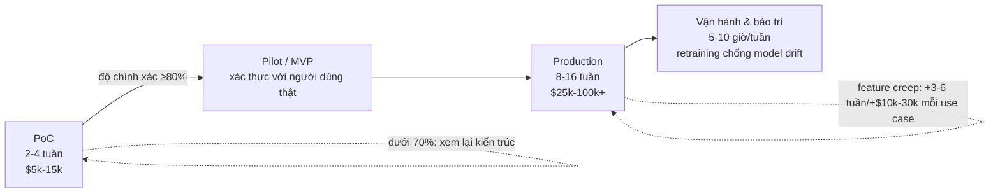

# Ước lượng nỗ lực (Effort Estimation) cho các dự án AI/ML và sự khác biệt với ước lượng phần mềm truyền thống

*Memo nghiên cứu — người viết: research subagent (deep-research harness)*
*Ngày: 2026-10-09*

## Mục lục
1. Vì sao dự án AI/ML khét tiếng khó ước lượng
2. Bằng chứng về tỷ lệ thất bại của dự án AI (McKinsey/Oxford 2018 và các nghiên cứu cập nhật)
3. Phân pha: PoC → Pilot → MVP → Production và phân bổ nỗ lực giữa data / modeling / integration / MLOps
4. Các archetype giải pháp (traditional ML, RAG, AI agents, fine-tuning, "không cần AI") và hồ sơ nỗ lực của từng loại
5. Mức độ sẵn sàng dữ liệu (data readiness) — động lực chi phí lớn nhất
6. Heuristic ước lượng thực tế từ các công ty tư vấn AI / đội offshore
7. Danh sách nguồn
8. Key claims

---

## 1. Vì sao dự án AI/ML khó ước lượng

Tài liệu hướng dẫn ước lượng chi phí cho dự án AI của ICEAA (International Cost Estimating and Analysis Association, trình bày tại hội thảo ICEAA 2025, Atlanta) — [Minkiewicz, "Cost Estimation Guidance for AI Software Development Projects", ICEAA 2025 (PDF)](https://www.iceaaonline.com/wp-content/uploads/2025/06/MLN06-Minkiewicz-Guidance-for-AI-Software-Development-paper.pdf) — liệt kê 9 lý do khiến các phương pháp ước lượng truyền thống (expert judgement, analogous, parametric, bottom-up) thất bại khi áp cho AI:

1. **Thiếu dữ liệu lịch sử so sánh** — AI phát triển quá nhanh, hầu hết dự án AI là "chưa từng có tiền lệ" (unprecedented), không có cơ sở dữ liệu lịch sử đáng tin cậy để suy luận tương tự (analogous).
2. **Tiến bộ công nghệ nhanh** — model, công cụ, best practice thay đổi liên tục, dữ liệu lịch sử cũ nhanh chóng lỗi thời.
3. **Biến thiên lớn trong yêu cầu dữ liệu** — nỗ lực cho thu thập, làm sạch, gán nhãn, augmentation dữ liệu khác nhau rất lớn giữa các dự án và gần như không thể ước lượng từ đầu.
4. **Bản chất lặp và thử nghiệm** — AI có nhiều vòng thử nghiệm, tuning, retraining; workflow tiến hóa khó đoán, đặc biệt phá vỡ ước lượng bottom-up.
5. **Chi phí tính toán** — deep learning cần GPU/TPU, chi phí dao động theo độ phức tạp model, kích thước dataset, nhu cầu tuning.
6. **Khan hiếm kỹ năng** — cần chuyên gia ML/data science/deep learning với mức lương cao và biến động lớn.
7. **Phức tạp triển khai và bảo trì** — model cần giám sát, retraining liên tục để chống model drift; chi phí duy trì dài hạn khác hẳn phần mềm truyền thống.
8. **Scope creep do bản chất thử nghiệm** — ví dụ điển hình: model không đạt yêu cầu thì phải đi thu thập thêm dữ liệu.
9. **QA/testing phức tạp** — đầu ra xác suất đòi hỏi kiểm định fairness, bias, độ tin cậy mà khung test truyền thống không bao phủ.

Bài viết của Quantumobile (công ty tư vấn AI/outsource) — [Dolgaryeva, "How to Accurately Estimate Data Science Project: A Step-by-Step Framework", Quantumobile blog](https://quantumobile.com/blog/how-to-accurately-estimate-data-science-project-a-step-by-step-framework/) — đúc kết sự khác biệt cốt lõi: phần mềm truyền thống ước lượng theo **chức năng** (feature), còn data science ước lượng theo **hiệu năng model** (accuracy/precision/recall/F1). "Bạn không thể hứa F1-score 95% ngay ngày đầu vì nó phụ thuộc vào chất lượng dữ liệu, độ nhiễu, bias ẩn và khả năng học được của bài toán — những thứ bạn không kiểm soát được lúc bắt đầu. Trong kỹ thuật phần mềm, yêu cầu có thể được 'engineer' ra bằng thiết kế; trong data science, chúng được *khám phá* bằng thực nghiệm." Hệ quả: "bạn không còn ước lượng mất bao lâu để *triển khai* một giải pháp — mà là mất bao lâu để *tìm ra* một giải pháp."

## 2. Bằng chứng về tỷ lệ thất bại

Nghiên cứu gốc của McKinsey Global Institute "Notes from the AI frontier: Insights from hundreds of use cases" (tháng 4/2018) đối chiếu hơn 400 use case AI/analytics trên 19 ngành và 47 quốc gia ([McKinsey, 2018](https://www.mckinsey.com/featured-insights/artificial-intelligence/notes-from-the-ai-frontier-applications-and-value-of-deep-learning)). Đây là nghiên cứu về *giá trị kinh tế tiềm năng* của AI chứ không trực tiếp công bố một "tỷ lệ thất bại" — điểm cần lưu ý khi trích dẫn.

Con số "85% dự án AI thất bại" thường bị gán sai nguồn. Truy vết nguồn gốc: (a) **Gartner, tháng 2/2018** — dự báo của VP Jim Hare rằng "through 2022, 85% of AI projects will deliver erroneous outcomes due to bias in data, algorithms or the teams responsible for managing them" — đây là dự báo về *kết quả sai lệch*, không phải "thất bại kinh doanh"; nhiều nguồn trung gian xác nhận cách đọc này ([ProjectManagement.com, 2025](https://www.projectmanagement.com/blog-post/79154/why-do-ai-projects-fail-), [BMC Blogs, 12/2018](https://www.bmc.com/blogs/cio-ai-artificial-intelligence/)); (b) **Nick Heudecker (phó chủ tịch phân tích Gartner), 2016** — ước tính "85% of data science projects fail", được Quantumobile dẫn lại kèm link press release Gartner 4/2018 ([Quantumobile](https://quantumobile.com/blog/how-to-accurately-estimate-data-science-project-a-step-by-step-framework/)); (c) **VentureBeat** đưa tin "87% of data science projects never make it into production" (được [iunera](https://www.iunera.com/kraken/big-data-lessons/3-unignorable-reasons-big-data-and-ai-projects-fail/) dẫn lại).

Nghiên cứu MIT Sloan Management Review / BCG "Winning With AI" (khảo sát 2.555 người, 29 ngành, 97 quốc gia, công bố 15/10/2019) kết luận **chỉ 10% công ty thu được lợi ích tài chính đáng kể từ AI**; 9/10 người được hỏi đồng ý AI là cơ hội kinh doanh ([MIT SMR, 2019](https://sloanreview.mit.edu/projects/scholars/winning-with-ai/), [BCG, 2019](https://www.bcg.com/publications/2019/how-to-win-with-artificial-intelligence-ai)). Nghiên cứu tiếp nối "Expanding AI's Impact With Organizational Learning" (10/2020) lặp lại con số 10% ([MIT SMR, 2020](https://sloanreview.mit.edu/projects/scholars/expanding-ais-impact-with-organizational-learning/)). Đáng chú ý, BCG đưa ra quy tắc kinh nghiệm phân bổ: **"AI là 10% về thuật toán, 20% về công nghệ, và 70% về chuyển đổi quy trình kinh doanh"** ([BCG, 2019](https://www.bcg.com/publications/2019/how-to-win-with-artificial-intelligence-ai)) — một heuristic phân bổ nỗ lực quan trọng cho việc ước lượng.

## 3. Phân pha PoC → Pilot → MVP → Production

**Khung 6 pha của ICEAA** ([Minkiewicz, 2025](https://www.iceaaonline.com/wp-content/uploads/2025/06/MLN06-Minkiewicz-Guidance-for-AI-Software-Development-paper.pdf)): Planning (feasibility study, đánh giá rủi ro dữ liệu/compute/scalability) → Data Preparation (đánh giá toàn diện nhu cầu dữ liệu, chi phí thu thập/làm sạch/chuẩn bị, phương thức mua hay tự thu thập, licensing, lưu trữ) → Algorithm Selection & Development (fine-tune model tiền huấn luyện vs train từ đầu) → Model Training & Tuning (hyperparameter optimization có thể kéo dài thời gian training thêm 30-50%) → Deployment (tích hợp hệ thống, cloud vs edge) → Maintenance & Monitoring (chống data drift, yêu cầu pháp lý). Khung nhấn mạnh ước lượng phải là **quá trình động, lặp** giống agile: "expect things to change... don't expect to get it right the first time", và **tránh point estimate — hãy đưa ra một khoảng (range)** thừa nhận độ bất định.

**Phân bổ nỗ lực giữa các hạng mục** (chi tiết ở mục 5-6): Quantumobile cho rằng **modeling chỉ chiếm 30-40% tổng nỗ lực**; phần còn lại nằm ở requirements, thu thập/làm sạch dữ liệu, và đưa mã nghiên cứu vào production (environment, packaging API, test, logging, tích hợp) — bước cuối này thường bị bỏ qua và là lý do phổ biến nhất khiến dự án DS không tạo ra giá trị kinh doanh ([Quantumobile](https://quantumobile.com/blog/how-to-accurately-estimate-data-science-project-a-step-by-step-framework/)).

**Kinh tế học PoC → Production (ví dụ AI agent)**: SlashDev (công ty phát triển AI agent) công bố các dải chi phí/thời gian cụ thể: **PoC mất 2-4 tuần, tốn $5.000-$15.000; bản production mất 8-16 tuần, tốn $25.000-$100.000+** — tức production đắt gấp ~5-7 lần PoC và mất gấp ~4 lần thời gian. Điểm mấu chốt: "khoảng cách giữa PoC và production không phải là 'trau chuốt thêm' mà là một bài toán kỹ thuật khác hẳn" — xử lý lỗi (error handling) chiếm 30-40% thời gian engineering production; observability stack (logging, metrics, tracing, alerting) mất 2-3 tuần; mỗi use case mở rộng thêm ngoài phạm vi đã kiểm chứng tốn thêm 3-6 tuần và $10.000-$30.000; chi phí vận hành liên tục 5-10 giờ/tuần cho monitoring và prompt tuning. Bài viết cảnh báo "feature creep là nguyên nhân số một gây thất bại dự án AI" ([SlashDev, 4/2026](https://slashdev.io/answers/ai-agent-poc-vs-production-build)). Tỷ lệ ngân sách test/monitoring nên là ~40% cho AI agent (so với 20% ở phần mềm truyền thống) vì hành vi LLM là phi tất định ([SlashDev](https://slashdev.io/answers/ai-agent-poc-vs-production-build)).

**Bằng chứng thực nghiệm về khác biệt nỗ lực bảo trì**: nghiên cứu thực nghiệm trên 4.031 dự án ML so với 4.076 dự án phi-ML trên GitHub (tạp chí Information and Software Technology, 12/2022) đo lường mức độ áp dụng ML DevOps, nỗ lực bảo trì và lợi ích, cho thấy hồ sơ nỗ lực và bảo trì của dự án ML khác biệt có hệ thống so với phần mềm thường (["An empirical study on ML DevOps adoption trends, efforts, and benefits analysis", IST 2022](https://www.sciencedirect.com/science/article/pii/S0950584922001537)).

## 4. Archetype giải pháp và hồ sơ nỗ lực của từng loại

Việc chọn đúng "hình thái giải pháp" (solution archetype) quyết định phần lớn cấu trúc ước lượng, vì mỗi loại có hồ sơ chi phí và độ bất định khác nhau:

**"Không cần AI" / heuristic trước.** Quy tắc số 1 trong "Rules of Machine Learning" của Google (Martin Zinkevich, tài liệu best-practice chính thức của Google): *"Don't be afraid to launch a product without machine learning"* — ML cần dữ liệu; nếu heuristic đơn giản (xếp hạng theo lượt cài, lọc spam theo danh sách đen...) đạt 50% mức tăng mà ML hứa hẹn thì hãy dùng heuristic cho tới khi có dữ liệu. Quy tắc 4: *"Keep the first model simple and get the infrastructure right"* — model đầu tiên không cần cầu kỳ, phần lớn công việc là hạ tầng ([Google Developers, Rules of ML](https://developers.google.com/machine-learning/guides/rules-of-ml/)). Đây là archetype rẻ và ít rủi ro nhất; trong ước lượng, nó là "exit option" để so sánh: nếu chi phí AI vượt giá trị gia tăng so với heuristic, dự án không nên triển khai.

**Traditional ML (tabular/predictive).** Chi phí tập trung vào dữ liệu (xem mục 5) và vòng lặp feature engineering; model có thể train trên CPU, dataset cỡ nghìn mẫu là đủ ([Minkiewicz, ICEAA 2025](https://www.iceaaonline.com/wp-content/uploads/2025/06/MLN06-Minkiewicz-Guidance-for-AI-Software-Development-paper.pdf)). Độ bất định vừa phải, chủ yếu ở chất lượng dữ liệu và ngưỡng hiệu năng.

**RAG (Retrieval-Augmented Generation).** Chi phí chủ yếu là *vận hành định kỳ*: hạ tầng RAG (ingestion, embeddings, search, retrieval, model calls) khoảng **$350-$2.850/tháng**, phát triển ban đầu 2-4 tuần, bảo trì 5-10 giờ engineering/tháng; rủi ro lớn nhất không phải kỹ thuật retrieval mà là quyết định "nguồn nào đáng tin, tài liệu cập nhật ra sao, xử lý thế nào khi không tìm thấy câu trả lời" ([PE Collective, 2/2026](https://pecollective.com/blog/rag-vs-fine-tuning-cost/)). Phù hợp khi tri thức thay đổi liên tục; độ bất định thấp-trung bình.

**Fine-tuning.** Chi phí *trả trước* lớn: **$2.400-$18.000 cho lần chạy đầu tiên**, thời gian phát triển tối thiểu 4-8 tuần vì phải xây bộ dữ liệu huấn luyện + bộ đánh giá; khi tri thức thay đổi, không có đường cập nhật sạch — phải quay lại data pipeline ([PE Collective, 2/2026](https://pecollective.com/blog/rag-vs-fine-tuning-cost/)). ICEAA nhấn mạnh dải chiến lược huấn luyện từ train-from-scratch → full training → fine-tuning là "đánh đổi quyền kiểm soát lấy hiệu quả và chi phí"; chọn sai thuật toán có thể làm chi phí training tăng 2-5 lần ([Kus et al., 2024, dẫn theo Minkiewicz](https://www.iceaaonline.com/wp-content/uploads/2025/06/MLN06-Minkiewicz-Guidance-for-AI-Software-Development-paper.pdf)).

**AI agents.** Archetype đắt và khó đoán nhất trong nhóm ứng dụng LLM: PoC $5k-15k/2-4 tuần, production $25k-100k+/8-16 tuần (xem mục 3); đòi hỏi error handling (30-40% thời gian production), observability, security/compliance, và vận hành liên tục ([SlashDev, 4/2026](https://slashdev.io/answers/ai-agent-poc-vs-production-build)). Độ bất định cao vì hành vi LLM phi tất định và phụ thuộc chuỗi nhiều bước.

Nguyên tắc chung xuyên suốt: **chọn kiến trúc theo nơi "thay đổi" xảy ra** — tri thức thay đổi thì RAG, hành vi ổn định lặp lại thì fine-tuning; "kiến trúc đắt nhất là kiến trúc buộc đội ngũ chống lại cách thông tin thay đổi" ([PE Collective](https://pecollective.com/blog/rag-vs-fine-tuning-cost/)).

## 5. Data readiness — động lực chi phí lớn nhất

Khảo sát CrowdFlower năm 2016 (được Forbes đưa tin, Gil Press, 23/3/2016): các nhà khoa học dữ liệu dành **60% thời gian cho cleaning/organizing data** và **19% cho thu thập dữ liệu** — cộng lại ~80% thời gian cho khâu chuẩn bị dữ liệu, chỉ ~20% cho phân tích thực sự ([Forbes, 2016](https://www.forbes.com/sites/gilpress/2016/03/23/data-preparation-most-time-consuming-least-enjoyable-data-science-task-survey-says/)). Con số "80%" phổ biến thực chất là 60% cleaning + 19% collecting, không phải một con số riêng lẻ — phân tích chi tiết tại ([blog LDodds, 2020](https://blog.ldodds.com/2020/01/31/do-data-scientists-spend-80-of-their-time-cleaning-data-turns-out-no/)). Khảo sát Anaconda 2020 (State of Data Science) cho con số thấp hơn, ~45% thời gian cho chuẩn bị dữ liệu ([Prophecy blog, 2020](https://www.prophecy.ai/blog/data-analytics-automation)).

ICEAA tổng hợp các con số định lượng: **preprocessing có thể chiếm tới 60% tổng thời gian quy trình ML** (theo Avinash et al., 2022); chi phí gán nhãn dữ liệu thủ công dao động **$0,02-$15 mỗi điểm dữ liệu** tùy độ phức tạp (y ảnh y khoa đắt hơn nhiều so với nhãn mạng xã hội); **dữ liệu kém chất lượng có thể làm tăng chi phí dự án 50-100%**, trong khi model huấn luyện trên dữ liệu sạch, gán nhãn tốt đạt độ chính xác cao hơn tới 30%, giảm rework và số vòng lặp training ([Minkiewicz, ICEAA 2025](https://www.iceaaonline.com/wp-content/uploads/2025/06/MLN06-Minkiewicz-Guidance-for-AI-Software-Development-paper.pdf)).

Hệ quả ước lượng: giai đoạn "đánh giá mức độ sẵn sàng dữ liệu" (data readiness assessment) phải là hạng mục bắt buộc đầu tiên — ICEAA đặt Data Preparation thành pha 2 trong khung 6 pha với yêu cầu định giá đầy đủ: thu thập từ nguồn mở vs mua, licensing định kỳ, chi phí lưu trữ (cloud vs on-prem), làm sạch (mất cân bằng lớp, giá trị thiếu, chuẩn hóa định dạng, khử nhiễu, dedup), và gán nhãn ([Minkiewicz, ICEAA 2025](https://www.iceaaonline.com/wp-content/uploads/2025/06/MLN06-Minkiewicz-Guidance-for-AI-Software-Development-paper.pdf)). Quantumobile cảnh báo cùng điểm: "open-source datasets có thể trông hứa hẹn nhưng hóa ra nhiễu, thiếu, lệch với bài toán thực" — pha thu thập dữ liệu "có thể nuốt chửng nhiều tuần" ([Quantumobile](https://quantumobile.com/blog/how-to-accurately-estimate-data-science-project-a-step-by-step-framework/)).

## 6. Heuristic ước lượng thực tế từ tư vấn AI / offshore

Tổng hợp các heuristic định lượng đang được dùng trong thực tế tư vấn:

- **Phân bổ nỗ lực**: modeling chỉ 30-40% tổng nỗ lực; phần còn lại là requirements + data + productionization ([Quantumobile](https://quantumobile.com/blog/how-to-accurately-estimate-data-science-project-a-step-by-step-framework/)). Quy tắc BCG: AI = 10% thuật toán + 20% công nghệ + 70% chuyển đổi quy trình kinh doanh ([BCG, 2019](https://www.bcg.com/publications/2019/how-to-win-with-artificial-intelligence-ai)).
- **Ước lượng theo vòng lặp (iteration) thay vì waterfall**: mỗi vòng lặp CRISP-DM có mục tiêu rõ (baseline model → cải thiện hiệu năng → kiểm chứng generalization) và được định giá độc lập; khách hàng quyết định dừng hay tài trợ vòng tiếp theo dựa trên kết quả đo được. Ví dụ làm việc của Quantumobile (ước lượng sinh khối từ ảnh vệ tinh): nghiên cứu dataset ~20 giờ-người, baseline model ~50 giờ-người, vòng refine ~50 giờ-người, chuẩn bị deployment ~20 giờ-người — tổng ~150 giờ-người ([Quantumobile](https://quantumobile.com/blog/how-to-accurately-estimate-data-science-project-a-step-by-step-framework/)).
- **Dải chi phí theo cấp độ**: PoC cơ bản từ $15.000 đến enterprise AI platform $500.000+ ([Azilen, 2/2026](https://www.azilen.com/blog/ai-development-cost/)); $50.000-$500.000+ tùy độ phức tạp ([Coherent Solutions, 4/2026](https://www.coherentsolutions.com/insights/ai-development-cost-estimation-pricing-structure-roi)); PoC agent $5k-15k (2-4 tuần) vs production $25k-100k+ (8-16 tuần) ([SlashDev](https://slashdev.io/answers/ai-agent-poc-vs-production-build)).
- **Guardrail về độ bất định**: ICEAA khuyến nghị *không bao giờ đưa ra point estimate* — hãy đưa khoảng (range) và quỹ dự phòng (contingency) cho rủi ro dữ liệu/bias/pháp lý; ước lượng phải là quá trình động cập nhật theo phát hiện mới, giống agile: "đừng kỳ vọng đúng ngay lần đầu" ([Minkiewicz, ICEAA 2025](https://www.iceaaonline.com/wp-content/uploads/2025/06/MLN06-Minkiewicz-Guidance-for-AI-Software-Development-paper.pdf)).
- **Multiplier theo mức độ phức tạp**: hyperparameter tuning kéo dài thời gian training thêm 30-50%; real-time inference đắt gấp tới 10 lần batch processing; chọn sai thuật toán tăng chi phí training 2-5 lần; dữ liệu kém chất lượng tăng chi phí dự án 50-100% ([Minkiewicz, ICEAA 2025](https://www.iceaaonline.com/wp-content/uploads/2025/06/MLN06-Minkiewicz-Guidance-for-AI-Software-Development-paper.pdf)).
- **Ngưỡng quyết định PoC→production**: độ chính xác ≥80% trên use case cốt lõi mới nên vào production; dưới 70% phải xem lại kiến trúc; 70-80% cần lặp thêm ([SlashDev](https://slashdev.io/answers/ai-agent-poc-vs-production-build)).
- **Chi phí vận hành dài hạn**: AI model không phải "xong là xong" — Sculley et al. (NeurIPS 2015) chỉ ra "only a tiny fraction of the code in many ML systems is actually devoted to learning or prediction", phần còn lại là "plumbing" (glue code, pipeline, monitoring) mang nợ kỹ thuật âm thầm ([Sculley et al., 2015](https://proceedings.neurips.cc/paper/2015/file/86df7dcfd896fcaf2674f757a2463eba-Paper.pdf)); ICEAA nhấn mạnh chi phí duy trì (retraining chống model drift) thường vượt chi phí phát triển ban đầu ([Minkiewicz, ICEAA 2025](https://www.iceaaonline.com/wp-content/uploads/2025/06/MLN06-Minkiewicz-Guidance-for-AI-Software-Development-paper.pdf)).

Nghiên cứu tình huống tại Microsoft (ICSE-SEIP 2019, đoạt giải Best Paper) — [Amershi et al., "Software Engineering for Machine Learning: A Case Study"](https://www.microsoft.com/en-us/research/publication/software-engineering-for-machine-learning-a-case-study/) — xác định 3 điểm khiến AI khác hẳn các domain phần mềm trước đây: (1) việc khám phá, quản lý và versioning dữ liệu cho ML phức tạp và khó hơn nhiều so với các dạng SE khác; (2) tùy chỉnh và tái sử dụng model đòi hỏi kỹ năng rất khác so với đội phần mềm thông thường; (3) thành phần AI khó xử lý như module độc lập — model có thể "entangled" theo những cách phức tạp và có hành vi lỗi phi đơn điệu (non-monotonic error behavior). Cả ba đều trực tiếp phá vỡ giả định của ước lượng truyền thống (module hóa, phân rã công việc, dữ liệu lịch sử).

Dòng thời gian điển hình của một dự án AI theo các nguồn đã thu thập:

*Nguồn: [SlashDev, 4/2026](https://slashdev.io/answers/ai-agent-poc-vs-production-build); [Minkiewicz, ICEAA 2025](https://www.iceaaonline.com/wp-content/uploads/2025/06/MLN06-Minkiewicz-Guidance-for-AI-Software-Development-paper.pdf)*

## 7. Danh sách nguồn

1. Minkiewicz, A., "Cost Estimation Guidance for AI Software Development Projects", ICEAA 2025 PD&T Workshop, Atlanta (5/2025) — https://www.iceaaonline.com/wp-content/uploads/2025/06/MLN06-Minkiewicz-Guidance-for-AI-Software-Development-paper.pdf
2. McKinsey Global Institute, "Notes from the AI frontier: Applications and value of deep learning" (17/4/2018) — https://www.mckinsey.com/featured-insights/artificial-intelligence/notes-from-the-ai-frontier-applications-and-value-of-deep-learning
3. MIT SMR/BCG, "Winning With AI" (15/10/2019) — https://sloanreview.mit.edu/projects/scholars/winning-with-ai/ ; BCG version — https://www.bcg.com/publications/2019/how-to-win-with-artificial-intelligence-ai ; follow-up "Expanding AI's Impact With Organizational Learning" (10/2020) — https://sloanreview.mit.edu/projects/scholars/expanding-ais-impact-with-organizational-learning/
4. Amershi et al., "Software Engineering for Machine Learning: A Case Study", ICSE-SEIP 2019 — https://www.microsoft.com/en-us/research/publication/software-engineering-for-machine-learning-a-case-study/
5. Sculley et al., "Hidden Technical Debt in Machine Learning Systems", NeurIPS 2015 — https://proceedings.neurips.cc/paper/2015/file/86df7dcfd896fcaf2674f757a2463eba-Paper.pdf
6. "An empirical study on ML DevOps adoption trends, efforts, and benefits analysis", Information and Software Technology (12/2022) — https://www.sciencedirect.com/science/article/pii/S0950584922001537
7. Dolgaryeva, A., "How to Accurately Estimate Data Science Project: A Step-by-Step Framework", Quantumobile — https://quantumobile.com/blog/how-to-accurately-estimate-data-science-project-a-step-by-step-framework/
8. SlashDev, "AI Agent POC vs Production Build: Scope, Cost, and Timeline" (4/2026) — https://slashdev.io/answers/ai-agent-poc-vs-production-build
9. PE Collective, "RAG vs Fine Tuning Cost Comparison" (15/2/2026) — https://pecollective.com/blog/rag-vs-fine-tuning-cost/
10. Zinkevich, M., "Rules of Machine Learning: Best Practices for ML Engineering", Google Developers — https://developers.google.com/machine-learning/guides/rules-of-ml/
11. Press, G., "Cleaning Big Data: Most Time-Consuming, Least Enjoyable Data Science Task, Survey Says", Forbes (23/3/2016) — https://www.forbes.com/sites/gilpress/2016/03/23/data-preparation-most-time-consuming-least-enjoyable-data-science-task-survey-says/
12. LDodds blog, "Do data scientists spend 80% of their time cleaning data? Turns out, no" (31/1/2020) — https://blog.ldodds.com/2020/01/31/do-data-scientists-spend-80-of-their-time-cleaning-data-turns-out-no/
13. Algorithmia, "State of Enterprise Machine Learning 2020" (qua GlobeNewswire, 12/12/2019) — https://www.globenewswire.com/news-release/2019/12/12/1959883/0/en/Algorithmia-Machine-Learning-2020-Report-Challenges-and-Trends-for-the-Enterprise.html
14. Azilen, "AI Development Cost in 2026" (2/2026) — https://www.azilen.com/blog/ai-development-cost/ ; Coherent Solutions, "AI Development Cost Estimation" (4/2026) — https://www.coherentsolutions.com/insights/ai-development-cost-estimation-pricing-structure-roi
15. ProjectManagement.com, "Why do AI Projects Fail?" (11/2025) — https://www.projectmanagement.com/blog-post/79154/why-do-ai-projects-fail- ; BMC Blogs, "Why does Gartner predict up to 85% of AI projects will 'not deliver'?" (12/2018) — https://www.bmc.com/blogs/cio-ai-artificial-intelligence/

## 8. Key claims

1. **Không có "nghiên cứu McKinsey/Oxford 2018 về tỷ lệ thất bại dự án AI" như thường được trích dẫn** — "Notes from the AI frontier" (4/2018) là nghiên cứu về giá trị kinh tế của 400+ use case, không công bố tỷ lệ thất bại. Các con số thất bại thực tế đến từ: Gartner 2/2018 (85% dự án AI cho "erroneous outcomes" tới 2022 — dự báo về kết quả sai lệch, không phải thất bại kinh doanh), Heudecker/Gartner 2016 (85% dự án data science thất bại), và MIT SMR/BCG 2019-2020 (chỉ 10% công ty thu được lợi ích tài chính đáng kể từ AI).
2. **Sự khác biệt cốt lõi về ước lượng**: phần mềm truyền thống ước lượng theo chức năng (có thể "engineer" ra yêu cầu), còn AI ước lượng theo hiệu năng model (accuracy/F1) — thứ phải *khám phá* bằng thực nghiệm chứ không hứa trước được; hệ quả là ước lượng "mất bao lâu để tìm ra giải pháp" thay vì "mất bao lâu để triển khai".
   (Sources: Quantumobile; ICEAA)
3. **Modeling chỉ chiếm 30-40% tổng nỗ lực dự án AI**; phần còn lại nằm ở requirements, dữ liệu, và productionization (integration, test, monitoring) — bước cuối thường bị bỏ qua và là lý do phổ biến nhất khiến dự án không tạo ra giá trị.
   (Source: Quantumobile)
4. **Chuẩn bị dữ liệu là động lực chi phí lớn nhất**: 60% thời gian cho cleaning + 19% thu thập (CrowdFlower 2016, ~80% gộp lại); preprocessing có thể chiếm tới 60% thời gian quy trình ML; dữ liệu kém chất lượng tăng chi phí dự án 50-100%; gán nhãn $0,02-$15/điểm dữ liệu.
   (Sources: Forbes 2016; ICEAA)
5. **PoC rẻ hơn production ~5-7 lần về tiền và ~4 lần về thời gian** (agent: $5k-15k/2-4 tuần vs $25k-100k+/8-16 tuần); khoảng cách này là do error handling (30-40% thời gian production), observability, security, compliance — không phải "trau chuốt thêm".
   (Source: SlashDev)
6. **RAG và fine-tuning có hồ sơ chi phí đối lập**: RAG trả phí vận hành định kỳ ($350-$2.850/tháng, phát triển 2-4 tuần) phù hợp tri thức thay đổi; fine-tuning trả phí trước ($2.400-$18.000, 4-8 tuần tối thiểu) phù hợp hành vi ổn định — chọn sai kiến trúc là nguồn lãng phí lớn.
   (Source: PE Collective)
7. **Mọi phương pháp ước lượng truyền thống đều suy yếu với AI** vì 9 lý do: thiếu dữ liệu lịch sử, công nghệ thay đổi nhanh, biến thiên yêu cầu dữ liệu, bản chất lặp/thử nghiệm, chi phí compute, khan hiếm kỹ năng, bảo trì liên tục chống drift, scope creep, QA xác suất.
   (Source: ICEAA)
8. **Guardrail thực hành**: không bao giờ đưa point estimate — đưa khoảng + quỹ dự phòng; ước lượng động theo vòng lặp (CRISP-DM) với mỗi vòng định giá độc lập; ngưỡng PoC→production là độ chính xác ≥80% (dưới 70% xem lại kiến trúc); feature creep là nguyên nhân số một gây thất bại.
   (Sources: ICEAA; Quantumobile; SlashDev)
9. **Archetype "không cần AI" là lựa chọn hợp lệ đầu tiên**: Rule #1 của Google là "đừng ngại ra mắt sản phẩm không có machine learning" — heuristic đạt 50% lợi ích của ML là đủ dùng cho tới khi có dữ liệu; điều này phải là một nhánh trong mọi ước lượng.
   (Source: Google Rules of ML)
10. **Chi phí sau production thường vượt chi phí phát triển**: chỉ một phần nhỏ code trong hệ thống ML là code học/dự đoán (phần còn lại là "plumbing"), model cần retraining liên tục chống drift, real-time inference đắt gấp 10 lần batch — ước lượng phải tính TCO dài hạn chứ không chỉ chi phí xây dựng.
    (Sources: Sculley et al. 2015; ICEAA)