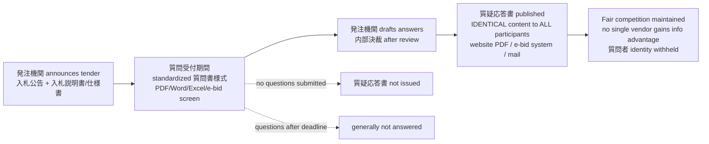

# Verify: Japanese IT Procurement Mechanics (質問QAシート共有 / 稟議 / 見積書)

Memo by: verifier subagent — adversarial refutation task
Date: 2026-10-09
Claim under test (3 sub-points):
- (a) Clarification questions collected via standardized Excel QA sheet; answers shared equally with all vendors to avoid information asymmetry (情報格差).
- (b) Purchase decision goes through 稟議 (ringi) internal approval, weeks-to-months.
- (c) 見積書 must show validity period (見積有効期限), tax-excluded/included amounts, itemized breakdown (内訳).

## Status (final)

- (a) 質疑応答共有: **CONFIRMED** (public procurement incl. IT/goods) — standardized 質問書様式 + 質疑応答書 published identically to ALL participants; fairness rationale explicitly stated. Caveats: "Excel" is one of several formats (PDF/Word/e-bid system forms common); private-sector RFPs share the practice but lack statutory compulsion; no Q&A doc issued when zero questions.
- (b) 稟議: **mechanism CONFIRMED, "weeks-to-months" REFUTED as the norm** — surveys show 2–3 days typical (52.5%), 1日以内 26.5%; ringi can be skipped for small/urgent cases; 電子決裁 fast-tracks. Weeks-to-months only plausible for exceptional large capex with board-level 決裁.
- (c) 見積書: **CONFIRMED as conventions; "must show validity period" REFUTED as a legal mandate** — 見積有効期限 is customary (near-universal in official forms, buyers request it) but not legally required and some suppliers omit it; 税込/税抜 display grounded in invoice system (2023-10-) for qualifying invoices + universal B2B convention; 内訳 required in municipal forms and expected in practice.

## Overall verdict on the claim

The claim is **substantially TRUE in mechanism but overstated in two specifics**: (a) holds strongly (with "Excel" being a format detail); (b) holds that ringi is the approval mechanism, but the "weeks-to-months" duration is contradicted by 2022–2025 survey data (median 2–3 days); (c) holds as business convention and public-procurement requirement, but 見積有効期限 is NOT a legal obligation — the word "must" overstates it.

## PART (a) — 質疑応答・質問回答書 shared with all vendors: CONFIRMED

Primary/secondary evidence:

1. **入札情報ユニオン (bid-scope.jp), "質問回答書とは" (2026-08-05, updated 2026-10-05)** — commercial bid-info service, practical guide. States: 「質問回答書とは、入札参加者からの質問に発注機関が書面で答え、参加予定者の全員に公開する書類です。」(Q&A doc = answers given in writing and published to ALL prospective participants). Key passage on fairness: 「質問回答書が持つ最も重要な特性は、すべての入札参加予定者に同じ内容が共有される点です…特定の企業だけが追加情報を得て有利になることがないよう、競争の公平性を担保するための仕組みです。」FAQ: 「1者しか質問していないのに全員に回答が公開されるのはなぜですか？入札の公平性を確保するためです。」Cites primary docs: Kuki City 入札説明書に係る質問書への回答 (https://www.city.kuki.lg.jp/_res/projects/default_project/_page_/001/004/160/1004160_001.pdf), Tottori Prefecture 入札閲覧設計書に関する質問回答等取扱要領 (http://www.pref.tottori.lg.jp/secure/90328/sitsumonkaitou.pdf), Kyoto University PFI 質問回答書 (その1) (https://www8.cao.go.jp/pfi/pfi_jouhou/jigyou/shousai/pdf/kyoto/069_26016_150328_3_a1.pdf). URL: https://bid-scope.jp/union/qa-document/

2. **LEGALIST 調達に関する質問回答書 template (2026, lawyer-reviewed draft)** — contract template for 発注機関 with explicit clause: 第2条(公平性の確保)「発注機関は、特定の入札参加者のみに有利又は不利となる回答を行ってはならず、質問者を特定できる情報を除いた上で全ての入札参加者に同一内容を公表する。」Legal basis cited: 地方自治法施行令第167条の2〜13, 入札契約適正化法(入契法)第3条 指針, 独占禁止法. URL: https://legalist.jp/templates/chotatsu-shitsumon-kaitosho/

3. **Sendai City (宮城県) 発注情報：物品 (2024-06-05公告, 質疑応答書掲載 2024-07-03)** — PRIMARY: procurement page states 「質問書の提出があった場合の質疑応答書や、入札説明書、仕様書等に訂正があった場合の訂正表等もこちらに掲載します」 and posts actual 質疑応答書 PDFs for every lot, incl. 「仙台市情報システムセンター電力需給」(IT infrastructure procurement). URL: https://www.city.sendai.jp/buppin/jigyosha/keyaku/kekka/r6buppin/r060605.html

4. **Sano City (栃木県) 条件付一般競争入札の質疑応答書** — actual Q&A documents published as public PDFs for specific tenders (議長車購入 2026-09-08公告; 電気の調達 2026-08-04公告). URL: https://www.city.sano.lg.jp/soshikiichiran/gijutucenter/keiyakukensaka/gyomuannai/koukoku/shitsugi.html

5. **Anjo City (愛知県) 質疑回答公表** — 「入札案件の公告、設計書の内容に関する質疑の回答を公表しています。この質疑の回答は、『設計図書』及び『仕様書』の追補となります」+ 質疑書様式 downloadable (standardized form). URL: https://www.city.anjo.aichi.jp/zigyo/nyusatsu/keiyaku/yoteikekka/shitugi.html (updated 2026-03-10)

6. **Okuizumo Town (島根県) 電子メールによる入札通知書等の送付について (2026-05-08)** — 質疑応答書 mechanism: questions previously FAX, now email; 「こちらについては、一般競争入札及び指名競争入札同様の取り扱い」— i.e., same Q&A treatment across both tender types. URL: https://www.town.okuizumo.shimane.jp/jigyosha/nyusatsu-keiyaku/1768523832857.html

7. **Standardized question forms (様式)**: Kagoshima City 質問書様式 (PDF+Word) https://www.city.kagoshima.lg.jp/kensetu/kensetukanri/kouenryokuka/kennkounomori_nyuusatu.html ; Asahikawa City 質疑応答書様式 with note 「※ 質問者に係る情報は回答時には公表しません」(questioner identity withheld when answers are published — evidence of anonymous, all-participant publication) https://www.city.asahikawa.hokkaido.jp/500/565/566/5681/d077267_d/fil/shitugioutou.docx ; Hitachinaka City 質疑応答書 (doc) https://www.city.hitachinaka.lg.jp/_res/projects/default_project/_page_/001/006/248/y5.doc ; Ibara City 質疑応答書 (docx) https://www.city.ibara.okayama.jp/uploaded/attachment/1750.docx

8. **Tottori Prefecture 通知「入札契約手続における質問回答等の適正な取扱いの徹底について」** — requires proper handling of Q&A for transparency/fairness (透明性、公平性の確保). URL: https://www.tctcplaza.or.jp/front/recycles/download/448

Assessment: The core mechanism (standardized question form + answers published identically to all participants to prevent information asymmetry) is CONFIRMED for Japanese public procurement (国/自治体), including goods/IT-type procurements (Sendai 情報システムセンター, Sano 電気調達, Kagoshima 企画提案競技). Note on "Excel": forms are commonly PDF/Word/docx or electronic-bidding-system screens; Excel is used by some bodies but is not the universal format — the claim's "Excel" is a detail, not the essence. Private-sector RFPs also use 質問書/回答書 shared with all bidders, but no statutory compulsion found (see counter-evidence).

The mechanism, as evidenced by the sources above (bid-scope process description; Legalist clauses; Sendai/Anjo publication practice):

## PART (b) — 稟議 (ringi) approval: mechanism CONFIRMED, "weeks-to-months" duration REFUTED as the norm

Ringi exists and is the standard internal approval mechanism in Japanese companies (confirmed), but survey data shows approval typically takes DAYS, not weeks-to-months:

1. **@DIME (小学館) / 弁護士ドットコム CloudSign survey (published 2025-02-04)** — n=312 business users, Sep–Oct 2024. Time from ringi application to approval: 「2〜3日」52.5%, 「1日以内」19.3%, 「4〜5日」14.4%. "1日以内に終わる" 26.5%, "1日以上かかる" 73.5%. Ringi method: workflow system 67.6%, email/chat 12.5%, paper+hanko 7.4%, no ringi system 4.5%. URL: https://dime.jp/genre/1920483/

2. **MarkeZine / SalesZine (2022-03-29)** — エイトレッド survey of 100+ employee companies: 稟議申請から承認までの平均日数 「1日未満」4.6%, 「1日以上3日未満」37.6%, 「3日以上」over half. URL: https://markezine.jp/news/detail/56567 (403 on fetch, headline data from SERP snippet) / https://saleszine.jp/news/detail/3356

3. **note.com (2026-09-18)** — "稟議の承認に時間がかかる原因・平均日数と改善策" — 1日以上 7割超. URL: https://note.com/yu_fujiwara731/n/n7285622618dd

Assessment: The claim's "weeks-to-months" is NOT supported as the typical duration — the median is 2–3 days. "Can take weeks-to-months" is only defensible for exceptional cases (very large capex, board-level 決裁, 差し戻し/rebuffs, multiple approvers). The mechanism (稟議 required for purchases, incl. 物品購入稟議) is confirmed; the duration claim is REFUTED as a general statement. Counter-evidence on fast-track (事前稟議/電子決裁) still to check.

## PART (c) — 見積書 conventions: mostly CONFIRMED as conventions; "must show validity period" REFUTED as legal mandate

1. **見積有効期限 (validity period)**: customary, NOT legally mandatory. Lawyer answer on 専門家プロファイル (2014-06-12/15): forcing suppliers to state validity "強制は基本できません"; ordering from a quotation without validity is "基本的に問題ありません"; conventional validity: goods 10 days–1 month, services 1–3 months. Notably, some suppliers deliberately OMIT validity (so they aren't bound to the price). URL: https://profile.ne.jp/ask/q-144114
   Official/municipal quotation forms nearly always include a validity field: Kochi City 見積書様式 shows 「有効期限 御見積後○か月」 https://www.city.kochi.kochi.jp/uploaded/attachment/159952.pdf ; CEV-PC EV subsidy form requires ⑤《有効期限》「申請時に有効期限内であることの記載」 https://www.cev-pc.or.jp/hojo/juden_pdf/R6/R6_juden_tenpu_koufu_mitsumori.pdf

2. **税抜/税込 display**: Since the インボイス制度 (適格請求書等保存方式, effective 2023-10-01), qualifying invoices must show 「税率ごとに区分した課税資産の譲渡等の合計金額（税抜または税込）」 plus consumption tax per rate — 7 required items (registered number, date, description, amount per rate, tax per rate, buyer name, etc.). Tax accountant blog 2025-05-15: https://iinotax.com/blog/7663 . While 見積書 per se isn't statutorily an invoice, B2B practice overwhelmingly displays both 税抜 and 税込 amounts; municipal forms (Shizuoka 参考様式 見積書.xls shows 税込み rows) follow suit. https://www.pref.shizuoka.jp/_res/projects/default_project/_page_/001/053/436/sanko_mitsumori.xls

3. **内訳 (itemized breakdown)**: expected in business practice; REQUIRED in municipal procurement forms — Chiba City 見積書様式: 「『積算内訳』については積算根拠を明確に記載すること」 https://www.city.chiba.jp/kyoiku/gakkokyoiku/kyoikushien/documents/6mitumorisyo.docx ; Nagano Prefecture 価格提案書: 単価×数量 itemization https://www.pref.nagano.lg.jp/michikanri/infra/doro/seibi/documents/kakakuteian-fuku.docx ; Tottori Water 見積書記載内容 (消費税及び地方消費税 fields) https://water.tottori.tottori.jp/secure/2073/mitumorisyo_kisainaiyou.pdf

## Counter-evidence and nuances (adversarial pass)

**(a) — Where the Q&A-sharing rule does NOT apply:**
- 随意契約 (negotiated contracts without competition) have no Q&A-sharing obligation — there is no competitive field to protect. The Legalist template explicitly warns the form must NOT be used to give one participant favorable info (独禁法 exposure), implying the rule binds only competitive procedures.
- bid-scope FAQ: 「質問がゼロ件の場合は発行されないこともあります。また、案件の性質によっては質問受付期間が設けられないケースもあります。」— no Q&A document if no questions were submitted; some tenders set no question period at all. URL: https://bid-scope.jp/union/qa-document/
- Questions received after the deadline are generally NOT answered (Legalist template 第4条; bid-scope FAQ: 「質問受付期間が終了した後は、原則として個別の質問への回答は得られません」).
- Private-sector RFPs: sharing Q&A with all bidders is standard practice and often contractual, but there is no statute equivalent to 地方自治法施行令/入札契約適正化法 compelling it; enforcement depends on the buyer's RFP terms. (No primary source found stating private firms may withhold Q&A — marked NOT FOUND.)
- The "Excel" element: municipal forms are delivered as PDF/Word/docx (Kagoshima 質問書様式 PDF+Word; Hitachinaka/Ibara/Asahikawa 質疑応答書 .doc/.docx) or via electronic bidding systems — Excel is used by some organizations but is not the exclusive format.

**(b) — Ringi is faster than the claim suggests, and sometimes skipped:**
- 弁護士ドットコム survey (2024, n=312): 2–3 days 52.5%, within 1 day 19.3%, 4–5 days 14.4%; workflow systems 67.6%, paper+hanko only 7.4%. URL: https://dime.jp/genre/1920483/
- エイトレッド survey (2022): 稟議申請→承認 「1日未満」4.6%, 「1日以上3日未満」37.6%, 「3日以上」majority. URL: https://markezine.jp/news/detail/56567 (page 403 on fetch; headline stats from SERP snippet — treat as secondary).
- jpbussiness.com (2025-11-22): 「小規模な案件や緊急性の高い案件では、稟議を省略して直接決裁者に決裁書を提出するケースもあります」; 決裁権限表 tiers (e.g. <¥1M 部長決裁, ¥1M–10M 役員決裁, >¥10M 社長決裁); 電子決裁/権限委譲 shorten approval. URL: https://jpbussiness.com/決裁が下りるとは意味や使い方・稟議との違いを/
- Nuance supporting the claim: moneyforward notes ringi is 「特に高額な備品や、社内全体で使用する物品を購入する場合に提出が求められます」 — high-value IT purchases DO go through ringi with multi-level approval (課長→部長→役員→社長), and 差し戻し (rejection for revision) can add days. For very large IT systems the whole procurement cycle (RFP→evaluation→ringi→contract) spans months, but the ringi step itself is typically days. URL: https://biz.moneyforward.com/work-efficiency/basic/12057/

**(c) — Validity period is not mandatory:**
- Lawyer answer (2014): 「強制は基本できません」; ordering from a validity-less quotation is 「基本的に問題ありません」; conventional validity goods 10日–1か月, services 1–3か月; some suppliers deliberately omit validity to avoid price lock-in. URL: https://profile.ne.jp/ask/q-144114
- So a supplier is NOT legally obliged to print 見積有効期限; buyers commonly request it and official forms include the field (Kochi City: 「有効期限 御見積後○か月」).

## Source list (URL + date)

1. 入札情報ユニオン (bid-scope.jp), 質問回答書とは — 2026-08-05 (updated 2026-10-05). https://bid-scope.jp/union/qa-document/
2. LEGALIST, 調達に関する質問回答書 template — accessed 2026-10-09. https://legalist.jp/templates/chotatsu-shitsumon-kaitosho/
3. 佐野市, 条件付一般競争入札の質疑応答書 — accessed 2026-10-09. https://www.city.sano.lg.jp/soshikiichiran/gijutucenter/keiyakukensaka/gyomuannai/koukoku/shitsugi.html
4. 安城市, 質疑回答公表 — updated 2026-03-10. https://www.city.anjo.aichi.jp/zigyo/nyusatsu/keiyaku/yoteikekka/shitugi.html
5. 奥出雲町, 電子メールによる入札通知書等の送付について — 2026-05-08. https://www.town.okuizumo.shimane.jp/jigyosha/nyusatsu-keiyaku/1768523832857.html
6. 鳥取県, 入札契約手続における質問回答等の適正な取扱いの徹底について(通知). https://www.tctcplaza.or.jp/front/recycles/download/448
7. 仙台市, 発注情報：物品（令和6年6月5日）— updated 2024-07-03 (質疑応答書 PDFs incl. 情報システムセンター電力需給). https://www.city.sendai.jp/buppin/jigyosha/keyaku/kekka/r6buppin/r060605.html
8. 鹿児島市, 企画提案競技（質疑応答更新）. https://www.city.kagoshima.lg.jp/kan-senryaku/ambassador07.html
9. 旭川市, 質疑応答書様式（質問者情報は回答時には公表しません）. https://www.city.asahikawa.hokkaido.jp/500/565/566/5681/d077267_d/fil/shitugioutou.docx
10. @DIME/弁護士ドットコム, 社内稟議の実態調査 — 2025-02-04. https://dime.jp/genre/1920483/
11. MarkeZine, 稟議申請から承認までの平均日数 — 2022-03-29. https://markezine.jp/news/detail/56567
12. jpbussiness.com, 決裁が下りるとは — 2025-11-22. https://jpbussiness.com/決裁が下りるとは意味や使い方・稟議との違いを/
13. Money Forward, 稟議書とは — accessed 2026-10-09. https://biz.moneyforward.com/work-efficiency/basic/12057/
14. 専門家プロファイル, 取引先からもらう見積書の有効期限記載要否 — 2014-06-12/15. https://profile.ne.jp/ask/q-144114
15. 飯野明宏税理士事務所, 適格請求書に必要な7つの記載事項 — 2025-05-15. https://iinotax.com/blog/7663
16. 高知市, 見積書様式（有効期限・支払条件）. https://www.city.kochi.kochi.jp/uploaded/attachment/159952.pdf
17. 千葉市, 見積書様式（積算内訳の明記）. https://www.city.chiba.jp/kyoiku/gakkokyoiku/kyoikushien/documents/6mitumorisyo.docx
18. 静岡県, 参考様式 見積書（税込み・内訳）. https://www.pref.shizuoka.jp/_res/projects/default_project/_page_/001/053/436/sanko_mitsumori.xls
19. CEV-PC, 充電設備補助金 見積書（有効期限の記載要件）. https://www.cev-pc.or.jp/hojo/juden_pdf/R6/R6_juden_tenpu_koufu_mitsumori.pdf
20. 鳥取市水道局, 見積書の記載内容. https://water.tottori.tottori.jp/secure/2073/mitumorisyo_kisainaiyou.pdf